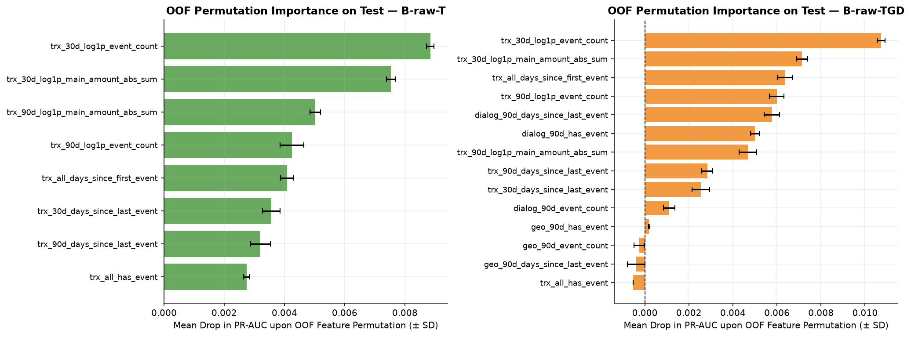

# MBD-mini: Báo cáo Hệ thống Baseline Propensity Chuẩn Múi Giờ Moscow (`UTC+3`)

Tài liệu này tổng hợp đầy đủ quy trình thiết kế dữ liệu chống rò rỉ theo múi giờ **Europe/Moscow (`UTC+3`)**, giao thức đánh giá 2 chiều (**Out-of-Time + 5-Fold Disjoint Clients — `0%` trùng khách hàng giữa train và eval**), kiểm định đa seed, phân rã tầm quan trọng biến và lát cắt cho **hệ thống 7 mô hình Baseline đã chạy** trên bộ dữ liệu **MBD-mini** (`100.224` khách hàng doanh nghiệp × `10` tháng mô hình hóa `04/2022–01/2023`, tổng cộng `1.002.240` dòng).

> **Phạm vi tài liệu:** Báo cáo này **chỉ ghi nhận các mô hình Baseline đã thực thi** (gồm mốc sàn ngẫu nhiên `L0_base_rate`, hai luật nghiệp vụ `L1_rule_target_lag` & `L2_rule_trx_rfm`, và bốn mô hình học máy trên tập biến đếm/recency thô `L3_logreg_rfm`, `B-raw-T`, `B-raw-TGD`, `B-raw-TGD_logreg`). Các mô hình sau Feature Engineering (mở rộng biến phái sinh đa cửa sổ, đặc trưng không gian `geohash`, đặc trưng ngữ nghĩa `DIALOG` embedding, v.v.) thuộc giai đoạn tiếp theo và **chưa đưa vào tài liệu `BASELINE.md` này**.

- **Mã nguồn tạo bảng dữ liệu chuẩn Moscow:** [`src/scripts/build_moscow_features.py`](src/scripts/build_moscow_features.py)
- **Mã nguồn chạy các baseline quy tắc/L3 & kiểm toán gốc:** [`src/scripts/run_moscow_ladder.py`](src/scripts/run_moscow_ladder.py)
- **Mã nguồn chạy đa seed & kiểm định cho các Baseline thô (`B-raw-T`, `B-raw-TGD`, `B-raw-TGD_logreg`):** [`src/scripts/run_fe_v1_ablation.py`](src/scripts/run_fe_v1_ablation.py) · Spec đóng băng: [`configs/fe_v1_evaluation_spec.json`](configs/fe_v1_evaluation_spec.json)
- **Dữ liệu & kiểm toán thời gian:** [`panel_moscow.parquet`](outputs/baseline_moscow_v1/panel_moscow.parquet) (`184,62 MB`, `1.002.240 × 135` cột) · [`moscow_audit.json`](outputs/baseline_moscow_v1/moscow_audit.json)
- **Bảng chỉ số & kiểm định đầu ra:**
  - Tổng hợp đa seed, theo seed, theo tháng & đường cong: [`model_summary_multiseed.csv`](outputs/fe_v1_ablation/metrics/model_summary_multiseed.csv) · [`per_seed_metrics.csv`](outputs/fe_v1_ablation/metrics/per_seed_metrics.csv) · [`monthly_metrics_test.csv`](outputs/fe_v1_ablation/metrics/monthly_metrics_test.csv) · [`lift_gain_curve_1_to_20pct.csv`](outputs/fe_v1_ablation/metrics/lift_gain_curve_1_to_20pct.csv)
  - Kiểm định bắt cặp, Permutation Importance, Lát cắt & Sanity Check: [`paired_holm_primary.csv`](outputs/fe_v1_ablation/metrics/paired_holm_primary.csv) · [`paired_auxiliary_2x2.csv`](outputs/fe_v1_ablation/metrics/paired_auxiliary_2x2.csv) · [`paired_bootstrap_test.csv`](outputs/baseline_moscow_v1/metrics/paired_bootstrap_test.csv) · [`permutation_importance_b_raw.csv`](outputs/fe_v1_ablation/metrics/permutation_importance_b_raw.csv) · [`slice_metrics.csv`](outputs/fe_v1_ablation/metrics/slice_metrics.csv) · [`shuffled_label_sanity.csv`](outputs/fe_v1_ablation/metrics/shuffled_label_sanity.csv) · [`fe_v1_timings.csv`](outputs/fe_v1_ablation/metrics/fe_v1_timings.csv)

---

## Tóm tắt Điều hành (Executive Summary)

Trên **tập Locked Test 3 tháng cuối (`2022-11`, `2022-12`, `2023-01` — `300.672` lượt chấm điểm, `2.301` ca mua hàng, base rate `0,7653%`, `0%` trùng khách với tập train)** với ngân sách chiến dịch chính **Top 1% (`K = 3.007` cuộc gọi / 3 tháng ≈ `1.003` cuộc gọi/tháng)**, kết quả trung bình qua các seed (`Mean ± Seed-SD`, kèm `95% CI` Paired Client-Clustered Bootstrap `1.000` lần) của **7 Baseline đã chạy**:

| Exp ID | Vai trò Baseline | Dùng Target? | Số biến | Seeds | PR-AUC `[95% CI]` | ROC-AUC | Lift@1% `[95% CI]` | Hits@1% (`P@1%`) | R@5% | Brier (`BSS`) |
| --- | --- | :---: | ---: | ---: | --- | ---: | --- | ---: | ---: | --- |
| `L0_base_rate` | Mốc sàn ngẫu nhiên (`p_train`) | Không | `0` | `1` | `0,0077` `[0,0073; 0,0081]` | `0,5022` | `0,91×` `[0,49; 1,38]` | `21,0` (`0,70%`) | `4,48%` | `0,007608` (`0,00%`) |
| `L1_rule_target_lag` | Luật nghiệp vụ Target-Lag (`1/3/6m`) | **Có** | `3` | `1` | `0,0168` `[0,0147; 0,0194]` | `0,5914` | **`7,39×`** `[6,26; 8,70]` | **`170,0`** (`5,65%`) | `22,21%` | — |
| `L2_rule_trx_rfm` | Luật nghiệp vụ RFM thuần `TRX` | Không | `6` | `1` | `0,0176` `[0,0161; 0,0195]` | `0,6694` | `4,43×` `[3,68; 5,30]` | `102,0` (`3,39%`) | `16,86%` | — |
| `L3_logreg_rfm` | Baseline tuyến tính `LogReg L2` (chỉ `TRX`) | Không | `8` | `3` | `0,0207 ± 0,0000` `[0,0191; 0,0229]` | `0,7394` | `4,74× ± 0,00×` `[3,89; 5,82]` | `109,0` (`3,62%`) | `17,25%` | `0,007556` (`+0,69%`) |
| `B-raw-T` | Baseline `CatBoost` mặc định thô (chỉ `TRX`) | Không | `8` | `3` | `0,0170 ± 0,0002` `[0,0157; 0,0185]` | `0,6853` | `4,68× ± 0,13×` `[3,95; 5,39]` | `107,7` (`3,58%`) | `14,95%` | `0,007724` (`-1,52%`) |
| `B-raw-TGD` | Baseline `CatBoost` mặc định thô 3 nguồn | Không | `14` | `3` | `0,0223 ± 0,0005` `[0,0204; 0,0246]` | `0,7213` | `6,30× ± 0,24×` `[5,42; 7,14]` | `145,0` (`4,82%`) | `19,12%` | `0,007673` (`-0,86%`) |
| **`B-raw-TGD_logreg`** | Baseline `LogReg L2` đối chứng 3 nguồn ($2\times2$) | Không | `14` | `3` | **`0,0270 ± 0,0000`** `[0,0248; 0,0299]` | **`0,7640`** | `7,13× ± 0,00×` `[6,09; 8,25]` | `164,0` (`5,45%`) | **`22,73%`** | **`0,007548`** (**`+0,79%`**) |

**4 kết luận cốt lõi từ hệ thống Baseline:**
1. **Mở rộng nguồn `GEO + DIALOG` ở mức thô (`8 → 14` biến) mang lại bước nhảy lớn trên cả hai họ thuật toán:** Với cùng tập 3 biến `GEO (90d)` và 3 biến `DIALOG (90d)` giữ nguyên mức thô, `CatBoost` (`B-raw-T → B-raw-TGD`) tăng **`+31,38%` PR-AUC (`+0,0053`, $p_{\text{Holm}} < 0,001$)** và **`+1,62×` Lift@1% ($p_{\text{Holm}} < 0,001$)**; còn `LogReg` (`L3_logreg_rfm → B-raw-TGD_logreg`) tăng **`+30,15%` PR-AUC (`+0,0063`, $p < 0,001$)** và **`+2,39×` Lift@1% ($p < 0,001$)**.
2. **`DIALOG` gánh gần như toàn bộ phần tăng ngoài `TRX`, còn `GEO` thô hầu như không đóng góp:** Phân tích OOF Permutation Importance trên `B-raw-TGD` cho thấy 3 biến `dialog_90d_{days_since_last_event, has_event, event_count}` đứng ngay nhóm quan trọng nhất (làm giảm tới `0,0058` / `0,0050` / `0,0011` PR-AUC khi hoán vị trên Test), trong khi 3 biến `geo_90d_*` thô có độ giảm PR-AUC xấp xỉ `0` đến hơi âm (`-0,0004` đến `+0,0002`).
3. **Trên không gian ít biến đếm & recency thô (`8` và `14` cột), `LogReg L2` vượt trội `CatBoost` mặc định:** Cả ở 8 biến (`C1`: `B-raw-T − L3_logreg_rfm`, `ΔPR-AUC = -0,0038` tức `-18,18%`, $p_{\text{Holm}} < 0,001$) lẫn 14 biến (`A2`: `B-raw-TGD − B-raw-TGD_logreg`, `ΔPR-AUC = -0,0047` tức `-17,41%`, $p < 0,001$), pipeline `SimpleImputer(median, add_indicator=True) + StandardScaler + LogReg(C=1.0)` khai thác `log1p` và cờ khuyết tốt hơn cây quyết định mặc định (`depth=6`, `500` trees) cả về thứ hạng lẫn độ tin cậy xác suất (`BSS +0,69% / +0,79%` so với `-1,52% / -0,86%`).
4. **Kiểm chứng sanity với hai luật nghiệp vụ `L1` / `L2` ở ngân sách `K = 1%`:** Cả `B-raw-TGD` (`6,30×`) và `B-raw-TGD_logreg` (`7,13×`) đều vượt xa luật thuần giao dịch `L2_rule_trx_rfm` (`4,43×`), khẳng định tính sạch của cửa sổ và snapshot thời gian. So với luật `L1_rule_target_lag` (dùng trực tiếp lịch sử mua nhãn `1/3/6m`), các baseline thuần hành vi thắng áp đảo về PR-AUC và ROC-AUC toàn cục, nhưng `L1` vẫn rất sắc ở đỉnh hẹp Top 1% (`7,39×`) nhờ tháng thấp điểm nghỉ lễ `2023-01` (`10,07×`).

---

## Chương 1. Kiểm toán Thời gian (`UTC` vs `Moscow UTC+3`), Giao thức & Định nghĩa 7 Baseline

### 1.1. Bằng chứng rò rỉ ranh giới 3 giờ khi dùng mốc `UTC`
Dữ liệu sự kiện gốc (`detail/trx`, `detail/geo`, `detail/dialog`) lưu `event_time` theo múi giờ **`UTC`**, trong khi nhãn mục tiêu `targets.mon` (tháng mua sản phẩm của ngân hàng Nga) chốt mốc tại **`00:00:00 Europe/Moscow (UTC+3)`**, tức **`21:00:00 UTC` ngày cuối tháng trước**.

Kết quả kiểm toán chính xác trên toàn bộ `105.277.859` sự kiện gốc ([`moscow_audit.json`](outputs/baseline_moscow_v1/moscow_audit.json)):

| Nguồn dữ liệu | Tổng số sự kiện | Khoảng thời gian `UTC` gốc | Khoảng thời gian `Moscow (UTC+3)` | Sự kiện bị rò rỉ nếu cắt `00:00 UTC` | Số cặp `(client, month)` bị nhiễm |
| --- | ---: | --- | --- | ---: | ---: |
| `detail/trx` | `38.764.930` | `2020-12-31 21:00:02` .. `2022-12-31 20:59:58` | **`2021-01-01 00:00:02` .. `2022-12-31 23:59:58`** | **`31.013`** | `27.277` |
| `detail/geo` | `66.295.724` | `2021-12-11 19:27:07` .. `2022-12-31 20:59:58` | **`2021-12-11 22:27:07` .. `2022-12-31 23:59:58`** | **`57.942`** | `45.729` |
| `detail/dialog` | `217.205` | `2021-02-10 09:36:07` .. `2022-12-31 20:25:11` | **`2021-02-10 12:36:07` .. `2022-12-31 23:25:11`** | **`21`** | `21` |
| **Tổng cộng** | **`105.277.859`** | Kết thúc đúng `20:59:58 UTC` ngày `31/12/2022` | **Tròn tuyệt đối `00:00:02` → `23:59:58 MSK`** | **`88.976`** | — |

Toàn bộ pipeline áp dụng quy tắc cắt cứng loại bỏ 100% rò rỉ ranh giới 3 giờ:

$$\text{event\_time\_msk} = \text{event\_time\_utc} + 3\text{h}, \qquad \text{event\_time\_msk} < \text{YYYY-MM-01 00:00:00 MSK}$$

### 1.2. Phân hoạch Thời gian & Giao thức `5-Fold OOT + OOC` Đa Seed
- **Burn-in (`2022-02`, `2022-03`):** Không đưa vào train/eval; bảo đảm từ `2022-04` trở đi nguồn `GEO` (bắt đầu `11/12/2021`) đã có đủ cửa sổ nhìn lại `≥ 90` ngày và mọi tháng đánh giá đều có đủ cửa sổ `prior_*` (`1/3/6m`).
- **Phân bố `10` tháng mô hình hóa (`100.224` khách hàng/tháng, tổng `1.002.240` dòng):**

| Giai đoạn | Các tháng | Số dòng | Số ca dương (`y_any = 1`) | Tỷ lệ nền | Vai trò |
| --- | --- | ---: | ---: | ---: | --- |
| **Train (cho Val)** | `2022-04` (`1.698`), `05` (`1.100`), `06` (`1.177`), `07` (`957`), `08` (`1.132`) | `501.120` | `6.064` | `1,210%` | Huấn luyện Stage 1 (`fold != k`) |
| **Validation (Stage 1)** | `2022-09` (`1.013`), `2022-10` (`868`) | `200.448` | `1.881` | `0,9384%` | Đánh giá trung gian (`fold == k`, `K=1%` = `2.005` calls) |
| **Train (cho Test)** | `2022-04` .. `2022-10` (7 tháng) | `701.568` | `7.945` | `1,132%` | Huấn luyện Stage 2 (`fold != k`) |
| **Locked Test (Stage 2)** | `2022-11` (`867`), `2022-12` (`759`), `2023-01` (`675`) | **`300.672`** | **`2.301`** | **`0,7653%`** | **Đánh giá cuối (`fold == k`, `K=1%` = `3.007` calls)** |

- **Bất biến `0%` trùng `client_id`:** Toàn bộ `100.224` khách hàng được tách rời tuyệt đối theo `fold ∈ {0..4}`. Mô hình fold `k` chỉ huấn luyện trên `fold != k` (~`80.179` khách) và chấm điểm ngoài mẫu trên `fold == k` (~`20.045` khách hoàn toàn mới).
- **Tổng hợp điểm & đa seed:** Dự báo của 5 fold được gộp (**Pooled OOF**) để xếp hạng chung trên 100% tập khách hàng mỗi kỳ, đồng thời tính **Per-Fold Mean (5 folds)** để kiểm chứng độ ổn định thang điểm giữa các fold. Các baseline học máy (`L3_logreg_rfm`, `B-raw-T`, `B-raw-TGD`, `B-raw-TGD_logreg`) được chạy lặp qua **3 seed `[42, 142, 242]`** (với `LogReg` chỉ khác thứ tự dữ liệu/hòa tất định nếu có, cho `SD = 0,0000`). Mọi khoảng tin cậy 95% CI và $p$-value đều tính bằng **1.000 lần Paired Client-Clustered Bootstrap** (lấy mẫu theo `client_id`).

### 1.3. Quy tắc Loại trừ FE & Đặc tả Chi tiết 7 Baseline Đã Chạy

Các baseline thô (`B-raw-T`, `B-raw-TGD`, `B-raw-TGD_logreg`) dùng lại trực tiếp các cột sẵn có từ [`panel_moscow.parquet`](outputs/baseline_moscow_v1/panel_moscow.parquet), **không build lại feature** và tuân thủ chặt quy tắc loại trừ:
- **Không** biến tỷ lệ (`foreign_fraction`, `top_share`, `rate_per_30d_tenure`), **không** biến liên cửa sổ (`share_30d_of_90d`, `first_activated_30d`).
- **Không** đặc trưng không gian `geohash_4/5/6`, **không** đặc trưng `DIALOG` embedding (PCA / L2 norm / cosine).
- **Không** đưa `cold_start` vào `B-raw-TGD` (vì `cold_start` là biến cờ tổng hợp liên nguồn trên toàn lịch sử; loại `cold_start` giữ cho `B-raw-TGD` thuần ghép cột thô độc lập của từng nguồn `8 + 3 + 3 = 14` biến).
- Dùng cửa sổ cố định `90d` cho `GEO` & `DIALOG` trong `B-raw-TGD` để tránh `event_count` cửa sổ `all` phình tích lũy theo lịch sử thời gian mà không có biến chuẩn hóa theo tenure.
- Giữ nguyên `NaN` có ngữ nghĩa cho `CatBoost`; cấm tuyệt đối 10 cột `FORBIDDEN_COLS` (`client_id`, `fold`, `month`, `cutoff_msk`, `y_any`, `target_1..4`, `prior_months_observed`) và cấm mọi biến `prior_*` khỏi 6 baseline thuần hành vi.

| Exp ID | Họ mô hình | Dùng Target? | Số biến | Seeds | Danh sách biến / Quy tắc chấm điểm chính xác |
| --- | --- | :---: | ---: | :---: | --- |
| `L0_base_rate` | `PrevalenceBaseline` | Không | `0` | `42` | Trả về hằng số $p_{\text{train}}$ + phá hòa tất định `SHA-256(42, client_id)`. |
| `L1_rule_target_lag` | `Rule` | **Có** | `3` | `42` | `score = 3*prior_1m_bought_any + 2*prior_3m_buy_months + 1*prior_6m_buy_months`. |
| `L2_rule_trx_rfm` | `Rule` | Không | `6` | `42` | Trung bình phân vị xếp hạng của `trx_30d_event_count`, `trx_90d_event_count`, `trx_30d_log1p_main_amount_abs_sum`, `trx_90d_log1p_main_amount_abs_sum`, nghịch đảo `trx_30d_days_since_last_event`, `trx_90d_days_since_last_event`. |
| `L3_logreg_rfm` | `LogReg L2` | Không | `8` | `42, 142, 242` | 8 biến `TRX`: `trx_30d_days_since_last_event`, `trx_90d_days_since_last_event`, `trx_30d_log1p_event_count`, `trx_90d_log1p_event_count`, `trx_30d_log1p_main_amount_abs_sum`, `trx_90d_log1p_main_amount_abs_sum`, `trx_all_days_since_first_event`, `trx_all_has_event`. |
| `B-raw-T` | `CatBoost` mặc định | Không | `8` | `42, 142, 242` | **Đúng 8 biến `TRX` của `L3_logreg_rfm`** (giữ nguyên `NaN`), chỉ đổi họ mô hình từ `LogReg` sang `CatBoost`. |
| `B-raw-TGD` | `CatBoost` mặc định | Không | `14` | `42, 142, 242` | 8 biến của `B-raw-T` + `geo_90d_has_event`, `geo_90d_event_count`, `geo_90d_days_since_last_event` + `dialog_90d_has_event`, `dialog_90d_event_count`, `dialog_90d_days_since_last_event` (giữ nguyên `NaN`). |
| `B-raw-TGD_logreg` | `LogReg L2` (phụ $2\times2$) | Không | `14` | `42, 142, 242` | **Đúng 14 biến của `B-raw-TGD`**, chạy với cùng pipeline `SimpleImputer(median, add_indicator=True) + StandardScaler + LogReg(C=1.0)` như `L3`. |

---

## Chương 2. Kết quả Thực nghiệm của 7 Baseline (Locked Test & Validation)

### 2.1. Kết quả trên Locked Test (`2022-11`, `2022-12`, `2023-01` — `300.672` dòng, `2.301` ca dương, `0%` trùng KH)

#### A. Chỉ số tổng hợp Pooled OOF & 5-Fold Mean (từ `model_summary_multiseed.csv`)

| Exp ID | Số biến | Seeds | PR-AUC `[95% CI]` | ROC-AUC `[95% CI]` | Lift@1% `[95% CI]` | Recall@1% (`Hits`) | Lift@5% (`R@5%`) | Lift@10% (`R@10%`) | 5-Fold PR-AUC | 5-Fold Lift@1% | LogLoss (`Skill`) | Brier (`BSS`) |
| --- | ---: | ---: | --- | --- | --- | --- | --- | --- | ---: | ---: | --- | --- |
| `L0_base_rate` | `0` | `1` | `0,0077` `[0,0073; 0,0081]` | `0,5022` `[0,4900; 0,5138]` | `0,91×` `[0,49; 1,38]` | `0,91%` (`21,0`) | `0,90×` (`4,48%`) | `0,93×` (`9,34%`) | `0,0077` | `0,89×` | `0,04559` (`0,00%`) | `0,007608` (`0,00%`) |
| `L1_rule_target_lag` *(có target)* | `3` | `1` | `0,0168` `[0,0147; 0,0194]` | `0,5914` `[0,5820; 0,6009]` | **`7,39×`** `[6,26; 8,70]` | **`7,39%`** (`170,0`) | `4,44×` (`22,21%`) | `2,72×` (`27,16%`) | `0,0172` | **`7,40×`** | — | — |
| `L2_rule_trx_rfm` | `6` | `1` | `0,0176` `[0,0161; 0,0195]` | `0,6694` `[0,6580; 0,6815]` | `4,43×` `[3,68; 5,30]` | `4,43%` (`102,0`) | `3,37×` (`16,86%`) | `2,72×` (`27,25%`) | `0,0182` | `4,39×` | — | — |
| `L3_logreg_rfm` | `8` | `3` | `0,0207 ± 0,0000` `[0,0191; 0,0229]` | `0,7394` `[0,7295; 0,7489]` | `4,74× ± 0,00×` `[3,89; 5,82]` | `4,74%` (`109,0`) | `3,45×` (`17,25%`) | `3,04×` (`30,38%`) | `0,0212` | `4,80×` | `0,04221` (`+7,43%`) | `0,007556` (`+0,69%`) |
| `B-raw-T` | `8` | `3` | `0,0170 ± 0,0002` `[0,0157; 0,0185]` | `0,6853 ± 0,0031` `[0,6747; 0,6953]` | `4,68× ± 0,13×` `[3,95; 5,39]` | `4,68%` (`107,7`) | `2,99×` (`14,95%`) | `2,43×` (`24,34%`) | `0,0175` | `4,73×` | `0,04454` (`+2,31%`) | `0,007724` (`-1,52%`) |
| `B-raw-TGD` | `14` | `3` | `0,0223 ± 0,0005` `[0,0204; 0,0246]` | `0,7213 ± 0,0021` `[0,7118; 0,7309]` | `6,30× ± 0,24×` `[5,42; 7,14]` | `6,30%` (`145,0`) | `3,82×` (`19,12%`) | `3,14×` (`31,38%`) | `0,0231` | `6,19×` | `0,04351` (`+4,56%`) | `0,007673` (`-0,86%`) |
| **`B-raw-TGD_logreg`** | `14` | `3` | **`0,0270 ± 0,0000`** `[0,0248; 0,0299]` | **`0,7640`** `[0,7545; 0,7741]` | `7,13× ± 0,00×` `[6,09; 8,25]` | `7,13%` (`164,0`) | **`4,55×`** (`22,73%`) | **`3,55×`** (`35,55%`) | **`0,0278`** | `7,17×` | **`0,04150`** (**`+8,97%`**) | **`0,007548`** (**`+0,79%`**) |

#### B. Ma trận nhầm lẫn tại ngân sách Top 1% (`K = 3.007` cuộc gọi / `300.672` lượt chấm — Locked Test)

| Mô hình | TP (Gọi & Mua) | FP (Gọi & Không mua) | FN (Bỏ sót mua) | TN (Không gọi & Không mua) | Precision@1% | Recall@1% | Số cuộc gọi / 1 khách mua |
| --- | ---: | ---: | ---: | ---: | ---: | ---: | --- |
| `L0_base_rate` | `21,0` | `2.986,0` | `2.280,0` | `295.385,0` | `0,70%` | `0,91%` | ~`143` cuộc gọi / 1 khách mua |
| `L2_rule_trx_rfm` | `102,0` | `2.905,0` | `2.199,0` | `295.466,0` | `3,39%` | `4,43%` | ~`29` cuộc gọi / 1 khách mua |
| `B-raw-T` *(TB 3 seeds)* | `107,7` | `2.899,3` | `2.193,3` | `295.471,7` | `3,58%` | `4,68%` | ~`28` cuộc gọi / 1 khách mua |
| `L3_logreg_rfm` | `109,0` | `2.898,0` | `2.192,0` | `295.473,0` | `3,62%` | `4,74%` | ~`28` cuộc gọi / 1 khách mua |
| `B-raw-TGD` *(TB 3 seeds)* | `145,0` | `2.862,0` | `2.156,0` | `295.509,0` | `4,82%` | `6,30%` | ~`21` cuộc gọi / 1 khách mua |
| `B-raw-TGD_logreg` | `164,0` | `2.843,0` | `2.137,0` | `295.528,0` | `5,45%` | `7,13%` | ~`18` cuộc gọi / 1 khách mua |
| `L1_rule_target_lag` *(có target)* | **`170,0`** | `2.837,0` | `2.131,0` | `295.534,0` | **`5,65%`** | **`7,39%`** | ~`18` cuộc gọi / 1 khách mua |

#### C. Đường cong Lift & Gain theo ngân sách `K = 1% .. 20%` trên Locked Test (từ `lift_gain_curve_1_to_20pct.csv`)

| Exp ID | `K=1%` Lift (Gain) | `K=2%` Lift (Gain) | `K=3%` Lift (Gain) | `K=5%` Lift (Gain) | `K=10%` Lift (Gain) | `K=15%` Lift (Gain) | `K=20%` Lift (Gain) |
| --- | --- | --- | --- | --- | --- | --- | --- |
| `L0_base_rate` | `0,91×` (`0,91%`) | `0,91×` (`1,83%`) | `0,83×` (`2,48%`) | `0,90×` (`4,48%`) | `0,93×` (`9,34%`) | `1,00×` (`14,99%`) | `0,99×` (`19,77%`) |
| `L1_rule_target_lag` *(có target)* | **`7,39×`** (`7,39%`) | `5,87×` (`11,73%`) | `5,40×` (`16,21%`) | `4,44×` (`22,21%`) | `2,72×` (`27,16%`) | `2,09×` (`31,42%`) | `1,71×` (`34,12%`) |
| `L2_rule_trx_rfm` | `4,43×` (`4,43%`) | `3,85×` (`7,69%`) | `3,87×` (`11,60%`) | `3,37×` (`16,86%`) | `2,72×` (`27,25%`) | `2,44×` (`36,59%`) | `2,22×` (`44,33%`) |
| `L3_logreg_rfm` | `4,74×` (`4,74%`) | `4,00×` (`8,00%`) | `3,72×` (`11,17%`) | `3,45×` (`17,25%`) | `3,04×` (`30,38%`) | `2,95×` (`44,20%`) | `2,62×` (`52,46%`) |
| `B-raw-T` | `4,68×` (`4,68%`) | `3,85×` (`7,71%`) | `3,44×` (`10,33%`) | `2,99×` (`14,95%`) | `2,43×` (`24,34%`) | `2,30×` (`34,43%`) | `2,20×` (`44,00%`) |
| `B-raw-TGD` | `6,30×` (`6,30%`) | `4,95×` (`9,91%`) | `4,48×` (`13,44%`) | `3,82×` (`19,12%`) | `3,14×` (`31,38%`) | `2,71×` (`40,68%`) | `2,44×` (`48,80%`) |
| **`B-raw-TGD_logreg`** | `7,13×` (`7,13%`) | **`6,37×`** (**`12,73%`**) | **`5,79×`** (**`17,38%`**) | **`4,55×`** (**`22,73%`**) | **`3,55×`** (**`35,55%`**) | **`3,11×`** (**`46,68%`**) | **`2,86×`** (**`57,11%`**) |

#### D. Phân rã từng tháng trên Locked Test (`2022-11`, `2022-12`, `2023-01` — trung bình qua các seed từ `monthly_metrics_test.csv`)

| Exp ID | `2022-11` (`867` pos, `0,865%`) AP \| Lift@1% (`Hits`) | `2022-12` (`759` pos, `0,757%`) AP \| Lift@1% (`Hits`) | `2023-01` (`675` pos, `0,673%`) AP \| Lift@1% (`Hits`) | Nhận xét xu hướng theo tháng |
| --- | --- | --- | --- | --- |
| `L0_base_rate` | `0,0087` \| `1,15×` (`10,0`) | `0,0075` \| `0,79×` (`6,0`) | `0,0068` \| `0,74×` (`5,0`) | Bám đúng tỷ lệ nền suy giảm `0,865% → 0,673%` |
| `L1_rule_target_lag` *(có target)* | `0,0161` \| **`7,38×`** (`64,0`) | `0,0149` \| `6,06×` (`46,0`) | **`0,0216`** \| **`10,07×`** (**`68,0`**) | Bật mạnh vào `2023-01` khi khách mua lặp chiếm tỷ trọng cao |
| `L2_rule_trx_rfm` | `0,0181` \| `3,80×` (`33,0`) | `0,0158` \| `3,82×` (`29,0`) | `0,0202` \| `5,77×` (`39,0`) | Ổn định; nhích lên vào `2023-01` |
| `L3_logreg_rfm` | `0,0241` \| `5,42×` (`47,0`) | `0,0203` \| `4,34×` (`33,0`) | `0,0179` \| `4,44×` (`30,0`) | Vượt `L2` ở `11–12/2022`, suy nhẹ ở `2023-01` |
| `B-raw-T` *(TB 3 seeds)* | `0,0196` \| `4,53×` (`39,3`) | `0,0181` \| `5,97×` (`45,3`) | `0,0139` \| `3,60×` (`24,3`) | Dao động giữa các seed/tháng; yếu hẳn ở `2023-01` |
| `B-raw-TGD` *(TB 3 seeds)* | `0,0269` \| `6,72×` (`58,3`) | `0,0242` \| `7,28×` (`55,3`) | `0,0165` \| `4,10×` (`27,7`) | Mạnh ở `11–12/2022`; giảm rõ vào dịp nghỉ lễ `2023-01` |
| **`B-raw-TGD_logreg`** *(TB 3 seeds)* | **`0,0309`** \| **`7,38×`** (**`64,0`**) | **`0,0297`** \| **`8,29×`** (**`63,0`**) | `0,0213` \| `5,48×` (`37,0`) | Giữ phong độ ổn định nhất qua cả 3 tháng trong nhóm không dùng target |

---

### 2.2. Kết quả đối chứng trên Validation (`2022-09`, `2022-10` — `200.448` dòng, `1.881` ca dương, `K=1%` = `2.005` calls)

Thứ tự xếp hạng PR-AUC trên Validation (`L0 < L2 < B-raw-T < L3_logreg_rfm < B-raw-TGD < B-raw-TGD_logreg`) khớp hoàn toàn với Locked Test:

| Exp ID | Số biến | Seeds | PR-AUC `[95% CI]` | ROC-AUC | Lift@1% `[95% CI]` | Hits@1% | Lift@5% (`R@5%`) | Lift@10% (`R@10%`) | 5-Fold PR-AUC | 5-Fold Lift@1% | LogLoss | Brier |
| --- | ---: | ---: | --- | ---: | --- | ---: | --- | --- | ---: | ---: | ---: | ---: |
| `L0_base_rate` | `0` | `1` | `0,0093` `[0,0087; 0,0098]` | `0,4989` | `0,80×` `[0,41; 1,22]` | `15,0` | `0,95×` (`4,73%`) | `1,00×` (`10,05%`) | `0,0094` | `1,38×` | `0,05349` | `0,009303` |
| `L1_rule_target_lag` *(có target)* | `3` | `1` | `0,0194` `[0,0168; 0,0234]` | `0,5895` | **`6,17×`** `[5,07; 7,32]` | **`116,0`** | `3,93×` (`19,67%`) | `2,67×` (`26,74%`) | `0,0204` | **`6,25×`** | — | — |
| `L2_rule_trx_rfm` | `6` | `1` | `0,0184` `[0,0169; 0,0203]` | `0,6481` | `2,87×` `[2,12; 3,66]` | `54,0` | `2,90×` (`14,51%`) | `2,49×` (`24,88%`) | `0,0189` | `2,89×` | — | — |
| `L3_logreg_rfm` | `8` | `3` | `0,0226 ± 0,0000` `[0,0207; 0,0251]` | `0,7255` | `3,77× ± 0,00×` `[2,89; 4,62]` | `71,0` | `3,05×` (`15,26%`) | `2,72×` (`27,22%`) | `0,0231` | `3,66×` | `0,05022` | `0,009249` |
| `B-raw-T` | `8` | `3` | `0,0191 ± 0,0001` `[0,0175; 0,0212]` | `0,6742` | `3,83× ± 0,30×` `[3,17; 4,58]` | `72,0` | `2,61×` (`13,04%`) | `2,28×` (`22,79%`) | `0,0203` | `3,82×` | `0,05292` | `0,009411` |
| `B-raw-TGD` | `14` | `3` | `0,0244 ± 0,0007` `[0,0224; 0,0270]` | `0,6982` | `5,78× ± 0,32×` `[4,99; 6,60]` | `108,7` | `3,53×` (`17,65%`) | `2,83×` (`28,30%`) | `0,0254` | `5,74×` | `0,05228` | `0,009414` |
| **`B-raw-TGD_logreg`** | `14` | `3` | **`0,0314 ± 0,0000`** `[0,0288; 0,0351]` | **`0,7632`** | `6,01× ± 0,00×` `[4,99; 7,05]` | `113,0` | **`4,48×`** (`22,38%`) | **`3,44×`** (`34,45%`) | **`0,0329`** | `5,87×` | **`0,04910`** | **`0,009232`** |

---

## Chương 3. Kiểm định Bắt cặp (`2×2`), Permutation Importance & Chẩn đoán Lát cắt

### 3.1. Kiểm định Thống kê Bắt cặp (Paired Client-Clustered Bootstrap `1.000` lần)

Nguồn chi tiết: [`paired_bootstrap_test.csv`](outputs/baseline_moscow_v1/metrics/paired_bootstrap_test.csv), [`paired_holm_primary.csv`](outputs/fe_v1_ablation/metrics/paired_holm_primary.csv) và [`paired_auxiliary_2x2.csv`](outputs/fe_v1_ablation/metrics/paired_auxiliary_2x2.csv).

| Nhóm kiểm định | Cặp so sánh (`B − A`) | Tập | $\Delta$PR-AUC (`Rel %`) [95% CI] | $p$-value (AP) | $\Delta$Lift@1% [95% CI] | $p$-value (Lift@1%) | $\Delta$ROC-AUC | Kết luận |
| --- | --- | :---: | --- | ---: | --- | ---: | ---: | --- |
| **Luật vs Sàn** | `L1_rule_target_lag − L0_base_rate` | Test | `+0,0091` `[+0,0071; +0,0116]` | `<0,001` | **`+6,47×`** `[+5,34; +7,84]` | `<0,001` | `+0,0892` | Lịch sử mua cũ rất sắc ở Top 1% |
| | `L2_rule_trx_rfm − L0_base_rate` | Test | `+0,0099` `[+0,0086; +0,0117]` | `<0,001` | `+3,52×` `[+2,69; +4,46]` | `<0,001` | `+0,1672` | Luật RFM thuần TRX vượt xa mốc sàn |
| | `L3_logreg_rfm − L2_rule_trx_rfm` | Test | `+0,0032` `[+0,0014; +0,0047]` | `<0,001` | `+0,30×` `[-0,78; +1,46]` | `0,582` | `+0,0700` | ML tuyến tính vượt rule về AP & AUC |
| **Đổi họ (8 biến)** | `C1: B-raw-T − L3_logreg_rfm` | Val | `-0,0035` (`-15,35%`) `[-0,0057; -0,0014]` | `0,002` *(Holm `0,004`)* | `+0,05×` `[-1,01; +1,13]` | `0,874` | `-0,0513` | CatBoost mặc định thua LogReg về AP & AUC |
| | `C1: B-raw-T − L3_logreg_rfm` | Test | `-0,0038` (`-18,18%`) `[-0,0056; -0,0023]` | `<0,001` *(Holm `<0,001`)* | `-0,06×` `[-1,24; +0,91]` | `0,806` | `-0,0541` | Nhất quán trên cả Val lẫn Test |
| **Thêm nguồn (CB)** | `C3: B-raw-TGD − B-raw-T` | Val | **`+0,0053`** (`+27,96%`) `[+0,0033; +0,0073]` | `<0,001` *(Holm `<0,001`)* | **`+1,95×`** `[+0,98; +2,88]` | `<0,001` | `+0,0240` | Thêm nguồn thô tăng mạnh cả AP & Lift |
| | `C3: B-raw-TGD − B-raw-T` | Test | **`+0,0053`** (`+31,38%`) `[+0,0039; +0,0070]` | `<0,001` *(Holm `<0,001`)* | **`+1,62×`** `[+0,74; +2,48]` | `<0,001` | `+0,0359` | Vượt ngưỡng thực tế & Holm trên cả hai tập |
| **Thêm nguồn (LR)** | `A1: B-raw-TGD_logreg − L3_logreg_rfm` | Val | **`+0,0088`** (`+38,94%`) `[+0,0070; +0,0108]` | `<0,001` | **`+2,23×`** `[+1,30; +3,19]` | `<0,001` | `+0,0377` | LogReg hấp thụ nguồn mới cực tốt |
| | `A1: B-raw-TGD_logreg − L3_logreg_rfm` | Test | **`+0,0063`** (`+30,15%`) `[+0,0048; +0,0079]` | `<0,001` | **`+2,39×`** `[+1,35; +3,40]` | `<0,001` | `+0,0246` | Tăng đồng đều `Lift@1/5/10%` & PR-AUC |
| **Đổi họ (14 biến)** | `A2: B-raw-TGD − B-raw-TGD_logreg` | Val | `-0,0069` (`-22,04%`) `[-0,0101; -0,0043]` | `<0,001` | `-0,23×` `[-1,31; +0,91]` | `0,734` | `-0,0650` | CatBoost thô yếu hơn LogReg thô |
| | `A2: B-raw-TGD − B-raw-TGD_logreg` | Test | `-0,0047` (`-17,41%`) `[-0,0068; -0,0026]` | `<0,001` | `-0,83×` `[-1,98; +0,24]` | `0,144` | `-0,0427` | Rất quan trọng khi chọn đối chứng cho giai đoạn FE |

**Lý giải thiết kế $2 \times 2$ (`LogReg` vs `CatBoost` trên `8` vs `14` biến thô):**
Trên chỉ `8` hoặc `14` biến đếm/recency có tỷ lệ thưa và `NaN` lớn, `LogReg L2` kết hợp `SimpleImputer(median, add_indicator=True) + StandardScaler` biến đổi mượt các biến `log1p` thành tổ hợp tuyến tính điều chuẩn tốt, tránh hiện tượng chia cây rời rạc quá sâu vào các cụm đếm hiếm như `CatBoost` mặc định (`depth=6, 500` trees). Vì vậy, giữ song song **`B-raw-TGD`** (mốc thô cùng họ GBDT) và **`B-raw-TGD_logreg`** (mốc thô tuyến tính mạnh) là điều kiện bắt buộc để mọi bước Feature Engineering sau này không bị "ăn gian" điểm nhờ khắc phục điểm yếu của cây mặc định trên ít biến thô.

---

### 3.2. Permutation Importance OOF trên `B-raw-T` và `B-raw-TGD` (5 lần hoán vị)

Nguồn: [`permutation_importance_b_raw.csv`](outputs/fe_v1_ablation/metrics/permutation_importance_b_raw.csv). Bảng dưới trích đầy đủ độ sụt trung bình trên **Locked Test (`base PR-AUC = 0,0171` cho `B-raw-T` và `0,0225` cho `B-raw-TGD`, `seed = 42`)** kèm giá trị Validation để đối chứng:

| Mô hình | Biến (`feature`) | Nguồn | Test $\Delta$PR-AUC drop (± SD) | Test $\Delta$Lift@1% drop | Test $\Delta$ROC-AUC drop | Val $\Delta$PR-AUC drop |
| --- | --- | :---: | ---: | ---: | ---: | ---: |
| `B-raw-T` | `trx_30d_log1p_event_count` | TRX | **`0,00884 ± 0,00013`** | `4,03×` | `0,1596` | `0,00830` |
| | `trx_30d_log1p_main_amount_abs_sum` | TRX | `0,00754 ± 0,00015` | `2,44×` | `0,1329` | `0,00656` |
| | `trx_90d_log1p_main_amount_abs_sum` | TRX | `0,00502 ± 0,00017` | `2,89×` | `0,0430` | `0,00348` |
| | `trx_90d_log1p_event_count` | TRX | `0,00425 ± 0,00039` | `2,27×` | `0,0467` | `0,00287` |
| | `trx_all_days_since_first_event` | TRX | `0,00408 ± 0,00021` | `2,26×` | `0,0359` | `0,00517` |
| | `trx_30d_days_since_last_event` | TRX | `0,00357 ± 0,00029` | `1,62×` | `0,0562` | `0,00242` |
| | `trx_90d_days_since_last_event` | TRX | `0,00320 ± 0,00033` | `1,79×` | `0,0436` | `0,00180` |
| | `trx_all_has_event` | TRX | `0,00275 ± 0,00010` | `2,81×` | `0,0081` | `0,00260` |
| `B-raw-TGD` | `trx_30d_log1p_event_count` | TRX | **`0,01073 ± 0,00018`** | `4,56×` | `0,1118` | `0,01004` |
| | `trx_30d_log1p_main_amount_abs_sum` | TRX | `0,00714 ± 0,00026` | `2,47×` | `0,0716` | `0,00627` |
| | `trx_all_days_since_first_event` | TRX | `0,00635 ± 0,00034` | `2,59×` | `0,0476` | `0,00599` |
| | `trx_90d_log1p_event_count` | TRX | `0,00599 ± 0,00032` | `3,17×` | `0,0271` | `0,00465` |
| | **`dialog_90d_days_since_last_event`** | **DIALOG** | **`0,00577 ± 0,00035`** | `1,62×` | `0,0319` | `0,00438` |
| | **`dialog_90d_has_event`** | **DIALOG** | **`0,00500 ± 0,00020`** | `2,35×` | `0,0232` | **`0,00682`** |
| | `trx_90d_log1p_main_amount_abs_sum` | TRX | `0,00468 ± 0,00040` | `2,09×` | `0,0299` | `0,00469` |
| | `trx_90d_days_since_last_event` | TRX | `0,00284 ± 0,00025` | `0,93×` | `0,0274` | `0,00206` |
| | `trx_30d_days_since_last_event` | TRX | `0,00253 ± 0,00040` | `1,41×` | `0,0237` | `0,00224` |
| | **`dialog_90d_event_count`** | **DIALOG** | `0,00111 ± 0,00026` | `0,58×` | `0,0053` | `0,00283` |
| | `geo_90d_has_event` | GEO | `0,00019 ± 0,00003` | `0,14×` | `0,0008` | `-0,00002` |
| | `geo_90d_event_count` | GEO | `-0,00026 ± 0,00024` | `-0,35×` | `0,0031` | `-0,00091` |
| | `geo_90d_days_since_last_event` | GEO | `-0,00040 ± 0,00040` | `-0,24×` | `0,0051` | `-0,00054` |
| | `trx_all_has_event` | TRX | `-0,00053 ± 0,00000` | `-0,09×` | `-0,0005` | `-0,00011` |



---

### 3.3. Phân tích Lát cắt trên Locked Test (từ `slice_metrics.csv`)

Bảng đối chiếu các Baseline theo 5 chiều phân khúc hành vi cốt lõi (`n`, `positives`, `base rate`):

| Lát cắt (`n`, `positives`, `base rate`) | `L1` (Target-Lag) AP \| Lift@1% | `L2` (Rule TRX) AP \| Lift@1% | `L3_logreg_rfm` AP \| Lift@1% | `B-raw-T` AP \| Lift@1% | `B-raw-TGD` AP \| Lift@1% | `B-raw-TGD_logreg` AP \| Lift@1% |
| --- | --- | --- | --- | --- | --- | --- |
| `trx_90d_has_event = 0` (`42.019`, `214`, `0,509%`) | `0,0080` \| `5,60×` | `0,0051` \| `0,00×` | `0,0200` \| `4,66×` | `0,0202` \| `3,89×` | **`0,0549`** \| **`20,68×`** | **`0,0563`** \| **`20,99×`** |
| `trx_90d_has_event = 1` (`258.653`, `2.087`, `0,807%`) | `0,0178` \| **`6,85×`** | `0,0186` \| `4,22×` | `0,0204` \| `4,74×` | `0,0166` \| `4,66×` | `0,0202` \| `4,90×` | **`0,0259`** \| `6,42×` |
| `dialog_90d_has_event = 0` (`249.416`, `1.317`, `0,528%`) | `0,0142` \| **`9,94×`** | `0,0135` \| `4,71×` | `0,0143` \| `4,02×` | `0,0115` \| `4,17×` | `0,0127` \| `4,38×` | **`0,0145`** \| `4,25×` |
| `dialog_90d_has_event = 1` (`51.256`, `984`, `1,920%`) | `0,0265` \| `3,86×` | `0,0269` \| `2,23×` | `0,0326` \| `2,54×` | `0,0300` \| `2,74×` | `0,0349` \| **`4,23×`** | **`0,0395`** \| `3,15×` |
| `dialog_all_has_event = 0` (`165.525`, `672`, `0,406%`) | **`0,0119`** \| **`11,60×`** | `0,0075` \| `3,87×` | `0,0114` \| `4,31×` | `0,0106` \| `5,11×` | `0,0107` \| `5,21×` | `0,0117` \| `4,46×` |
| `dialog_all_has_event = 1` (`135.147`, `1.629`, `1,205%`) | `0,0210` \| `5,15×` | `0,0226` \| `3,62×` | `0,0258` \| `3,93×` | `0,0212` \| `3,56×` | `0,0273` \| **`5,05×`** | **`0,0322`** \| `4,85×` |
| `geo_90d_has_event = 0` (`108.131`, `648`, `0,599%`) | `0,0144` \| **`8,94×`** | `0,0133` \| `4,32×` | `0,0167` \| `5,24×` | `0,0136` \| `4,78×` | `0,0182` \| `6,07×` | **`0,0204`** \| `7,87×` |
| `geo_90d_has_event = 1` (`192.541`, `1.653`, `0,859%`) | `0,0182` \| **`6,59×`** | `0,0195` \| `4,17×` | `0,0232` \| `4,54×` | `0,0187` \| `4,44×` | `0,0248` \| `6,15×` | **`0,0298`** \| `6,41×` |
| `cold_start = 0` (`298.400`, `2.253`, `0,755%`) | `0,0168` \| **`7,46×`** | `0,0178` \| `4,53×` | `0,0207` \| `4,79×` | `0,0169` \| `4,69×` | `0,0223` \| `6,42×` | **`0,0271`** \| `7,23×` |
| `cold_start = 1` (`2.272`, `48`, **`2,113%`**) | **`0,0434`** \| **`6,17×`** | `0,0211` \| `0,00×` | `0,0199` \| `0,00×` | `0,0200` \| `0,00×` | `0,0189` \| `0,69×` | `0,0199` \| `0,00×` |

**Hai phát hiện vận hành quan trọng từ lát cắt Baseline:**
1. **Nhóm không có giao dịch 90 ngày gần đây (`trx_90d_has_event = 0`, `42.019` lượt):** Các baseline chỉ nhìn `TRX` bị mù một phần (`L2 = 0,00×`, `B-raw-T = 3,89×`, `L3 = 4,66×`), nhưng ngay khi bổ sung tín hiệu thô `DIALOG + GEO`, `B-raw-TGD` vọt lên **`20,68×` Lift@1%** (`44,3` hits / `214` pos) và `B-raw-TGD_logreg` đạt **`20,99×`** (`45` hits) — cho thấy khách hàng im ắng giao dịch nhưng phát sinh hội thoại tư vấn (`dialog_90d`) có xác suất chuyển đổi cực cao.
2. **Điểm mù ở tệp `cold_start = 1` (`2.272` lượt, `48` pos, base rate `2,113%`):** Dù chiếm dưới `1%` tập khách nhưng tỷ lệ mua của nhóm chưa từng phát sinh bất kỳ sự kiện `TRX/GEO/DIALOG` nào cao gấp **`2,8×`** mặt bằng chung (`2,113%` vs `0,765%`). Toàn bộ baseline thuần hành vi gần như không xếp hạng được nhóm này (`ROC-AUC ≈ 0,44–0,48`), chỉ `L1_rule_target_lag` chạm được vào `3` ca mua (`6,17×`) nhờ lịch sử mua trước đây.

---

### 3.4. Kiểm tra Chất lượng Tự động, Xáo nhãn & Chi phí Tính toán

- **Kiểm tra tĩnh & Xáo nhãn ([`shuffled_label_sanity.csv`](outputs/fe_v1_ablation/metrics/shuffled_label_sanity.csv)):** Toàn bộ 7 baseline đều vượt kiểm tra tự động (`0` cột cấm, đúng số lượng biến, `0` rò rỉ `prior_*` ngoài `L1_rule_target_lag`). Cả phép xáo `y_train` lẫn `y_eval` trên `L3_logreg_rfm`, `B-raw-T` và `B-raw-TGD` ở cả Validation (`base rate = 0,00938`) và Locked Test (`base rate = 0,00765`) đều đưa `PR-AUC` về đúng tỷ lệ nền (`0,0066–0,0095`, `abs_gap ≤ 0,00103`, `passed = True`).
- **Chi phí chạy & số ô `NaN` bảo toàn ([`fe_v1_timings.csv`](outputs/fe_v1_ablation/metrics/fe_v1_timings.csv)):**

| Exp ID | Số biến | Thời gian / seed (Val) | Thời gian / seed (Test) | Ô `NaN` Train (Test) | Ô `NaN` Eval (Test) | Xử lý `NaN` |
| --- | ---: | ---: | ---: | ---: | ---: | --- |
| `L3_logreg_rfm` | `8` | `5,89–6,01s` | `8,22–8,33s` | Imputed | Imputed | `SimpleImputer(median, add_indicator=True)` trong từng fold |
| `B-raw-TGD_logreg` | `14` | `8,66–9,04s` | `11,23–11,74s` | Imputed | Imputed | `SimpleImputer(median, add_indicator=True)` trong từng fold |
| `B-raw-T` | `8` | `136,80–148,65s` | `201,15–202,97s` | `1.310.784` | `115.484` | Giữ nguyên `NaN` trong ma trận `float32` cho CatBoost |
| `B-raw-TGD` | `14` | `154,59–156,59s` | `210,91–212,40s` | `4.801.348` | `473.031` | Giữ nguyên `NaN` trong ma trận `float32` cho CatBoost |

---

## Chương 4. Tổng kết Vai trò các Mốc Baseline, Hạn chế & Phụ lục Tái lập

### 4.1. Phân vai chính thức của 7 Baseline làm thước đo chuẩn

| Mốc Baseline | Thước đo dùng để trả lời câu hỏi gì cho các bước sau? |
| --- | --- |
| `L0_base_rate` | Ngưỡng ngẫu nhiên tối thiểu theo tỷ lệ nền từng kỳ (`0,938%` Val / `0,765%` Test). |
| `L1_rule_target_lag` | Ngưỡng luật nghiệp vụ dùng trực tiếp lịch sử mua (`prior_1/3/6m`) tại ngân sách `K = 1%` (`7,39×` Test). |
| `L2_rule_trx_rfm` | Ngưỡng kiểm tra độ sạch snapshot/cửa sổ bằng luật RFM thuần giao dịch (`4,43×` Test). |
| `L3_logreg_rfm` | Mốc học máy tuyến tính trên `8` biến `TRX` thô (`0,0207` AP / `4,74×` Test). |
| `B-raw-T` | Mốc `CatBoost` mặc định trên cùng `8` biến `TRX` thô — tách biệt hiệu ứng họ mô hình (`C1`) và là điểm xuất phát đo FE trên `TRX`. |
| **`B-raw-TGD`** | **Baseline thô đa nguồn chính** (`14` biến `TRX + GEO + DIALOG`, `CatBoost` mặc định, `0,0223` AP / `6,30×` Test) — đo đóng góp thuần của việc ghép thêm nguồn (`C3`) và làm mốc gốc cho các mô hình sau Feature Engineering cùng họ cây. |
| **`B-raw-TGD_logreg`** | **Baseline đối chứng tuyến tính trên `14` biến thô** (`0,0270` AP / `7,13×` Test) — bảo đảm mọi cải tiến ở giai đoạn Feature Engineering hoặc đổi họ mô hình đều phải đối chiếu nghiêm túc với ngưỡng tuyến tính điều chuẩn mạnh trên dữ liệu thô. |

*(Lưu ý: Các mô hình sau Feature Engineering sẽ được tổng hợp ở báo cáo riêng sau khi hoàn thiện và đối chiếu với 7 mốc Baseline trên.)*

### 4.2. Giả định & Hạn chế của Hệ thống Baseline
1. **Chuỗi nhãn ~1 năm:** Sau giai đoạn burn-in `02–03/2022`, tập mô hình hóa chỉ phủ `10` tháng có nhãn (`04/2022–01/2023`), chưa quét trọn một chu kỳ 12 tháng đầy đủ.
2. **Tỷ lệ nền suy giảm liên tục & hiệu ứng Tết Dương lịch `2023-01`:** Tỷ lệ dương giảm dần từ `1,210%` (Train Val) $\rightarrow$ `0,938%` (Val) $\rightarrow$ `0,765%` (Locked Test) và rơi xuống `0,673%` ở tháng `2023-01`; điểm số tuyệt đối (như `PR-AUC`, `Precision@1%`) luôn cần đọc kèm `Lift` và báo cáo từng tháng.
3. **Điểm mù nhóm `cold_start = 1`:** Khách hàng chưa có log `TRX/GEO/DIALOG` có tỷ lệ mua `2,113%` nhưng các baseline thuần hành vi không thể phân tách (`0,00×` ngoại trừ `0,69×` ở `B-raw-TGD`).
4. **Propensity $\neq$ Uplift:** Toàn bộ baseline ước lượng xác suất chuyển đổi quan sát $P(Y = 1 \mid X)$, không phải hiệu ứng nhân quả ròng (CATE / Uplift) khi tác động chiến dịch vì thiếu dữ liệu thử nghiệm ngẫu nhiên (RCT treatment/control).

---

## Phụ lục. Cấu hình Thuật toán & Lệnh Tái lập các Baseline

| Exp ID | Tiền xử lý & `NaN` | Siêu tham số cố định |
| --- | --- | --- |
| `L0_base_rate` | Không biến | $p_{\text{train}}$ + phá hòa `SHA-256(42, client_id)`. |
| `L1_rule_target_lag` / `L2_rule_trx_rfm` | Count/amount điền `0`, recency giữ xếp hạng riêng | Công thức quy tắc phi-ML cố định (`seed = 42`). |
| `L3_logreg_rfm` / `B-raw-TGD_logreg` | Fit theo từng fold train: `SimpleImputer(median, add_indicator=True)` → `StandardScaler()` | `LogisticRegression(C=1.0, solver="lbfgs", max_iter=300, random_state=seed)` với `seed ∈ {42, 142, 242}`. |
| `B-raw-T` / `B-raw-TGD` | `float32`, giữ nguyên `NaN` có ngữ nghĩa | `CatBoostClassifier(iterations=500, random_seed=seed, thread_count=4, border_count=128, used_ram_limit="1.5gb", loss_function="Logloss")` với `seed ∈ {42, 142, 242}`. |

```powershell
# 1. Tạo bảng đặc trưng chuẩn múi giờ Moscow (UTC+3), phân vùng theo fold=0..4
.\.venv\Scripts\python.exe -B -X utf8 src\scripts\build_moscow_features.py

# 2. Chạy từng baseline học máy thô đa seed (L3_logreg_rfm, B-raw-T, B-raw-TGD, B-raw-TGD_logreg)
.\.venv\Scripts\python.exe -B -X utf8 src\scripts\run_fe_v1_ablation.py --phase run_model --exp-id L3_logreg_rfm --seeds 42 142 242
.\.venv\Scripts\python.exe -B -X utf8 src\scripts\run_fe_v1_ablation.py --phase run_model --exp-id B-raw-T --seeds 42 142 242
.\.venv\Scripts\python.exe -B -X utf8 src\scripts\run_fe_v1_ablation.py --phase run_model --exp-id B-raw-TGD --seeds 42 142 242
.\.venv\Scripts\python.exe -B -X utf8 src\scripts\run_fe_v1_ablation.py --phase run_model --exp-id B-raw-TGD_logreg --seeds 42 142 242
```
