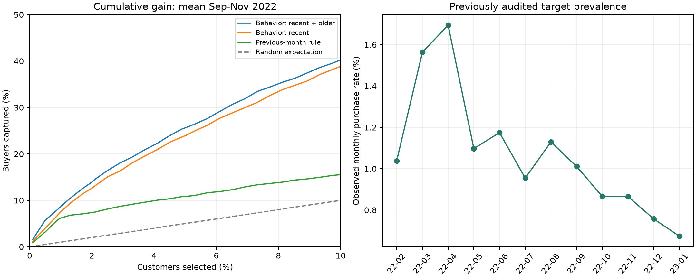
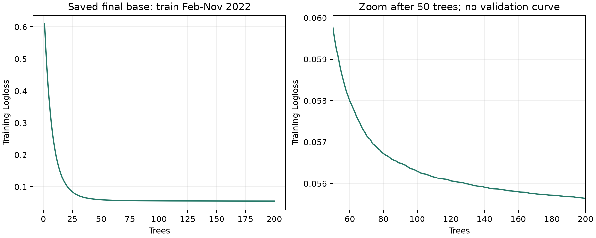

# Báo cáo baseline dự đoán mua sản phẩm — MBD-mini

Ngày cập nhật: **10/11/2026 — đã rà soát lại sau phản biện**. Báo cáo phân biệt kết quả đã chạy, chẩn đoán bổ sung từ artifact cũ và thí nghiệm mới chưa thực hiện.

**Baseline đã dùng đủ giao dịch (trx), geo và dialog metadata.** Mô hình được chọn là CatBoost `multi_history`, kết hợp hành vi tháng gần nhất với lịch sử cũ. Trên validation cuốn chiếu 09–11/2022, Recall@1% trung bình đạt **8,70%**, so với **6,18%** của rule “tháng này mua thì tháng sau mua”. Mô hình cuối và bộ hiệu chỉnh xác suất đã được lưu; **test 01/2023 chưa được đánh giá**.

**Phạm vi kết luận đã điều chỉnh:** đây là baseline **chỉ dùng hành vi**, chưa phải mô hình kết hợp đầy đủ thông tin có thể khả dụng. CatBoost chưa được xem lịch sử target, trong khi rule dùng target tháng trước. Phép so vẫn cho biết hai cách chọn khách đạt gì trên cùng ngân sách, nhưng chưa đo giá trị tăng thêm của hành vi khi đã biết lịch sử mua. Ưu tiên tiếp theo là so **lịch sử mua / hành vi / kết hợp cả hai**, rồi mới mở rộng tuning và mô hình.

Lần rà soát này đã tính thêm nhiều mức K, phân nhóm khách, độ chồng danh sách và cumulative gain từ dự đoán validation đã lưu. **Không train lại, không thay model/calibrator và không đánh giá dự đoán test.**

## 1. Bài toán là gì? Kết quả dùng để làm gì?

Tại đầu tháng M, dùng thông tin đã có trước thời điểm đó để dự đoán khách hàng có mua **ít nhất một trong bốn nhóm sản phẩm target** trong tháng M hay không.

| Thành phần | Định nghĩa hiện tại |
| --- | --- |
| Đơn vị quan sát | Một khách hàng trong một tháng: `client_id × month` |
| Tập khách | 100.224 khách/tháng trong bộ dữ liệu hiện có |
| Thời điểm dự đoán | Đầu ngày 1 tháng M, theo giả định UTC |
| Nhãn cần dự đoán | `y_any(M)`: có mua ít nhất một trong bốn target trong tháng M |
| Đầu ra mô hình | Xác suất `p_any` cho từng khách, dùng để sắp xếp ưu tiên |
| Cách mô phỏng sử dụng | Chọn top 1% khách có xác suất cao nhất; so với rule ở cùng ngân sách |

Ví dụ: dự đoán tại **01/12/2022** thì hành vi tháng gần nhất là tháng 11/2022, lịch sử cũ là phần trước tháng 11, còn target là kết quả mua trong tháng 12. Không dịch nhãn thêm một tháng sau khi đã gán đúng cutoff này.

Ý nghĩa nghiệp vụ là **ưu tiên danh sách khách có khả năng mua cao** khi nguồn lực tiếp cận có giới hạn. Baseline hiện dự đoán mua bất kỳ sản phẩm nào trong bốn target; chưa chọn sản phẩm cụ thể cho từng người. Kết quả offline chưa cho biết việc liên hệ khách có làm tăng số lượt mua hay doanh thu hay không.

## 2. Ý tưởng thiết kế

Hành vi gần đây phản ánh nhu cầu hiện tại; lịch sử dài hơn cung cấp nền hành vi và mức độ hoạt động của khách. Vì vậy, dữ liệu được tách thành hai cửa sổ không chồng lấn, thay vì chỉ gộp toàn bộ quá khứ vào một nhóm.

| Cửa sổ | Tại cutoff 01/12/2022 | Ý nghĩa |
| --- | --- | --- |
| `recent` | Từ 01/11 đến trước 01/12 | Hành vi trong tháng lịch gần nhất |
| `older` | Toàn bộ lịch sử có sẵn trước 01/11 | Nền hành vi tích lũy trước tháng gần nhất |
| `all` | Toàn bộ lịch sử trước 01/12 | Phục vụ kiểm tra dữ liệu; không đưa thêm vào X của hai baseline đã chạy |

Tháng gần nhất là **tháng lịch**, có thể có 28–31 ngày. Tất cả feature đều dừng trước cutoff. Recency được tính so với cutoff dự đoán, kể cả khi sự kiện nằm trong lịch sử cũ. Các thống kê phi tuyến như trung vị được tính từ đúng tập sự kiện, không lấy trung vị toàn bộ trừ trung vị tháng gần nhất.

Hai giả thuyết được kiểm tra:

1. Thêm lịch sử cũ có cải thiện so với chỉ dùng tháng gần nhất không?
2. Baseline có tìm được nhiều khách mua hơn rule mua tháng trước khi chọn cùng số khách không?

## 3. Input gồm những gì?

### 3.1. Các nguồn dữ liệu

| Nguồn | Cách sử dụng | Ý nghĩa |
| --- | --- | --- |
| Danh sách khách, split và mốc tháng | Xác định khách, khóa ghép và lịch đánh giá | Giữ đúng quần thể khách–tháng; ID và fold không phải predictor |
| Bốn target theo tháng | Tạo `y_any` và đối chiếu dự đoán | Là đáp án để học/đánh giá, không đưa vào X |
| `trx` | Số giao dịch, ngày hoạt động, recency, nhóm giao dịch, amount currency 11 và count/cờ currency khác | Mức độ, tần suất và cấu trúc giao dịch |
| `geo` | Thống kê số sự kiện, ngày hoạt động, recency, độ đa dạng mã vị trí và tỷ trọng vị trí phổ biến | Nhịp hoạt động và mức độ tập trung/phân tán theo mã geo |
| `dialog` | Số sự kiện, ngày hoạt động, recency và độ phủ | Mức độ tương tác; chưa dùng nội dung hội thoại hoặc embedding |

Geo hiện dùng thống kê mã vị trí, chưa diễn giải thành địa điểm địa lý thực tế. Amount được tách theo currency; currency 11 được dùng làm nhóm chính theo quy ước hiện tại của dự án. Không cộng tiền khác currency và không mặc định mã này là một đồng tiền ISO cụ thể.

### 3.2. Nhãn và độ phủ thời gian

Nhãn `y_any = 1` khi có ít nhất một target bằng 1; bằng 0 khi đủ căn cứ xác định cả bốn đều không mua. Nếu thiếu nhãn và chưa thể kết luận thì giữ unknown, không tự chuyển thành 0.

Snapshot đã kiểm tra có nhãn từ **02/2022 đến 01/2023**, tổng cộng **1.202.688 dòng khách–tháng**, **12.854 nhãn dương**, tương đương khoảng **1,07%**; không có dòng nhãn unknown trong snapshot này. Vì vậy, việc một bảng hoặc biểu đồ chỉ hiện từ 03/2022 không đủ để kết luận tháng 02 không có người mua: tháng 02 thực tế có **1.041 nhãn dương**.

Hành vi trước khoảng thời gian có nhãn vẫn được sử dụng để tạo lịch sử cũ. Các tháng chưa có target không được biến thành mẫu âm để train. Cùng một khách xuất hiện qua nhiều tháng, nên các dòng không độc lập như khi lấy mẫu những khách khác nhau.

### 3.3. Feature thực sự được đưa vào mô hình

| Nhóm | `multi_recent` | `multi_history` |
| --- | ---: | ---: |
| Giao dịch | 50 | 101 |
| Geo | 16 | 33 |
| Dialog metadata | 9 | 19 |
| **Tổng predictor** | **75** | **153** |

`multi_recent` dùng cửa sổ gần nhất của cả ba nguồn. `multi_history` bổ sung lịch sử cũ và các feature lịch sử được schema cho phép. Đây là số biến đầu vào sau chọn schema, không phải số sự kiện hay số chiều embedding.

Feature gồm count, số ngày hoạt động, thời gian từ sự kiện gần nhất đến cutoff, thống kê phân phối, độ đa dạng, độ phủ và rate. Với rate theo ngày, mẫu số là số ngày cửa sổ giao với khoảng trích xuất của nguồn. Mẫu số này **không chứng minh khách được quan sát liên tục**; thời điểm log đầu tiên cũng không được coi là ngày mở tài khoản.

Output chuẩn bị lưu 230 predictor được schema chấp nhận, nhưng hai mô hình thực tế chỉ chọn lần lượt 75 và 153 biến. Run hiện tại không đưa ID, fold, target cùng tháng, nhãn mua tháng trước, `trans_count`, `diff_trans_date` hay các cột phụ trợ ngoài danh sách cho phép vào X. Cờ `cold_start` tổng hợp nhiều nguồn phục vụ kiểm tra/phân nhóm, không làm predictor trong baseline này.

**Cần phân biệt target cùng tháng với target quá khứ:** target của tháng đang dự đoán phải loại khỏi X. Target các tháng trước đã khả dụng tại cutoff có thể trở thành feature hợp lệ. Việc chưa dùng lịch sử target là giới hạn của run đầu, không phải quy tắc cấm áp dụng cho mô hình tiếp theo. Bốn nhãn gốc vẫn được lưu trong dữ liệu; chúng chưa bị xóa khi tạo `y_any`.

## 4. Đã thực hiện những gì?

| Công việc đã làm | Cách thực hiện | Đầu ra/ý nghĩa |
| --- | --- | --- |
| Tái sử dụng dữ liệu đã chuẩn hóa | Đọc cache DuckDB của luồng preparation ở chế độ chỉ đọc | Không sửa raw, giữ quy tắc chuẩn hóa và quarantine đã có |
| Dựng cửa sổ thời gian | Tạo `recent`, `older`, `all` riêng cho từng cutoff | Dùng được lịch sử dài mà vẫn tách tín hiệu gần đây |
| Tổng hợp ba nguồn | Aggregate theo khách trước khi ghép vào bảng khách–tháng | Giữ một dòng/khách/tháng, tránh nhân bản do ghép log |
| Xử lý thiếu dữ liệu | Phân biệt số sự kiện bằng 0 với thống kê không xác định; giữ NaN phù hợp | Không biến mọi trường thiếu thành 0 |
| Khóa đầu vào mô hình | Kiểm tra tên/thứ tự/dtype, giá trị vô hạn và tràn khi chuyển float32 | Hạn chế lệch schema và lỗi số học |
| Huấn luyện validation | Chạy hai biểu diễn feature trên ba fold thời gian: tổng cộng sáu lần fit | So sánh tháng gần nhất với tháng gần nhất + lịch sử cũ |
| So với rule | Cùng khách, cùng tháng, cùng ngân sách; phá hòa cố định | Đo phần cải thiện so với cách chọn khách đơn giản |
| Ước lượng bất định | Bootstrap theo khách, giữ các tháng của khách đi cùng nhau | Tôn trọng việc một khách lặp lại qua thời gian |
| Fit bản cuối và calibration | Fit base trên 02–11/2022; fit sigmoid trên 12/2022 | Lưu model và bộ chuyển đổi xác suất để đánh giá sau |
| Kiểm tra triển khai | 7 kiểm thử baseline và 6 kiểm thử rule đạt; tải lại model và so 128 dự đoán calibration | Dự đoán tải lại khớp bản lưu, sai số lớn nhất bằng 0 |

Đã tạo đủ feature cho 12 tháng trên dữ liệu thật. Các cửa sổ có cùng tập sự kiện chỉ được tái sử dụng khi đúng cutoff và đúng điều kiện nguồn; không trừ hai thống kê phi tuyến để suy ra lịch sử cũ. Baseline giữ dữ liệu hiếm và cực trị theo quy trình hiện tại, không cân bằng bằng cách lấy mẫu 1:1.

## 5. Mô hình base và cách huấn luyện

### 5.1. Hai baseline đã chạy

| Tên | Input | Vai trò |
| --- | --- | --- |
| `multi_recent` | 75 biến tháng gần nhất từ trx + geo + dialog | Mốc so sánh khi chỉ quan sát hành vi gần đây |
| `multi_history` | 153 biến gần nhất + lịch sử cũ từ cả ba nguồn | Kiểm tra giá trị bổ sung của lịch sử tích lũy; được chọn làm baseline cuối |

Cả hai dùng **CatBoost phân loại nhị phân**, hàm mất mát Logloss. Cấu hình đã chạy: **200 cây, depth 4, learning rate 0,04, L2 leaf regularization 5, seed 20261110, CPU 2 threads**. Mô hình xử lý NaN với `nan_mode=Min`; không dùng class weight, lấy mẫu cân bằng hoặc early stopping.

Lệnh có tên `tune`, nhưng lần chạy này chỉ so sánh hai biểu diễn feature với cấu hình cố định. Chưa thực hiện tìm kiếm siêu tham số rộng. Mã có hỗ trợ đối chứng chỉ trx; những đối chứng đó chưa nằm trong kết quả chạy thật của báo cáo này.

Sáu lần fit validation đã chạy trên dữ liệu thật; vì vậy nhận xét “chưa chạy thật” không đúng về trạng thái thực thi. Tuy nhiên, độ rộng thử nghiệm còn thấp. **Chưa có bằng chứng để kết luận underfit hay đã đạt trần:** run không truyền `eval_set`, không có cặp đường học train/validation hoặc AP theo số cây và không lưu các model theo fold. Model cuối có lưu 200 giá trị Logloss trên train; đường này được trích lại bên dưới, nhưng model đã học qua 11/2022 nên không thể dùng nó chấm lại 09–11 rồi coi đó là learning curve ngoài mẫu.

### 5.2. Chia thời gian để tránh nhìn trước tương lai

| Giai đoạn | Dữ liệu học | Dữ liệu đánh giá/hiệu chỉnh | Số dòng học |
| --- | --- | --- | ---: |
| Validation fold 1 | 02–08/2022 | 09/2022 | 701.568 |
| Validation fold 2 | 02–09/2022 | 10/2022 | 801.792 |
| Validation fold 3 | 02–10/2022 | 11/2022 | 902.016 |
| Fit base cuối | 02–11/2022 | Dành 12/2022 cho calibration | 1.002.240 |
| Calibration | Giữ nguyên base đã fit | 12/2022: 100.224 dòng, 759 nhãn dương | — |
| Test độc lập | Giữ nguyên model và calibrator | 01/2023: chưa đánh giá | — |

Không chia ngẫu nhiên các dòng khách–tháng. Mỗi fold chỉ học từ nhãn tháng trước và dự đoán tháng sau. Feature của từng dòng chỉ dùng sự kiện trước cutoff của dòng đó.

Protocol hiện giả định **UTC và độ trễ nhãn bằng 0**. Đây là giả định triển khai, chưa phải xác nhận về timezone/SLA cung cấp nhãn của hệ thống nguồn. Nếu nhãn tháng trước đến chậm, cần sửa lịch khả dụng cho cả train và rule.

Chọn biến thể theo Recall@1% trung bình các tháng; các tiêu chí phụ là AP, Logloss và độ đơn giản. Sau khi chọn `multi_history`, base được fit lại trên 02–11/2022. Sigmoid calibration dùng raw margin của base trên 12/2022, với LogisticRegression L2, `C=1`; base không được fit lại sau bước này.

Các điểm validation bên dưới thuộc **ba model theo fold**, trước calibration. Chúng không phải điểm test của model cuối đã học đến tháng 11, cũng chưa chứng minh chất lượng xác suất sau calibration trên một tháng độc lập.

## 6. Rule “tháng này mua thì tháng sau mua” được so thế nào?

Rule được viết chính xác là **`ŷ_any(M) = y_any(M−1)`**: khách mua bất kỳ một trong bốn target tháng trước thì dự đoán tháng này cũng mua bất kỳ target nào. Không yêu cầu mua lại đúng cùng sản phẩm.

Nhãn tháng trước chỉ dùng cho rule, không đưa vào X của CatBoost. Phải tìm đúng tháng lịch liền trước; nếu thiếu hoặc chưa khả dụng thì giữ unknown. Vì không có nhãn 01/2022, rule chưa thể chấm cho 02/2022. Với ba tháng validation 09–11/2022, nhãn tháng trước có đủ cho toàn bộ khách, nên không loại dòng nào vì lý do này.

Hai bên có cùng cohort và ngân sách nhưng **khác tập thông tin**: mô hình dùng hành vi, rule dùng nhãn mua trước. Kết quả hiện tại là so hai hệ thống dự đoán có đầu vào khác nhau. Để đánh giá giá trị bổ sung một cách trực tiếp, cần thêm mô hình lịch sử mua và mô hình hành vi + lịch sử mua trên cùng lịch chia, cùng chính sách nhãn khả dụng và cùng quần thể đánh giá.

Hai phép so sánh đã chạy:

1. **Cùng top 1%:** mỗi phương pháp chọn `ceil(0,01 × 100.224) = 1.003` khách/tháng. Rule chỉ có điểm 0/1 nên nhiều khách đồng điểm; dùng SHA256 của seed và ID để phá hòa cố định, không dùng target hiện tại.
2. **Cùng ngân sách tự nhiên của rule:** rule chọn tất cả người mua tháng trước; mô hình chọn đúng bằng số khách đó, theo xác suất giảm dần.

Rule là quyết định 0/1, không phải xác suất đã hiệu chỉnh; không báo Logloss của rule như một mô hình xác suất. Khi so danh sách khách, không dùng threshold 0,5 cho mô hình vì sẽ tạo ngân sách khác rule.

## 7. Baseline đã đạt được gì?

### 7.1. Kết quả chính: cùng top 1%

Các giá trị sau là **trung bình đều theo ba tháng validation 09–11/2022**.

| Phương pháp | Precision@1% | Recall@1% | Lift@1% | AP |
| --- | ---: | ---: | ---: | ---: |
| **CatBoost gần nhất + lịch sử cũ (`multi_history`)** | **7,91%** | **8,70%** | **8,70** | **0,0419** |
| CatBoost tháng gần nhất (`multi_recent`) | 6,85% | 7,55% | 7,54 | 0,0348 |
| Rule mua tháng trước | 5,62% | 6,18% | 6,17 | 0,0125 |

Ý nghĩa của các chỉ số:

- **Precision@1% = 7,91%:** trong nhóm 1% khách được mô hình ưu tiên, trung bình khoảng 7,91% thực sự mua.
- **Recall@1% = 8,70%:** chỉ chọn 1% khách nhưng tìm được trung bình 8,70% tổng số người mua của tháng. Phần lớn người mua vẫn nằm ngoài danh sách này.
- **Lift@1% = 8,70:** tỷ lệ mua trong danh sách ưu tiên cao gấp khoảng 8,70 lần tỷ lệ mua của toàn bộ khách cùng tháng.
- **AP:** average precision, đánh giá chất lượng sắp xếp trên toàn bộ danh sách, không chỉ tại top 1%; càng cao càng tốt.

Thêm lịch sử cũ nâng Recall@1% từ **7,55% lên 8,70%**. So với rule, baseline được chọn tăng **2,52 điểm phần trăm**, tương đương khoảng **41% tương đối** trên chỉ số trung bình này. Đây là mức cải thiện quan sát được trên validation.

### 7.2. Kết quả theo từng tháng

Mỗi dòng đều so trên 100.224 khách và chọn đúng 1.003 khách cho mỗi phương pháp.

| Tháng | Người mua thực tế | `multi_history` tìm được | Rule tìm được | Recall mô hình | Recall rule |
| --- | ---: | ---: | ---: | ---: | ---: |
| 09/2022 | 1.013 | 80 | 57 | 7,90% | 5,63% |
| 10/2022 | 868 | 76 | 55 | 8,76% | 6,34% |
| 11/2022 | 867 | 82 | 57 | 9,46% | 6,57% |

Trong tổng cộng **3.009 lượt chọn khách–tháng**, mô hình tìm được **238 lượt mua**, rule tìm được **169**, chênh **69**. Đây là số người mua quan sát trong danh sách được chọn, chưa phải số lượt mua tăng thêm do một chiến dịch tác động.

### 7.3. Khi dùng ngân sách tự nhiên của rule

| Tháng | Số khách mỗi bên chọn | Mô hình tìm được | Rule tìm được | Recall mô hình | Recall rule |
| --- | ---: | ---: | ---: | ---: | ---: |
| 09/2022 | 1.132 | 89 | 70 | 8,79% | 6,91% |
| 10/2022 | 1.013 | 77 | 55 | 8,87% | 6,34% |
| 11/2022 | 868 | 73 | 55 | 8,42% | 6,34% |

Mô hình tìm được nhiều người mua hơn rule ở cả ba tháng, trong cả hai cách cố định ngân sách. Với ngân sách tự nhiên, tổng số lượt mua tìm được là **239 so với 180**.

### 7.4. Chất lượng xác suất trước calibration

| Phương pháp | ROC-AUC ↑ | Logloss ↓ | Brier score ↓ |
| --- | ---: | ---: | ---: |
| Xác suất hằng theo tỷ lệ mua của tập train | 0,5000 | 0,05239 | 0,009064 |
| `multi_recent` | 0,7471 | 0,04844 | 0,008967 |
| `multi_history` | **0,7846** | **0,04698** | **0,008914** |

Đây cũng là trung bình theo ba tháng, dùng xác suất gốc của model từng fold. `multi_history` tốt hơn mốc xác suất hằng và `multi_recent` trên cả ba chỉ số. Chưa có điểm test để kết luận mức cải thiện xác suất sau calibration.

Logloss giảm khoảng **0,00541 tuyệt đối, tương đương 10,32% tương đối** so với mốc xác suất hằng. Mức tuyệt đối nhỏ có liên quan đến tỷ lệ dương hiếm; riêng độ chênh này không xác định được mô hình underfit. Cần xem train/validation learning curve và các cấu hình mạnh hơn trước khi kết luận.

### 7.5. Độ bất định

Với 500 lần bootstrap theo khách, khoảng 95% của chênh lệch Recall@1% là:

| So sánh với rule | Chênh lệch trung bình | Khoảng bootstrap 95% |
| --- | ---: | ---: |
| `multi_history` − rule | +2,52 điểm phần trăm | [+1,24; +3,88] điểm phần trăm |
| `multi_recent` − rule | +1,37 điểm phần trăm | [−0,08; +2,75] điểm phần trăm |

Khoảng của `multi_history` nằm trên 0; khoảng của `multi_recent` còn chứa 0. Bootstrap có điều kiện theo model đã fit và ba tháng đã quan sát, chưa phản ánh đầy đủ bất định khi train lại hoặc gặp giai đoạn mới. Validation này đồng thời được dùng để chọn biến thể, nên kết quả vẫn cần xác nhận trên test độc lập.

### 7.6. Bổ sung nhiều mức ngân sách và cumulative gain

Kiểm tra lại `validation_metrics.json` cho thấy code **đã tính 0,5%, 1% và 5%**, nhưng báo cáo trước chỉ trình bày 1%. Lần rà soát này tính thêm 2%, 10% từ cùng dự đoán, giữ nguyên seed và cách phá hòa. Bảng là trung bình đều ba tháng; các chỉ số bổ sung mang tính chẩn đoán, không đổi tiêu chí chọn model ban đầu.

| Tỷ lệ khách chọn | Recall `multi_history` | Recall `multi_recent` | Recall rule | Lift `multi_history` | Lift rule |
| --- | ---: | ---: | ---: | ---: | ---: |
| 0,5% | 5,73% | 4,02% | 3,20% | 11,45 | 6,40 |
| 1% | 8,70% | 7,55% | 6,18% | 8,70 | 6,17 |
| 2% | 13,93% | 12,61% | 7,38% | 6,96 | 3,69 |
| 5% | 25,61% | 23,93% | 10,82% | 5,12 | 2,16 |
| 10% | 40,28% | 38,86% | 15,55% | 4,03 | 1,56 |

Ở ngân sách lớn hơn số người mua tháng trước, rule phải chọn thêm khách có điểm 0 theo tie-break cố định. Đó là cách mở rộng thứ hạng của hard rule, không phải rule có thêm khả năng phân biệt những khách này.



Biểu đồ bên trái là **cumulative gain theo tỷ lệ khách chọn**, không phải learning curve theo số cây. Dữ liệu đường đầy đủ tới 100% và metric từng tháng nằm trong [thư mục chẩn đoán](docs/baseline_diagnostics_20261110/).

### 7.7. Mô hình có đang chỉ tìm lại khách mua trước không?

So hai danh sách top 1.003 khách/tháng:

| Tháng | Khách chung giữa mô hình và rule | Tỷ lệ chồng trên mỗi danh sách | Khách mua tháng trước trong top mô hình | Lượt mua mô hình tìm được từ nhóm mua trước | Từ nhóm không mua tháng trước |
| --- | ---: | ---: | ---: | ---: | ---: |
| 09/2022 | 185 | 18,44% | 203 | 17 | 63 |
| 10/2022 | 139 | 13,86% | 139 | 10 | 66 |
| 11/2022 | 139 | 13,86% | 139 | 9 | 73 |

Tháng 09 có 1.132 khách mua trước nhưng ngân sách chỉ 1.003, nên số khách mua trước trong top mô hình có thể lớn hơn số khách chung với danh sách rule sau phá hòa.

Trong 238 lượt mua mô hình tìm được, **36** đến từ người mua tháng trước và **202** từ người không mua tháng trước. Vì vậy, chưa có căn cứ cho rằng mô hình chỉ tái phát hiện mua lại. Tuy nhiên, dự đoán hành vi có thể vẫn phản ánh tín hiệu liên quan tới mua trước; độ chồng thấp không phải bằng chứng nhân quả về cơ chế mô hình.

Bảng dưới cộng dồn **lượt khách–tháng** của ba tháng. Chọn top 1% trên toàn bộ khách trước rồi mới phân nhóm; không chọn riêng top 1% trong từng nhóm.

| Phân nhóm theo lịch sử trước cutoff | Số dòng | Ca mua thực | Được chọn | Ca mua tìm được | Precision trong phần được chọn | Recall trong nhóm |
| --- | ---: | ---: | ---: | ---: | ---: | ---: |
| Mua tháng trước | 3.013 | 180 | 481 | 36 | 7,48% | 20,00% |
| Không mua tháng trước | 297.659 | 2.568 | 2.528 | 202 | 7,99% | 7,87% |
| Từng ghi nhận mua từ 02/2022 | 24.502 | 732 | 1.066 | 67 | 6,29% | 9,15% |
| Chưa ghi nhận mua từ 02/2022 | 276.170 | 2.016 | 1.943 | 171 | 8,80% | 8,48% |

Hai dòng đầu là một cách chia, hai dòng sau là cách chia khác; **không cộng cả bốn dòng với nhau**. “Chưa ghi nhận mua” chỉ xét nhãn được cung cấp từ 02/2022 đến trước cutoff, không có nghĩa chưa từng mua trong đời khách hàng. Toàn bộ lịch sử nhãn dùng để phân nhóm trong snapshot đều đã biết; nếu thiếu nhãn phải thêm nhóm unknown.

### 7.8. Tỷ lệ mua cuối chuỗi giảm: đã biết gì, chưa biết gì?

| Tháng | Vai trò | Nhãn dương `y_any` | Tỷ lệ dương |
| --- | --- | ---: | ---: |
| 09/2022 | Validation | 1.013 | 1,011% |
| 10/2022 | Validation | 868 | 0,866% |
| 11/2022 | Validation | 867 | 0,865% |
| 12/2022 | Calibration | 759 | 0,757% |
| 01/2023 | Test, chỉ thống kê nhãn đã công bố trong EDA | 675 | 0,673% |

Mỗi tháng vẫn có 100.224 khách, đủ bốn nhãn, không có unknown. Điều này loại trừ cách giải thích đơn giản rằng số dương giảm chỉ vì ít dòng khách hoặc tăng nhãn null; **chưa loại trừ lỗi trích xuất/mapping nhãn hoặc thay đổi cách ghi nhận**.

Đối chiếu [thống kê từng sản phẩm đã audit](docs/mbd_mini_eda/tables/review/target_monthly.csv): từ 09 đến 12/2022, target 1 giảm 344→292, target 2 tăng 52→56, target 3 giảm 422→245, target 4 giảm 244→199. Tháng 01/2023, target 1/2/3 tiếp tục giảm còn 159/25/215, còn target 4 tăng lên 293. Tổng bốn target không bằng `y_any` do có đồng mua. Đây là thay đổi cơ cấu nhãn cần kiểm tra, chưa chứng minh mùa vụ hay concept drift.

Toàn chuỗi chỉ có một chu kỳ năm, không đủ xác nhận mùa vụ lặp lại. Cần đối chiếu định nghĩa target, lịch đóng sổ/backfill, ETL, độ phủ từng nguồn và phân phối feature/score theo tháng. Thống kê nhãn tháng 01 đã được xem trong EDA trước đây; giữ test chưa đánh giá nghĩa là **chưa dùng dự đoán/metric test để chọn mô hình**, không phải chưa từng biết tỷ lệ dương của tháng này.

Calibration một tháng với 759 ca dương và test một tháng không đủ chứng minh ổn định nhiều giai đoạn. Sigmoid có slope dương giữ nguyên thứ hạng; calibration không tự cải thiện Recall@K. Không dùng việc mean prediction khớp tỷ lệ mua trên chính tháng fit calibrator làm bằng chứng tổng quát hóa.

## 8. Output là gì? Đọc và sử dụng thế nào?

### 8.1. Đầu ra dự đoán

Bảng dự đoán lưu khóa khách/tháng, tên model, raw margin `score` và xác suất `p_any`; bảng đánh giá offline có thêm nhãn thật `y_any` để chấm điểm. Từ `p_any`, sắp xếp giảm dần để tạo danh sách top K; thứ hạng được suy ra khi chọn danh sách.

Ví dụ `p_any = 0,08` biểu diễn xác suất mua ước tính 8% cho khách–tháng đó, không phải khẳng định khách chắc chắn mua. Xác suất validation là xác suất gốc; bản cuối có calibrator đi kèm để chuyển raw margin thành xác suất sau hiệu chỉnh. Chưa triển khai API, tích hợp CRM hoặc luồng chấm điểm tự động cho dữ liệu tháng mới.

### 8.2. Artifact đã lưu trên máy

| Artifact | Vị trí | Ý nghĩa |
| --- | --- | --- |
| Feature 12 tháng, schema và protocol | `outputs/propensity_calendar_v2/` | Input có kiểm tra cho các bước mô hình |
| Kết quả chọn model | `outputs/propensity_baseline_geo_dialog_v1/selection.json` | Ghi biến thể được chọn và cấu hình |
| Dự đoán và metric validation | `validation_predictions.parquet`, `validation_metrics.json` trong thư mục run | Cho phép kiểm tra lại kết quả theo khách/tháng |
| So sánh với rule | `rule_validation/monthly_comparison.csv`, `.json`, `paired_comparison.json` trong thư mục run | Kết quả cùng ngân sách và khoảng bootstrap |
| Base model cuối | `outputs/propensity_baseline_geo_dialog_v1/final/model.cbm` | CatBoost đã fit trên 02–11/2022, dùng 153 predictor |
| Hiệu chỉnh và giải thích | `final/calibrator.json`, `calibration_predictions.parquet`, `feature_importance.csv` trong thư mục run | Bộ sigmoid, dự đoán tháng calibration và độ quan trọng feature |
| Trạng thái và thông tin tái lập | `outputs/propensity_baseline_geo_dialog_v1/manifest.json` | Trạng thái `fitted`, `test_opened=false`, cấu hình, môi trường và dấu kiểm tra artifact |
| Kiểm tra bản đã lưu | `outputs/baseline_geo_dialog_review_20261110/verification.json` | Kiểm tra hash, schema và dự đoán sau tải lại |
| Chẩn đoán sau phản biện | [docs/baseline_diagnostics_20261110/](docs/baseline_diagnostics_20261110/) | CSV tổng hợp nhiều K, phân nhóm, độ chồng, gain curve, biểu đồ và hash nguồn; không có ID khách |

Ở bảng trên, “thư mục run” là `outputs/propensity_baseline_geo_dialog_v1/`. Artifact mô hình và dữ liệu trong `outputs/` được Git ignore; clone repository không tự có các file này. Mã nguồn, cấu hình và báo cáo mô tả cách tạo chúng.

## 9. Đối chiếu phản biện và thứ tự ưu tiên

| Ưu tiên | Vấn đề | Kết luận sau kiểm tra | Trạng thái |
| --- | --- | --- | --- |
| P0 | Lịch sử mua chỉ có ở rule | Đúng với run hiện tại. Nhãn quá khứ đã khả dụng không tự động gây leakage; cần thêm đối chứng lịch sử mua và kết hợp hành vi | Đã sửa khuyến nghị; chưa train các đối chứng mới |
| P0 | Diễn giải kết quả và trạng thái notebook | Có câu “chưa chạy notebook trên toàn bộ MBD-mini” gây nhầm với CLI đã chạy; cần phân biệt nguồn notebook chưa có output với run thật đã hoàn thành | Đã đồng bộ báo cáo/notebook; giữ test chưa đánh giá |
| P1 | Đánh giá quá tập trung ở K=1% | Đúng về báo cáo cũ; artifact đã có 0,5%/5%. Thiếu 2%/10%, gain, phân nhóm và overlap | Đã bổ sung chẩn đoán từ dự đoán cũ; vẫn thiếu ablation nguồn và test độc lập |
| P1 | Cửa sổ quá thô và lịch sử tích lũy phụ thuộc độ dài | Đúng là chưa có 7d/14d trong run này. Recency/rate đã có nhưng không loại hết độ phủ khác nhau | Đề xuất thử cửa sổ ngắn/cố định, chưa mặc định bỏ lịch sử cũ |
| P1 | Ít cấu hình, có thể underfit | Đúng là chưa tuning/early stopping/learning curve; “chưa chạy thật” và “chắc underfit” không được artifact ủng hộ | Cần run mới lưu learning curve và thử cấu hình mạnh hơn |
| P1 | Base rate, calibration và test cuối chuỗi | Có giảm tỷ lệ mua và thay đổi cơ cấu sản phẩm; chưa biết do hành vi thật hay nguồn nhãn | Đã bổ sung thống kê, chưa xác minh được nguyên nhân ETL/nghiệp vụ |
| P2 | Chưa khai thác nội dung dialog, chuỗi trx và geo sâu | Đúng về mức khai thác; chưa biết nguồn nào giàu tín hiệu nhất nếu chưa làm ablation | Thử embedding đã có, đặc trưng thời gian/chuỗi và nguồn riêng |
| Có điều kiện | Cutoff tuần, nhãn mua 30 ngày tới, GroupKFold | Chưa dựng được nhãn trượt chính xác từ target tháng. GroupKFold không tự giữ thứ tự thời gian; thêm dòng chồng lấp không tạo thêm ca mua độc lập | Chỉ triển khai khi có timestamp mua và protocol thời gian phù hợp |

### 9.1. P0 — thiết kế lại đối chứng lịch sử mua

Giữ mục tiêu `y_any`, vì mục tiêu hiện tại bao gồm cả mua lại. Bổ sung feature cho **`y_any` và từng `target_1`–`target_4`**:

- Lag mua tháng M−1; có thể thêm M−2/M−3 để kiểm tra hiệu ứng kéo dài.
- Số tháng có mua trong 3/6 tháng gần nhất và từ đầu lịch sử nhãn đã quan sát.
- Số tháng từ lần mua được ghi nhận gần nhất; cờ chưa ghi nhận mua và cờ thiếu lịch sử.
- Số tháng có nhãn đã khả dụng, tỷ lệ tháng mua trên số tháng quan sát và trạng thái không đủ cửa sổ.

Lịch sử bắt đầu 02/2022, nên recency này có độ phân giải **tháng** và bị giới hạn phía đầu chuỗi; không suy ra ngày mua chính xác hoặc trạng thái mua suốt đời. Mọi phép tính phải dùng **tháng trước cutoff và nhãn đã công bố trước cutoff**. Chỉ dịch theo `mon` mà bỏ qua độ trễ nhãn vẫn có thể nhìn trước tương lai.

Với lag một tháng, nếu yêu cầu đủ lịch sử và bỏ tháng đầu thì bỏ 02/2022: mất 1/12 tháng nhãn toàn snapshot, hoặc 1/10 tháng của tập fit base 02–11. Validation 09–11 vẫn có đủ lag. Không nhất thiết cắt: có thể giữ tháng đầu với missing/availability flag và báo kết quả theo độ dài lịch sử. Nếu yêu cầu đủ sáu tháng, chi phí warm-up lớn hơn đáng kể; phải tính lại cohort và số dương thay vì suy từ “có 12 tháng”.

Thí nghiệm tối thiểu trên cùng quần thể đánh giá:

| Mốc | Input | Câu hỏi cần trả lời |
| --- | --- | --- |
| R | Rule `y_any(M−1)` | Chuẩn mua lại đơn giản |
| H | Chỉ lịch sử nhãn any + bốn sản phẩm | Lịch sử mua tự nó dự đoán được đến đâu? |
| B | Hành vi ba nguồn, như baseline hiện tại | Tín hiệu hành vi độc lập với việc đưa nhãn quá khứ vào X |
| B+H | Hành vi + lịch sử nhãn | Hành vi bổ sung bao nhiêu so với H, và lịch sử mua bổ sung bao nhiêu so với B? |

Bốn nhãn gốc có thể bổ sung thông tin vào X dưới dạng lag mà chưa cần đổi đầu ra thành bốn model. Nếu chuyển sang dự đoán từng sản phẩm, đó là thí nghiệm nhiều nhãn riêng, cần metric/calibration theo từng target. Không tự cộng bốn xác suất để ra `p_any` khi các sản phẩm có thể đồng mua.

### 9.2. P1 — thử độ phân giải thời gian trước khi thay đổi bài toán

Cutoff đầu tháng phù hợp với bài toán chốt danh sách hằng tháng; bản thân việc chốt tại một thời điểm không phải lỗi. Điểm yếu là tổng hợp tháng có thể làm loãng vài ngày cuối. Thử **7d, 14d, 30d, 90d**, recency và chênh lệch rate giữa cửa sổ trên cùng cutoff tháng. So thêm với cấu trúc `recent + older` hiện tại, rồi mới quyết định giữ/bỏ tích lũy cũ. Cửa sổ cố định giới hạn độ dài nhưng vẫn cần cờ nguồn có đủ khoảng quan sát hay không.

Chỉ khi có **timestamp mua/định nghĩa sự kiện target** mới dựng được cutoff tuần và nhãn `(cutoff, cutoff + 30 ngày]` chính xác. Target tháng hiện có không cho biết ngày nào trong tháng đã mua; không gán cùng một nhãn tháng cho mọi tuần rồi gọi đó là nhãn 30 ngày tới. Dòng dương chồng lấp có thể cùng bắt nguồn từ một lần mua, nên số dòng tăng không tương đương số ca dương độc lập tăng.

Với horizon trượt, chọn train theo điều kiện nhãn đã kết thúc và đã khả dụng trước thời điểm dự đoán validation; purge các cửa sổ nhãn giao với giai đoạn validation theo protocol. Chia theo cutoff chung cho toàn bộ khách, không đặt `gap=30` một cách máy móc lên bảng panel vì tham số gap đếm dòng chứ không đếm ngày.

`GroupKFold` giữ một khách khỏi xuất hiện ở cả hai phía của cùng split, nhưng không áp đặt train trước validation. Nó phù hợp để kiểm tra khách chưa thấy; không thay thế đánh giá theo thời gian cho mục tiêu khách hiện hữu tháng sau. Nếu cần kiểm tra đồng thời khách mới và thời gian mới, phải kết hợp hai ràng buộc. Cơ sở API: [GroupKFold](https://scikit-learn.org/stable/modules/generated/sklearn.model_selection.GroupKFold.html), [TimeSeriesSplit](https://scikit-learn.org/stable/modules/generated/sklearn.model_selection.TimeSeriesSplit.html).

### 9.3. P1 — learning curve, tuning và số tháng học

Kiểm tra `get_evals_result()` của model cuối tìm thấy chuỗi **train Logloss**, chưa có chuỗi validation. Đã xuất lại [CSV theo số cây](docs/baseline_diagnostics_20261110/final_training_logloss.csv) và biểu đồ, không train lại:



Train Logloss tại 50/100/150/200 cây lần lượt khoảng **0,05977 / 0,05630 / 0,05586 / 0,05564**: vẫn giảm, chậm dần. Đây là train 02–11/2022, không phải các train fold; không so trực tiếp con số này với Logloss validation trung bình ở tháng có base rate khác để suy ra overfit/underfit. Phần **train so với validation, cả Logloss và AP** vẫn cần run mới.

Cần chạy lại các fold trong **run mới**, lưu Logloss và AP trên train/validation theo số cây. Tăng giới hạn số cây, ví dụ 1.000–2.000, thử depth 4/6 và L2 3/5/10 trong ngân sách tính toán đã định; đây là dải thử ban đầu, không phải cấu hình đã chứng minh tốt hơn. Early stopping cần validation set; nên dùng tháng cuối trong phần train làm tập dừng bên trong, để tháng validation ngoài chỉ chấm chất lượng. Chọn số cây/quy tắc refit từ các fold, không chọn bằng calibration hoặc test. Xem [CatBoost fit: eval_set và early_stopping_rounds](https://catboost.ai/docs/en/concepts/python-reference_catboostclassifier_fit).

Nếu dùng validation ngoài để vừa dừng vừa chọn, phải ghi rõ mức lạc quan do tái sử dụng và giữ test cuối độc lập. Không có lựa chọn early stopping nào tạo ra bằng chứng underfit cho run cũ nếu chưa vẽ đường học. Sau đối chứng feature, có thể so LightGBM/XGBoost với **cùng input, lịch chia và ngân sách tìm kiếm**, không diễn giải vài cấu hình thử là trần chung của họ cây.

Fold 1 học 7 tháng, fold 2 học 8, fold 3 học 9. Điểm khác nhau trộn lẫn số tháng train, base rate và hành vi tháng đánh giá; chưa thể quy cho thiếu dữ liệu. Để tách ảnh hưởng, giữ cùng một tháng validation rồi thay độ dài lịch sử train, hoặc thêm đối chứng rolling train có số tháng cố định. Cả hai là thí nghiệm mới, không có trong metric hiện tại.

Để kiểm tra calibration qua nhiều giai đoạn, có thể thêm backtest ba bước **train → tháng calibration → tháng đánh giá sau đó**, cuốn chiếu trong phần phát triển. Ví dụ base học 02–07, calibrate 08, đánh giá 09; các fold sau dịch tương ứng. Cách này giảm số tháng fit base so với lịch cũ, nên phải so raw/calibrated probability trên cùng base và cùng tháng, báo Logloss/Brier/calibration bins theo tháng. Đây là kiểm tra cơ chế, không thay thế xác nhận trên dữ liệu tương lai thực tế và chưa được chạy trong báo cáo.

### 9.4. P2 — khai thác nguồn và ablation có kiểm soát

Ưu tiên ablation cùng một bộ cửa sổ/lịch sử nhãn: **trx → trx+geo → trx+dialog → trx+geo+dialog**. Bổ sung hai tổ hợp trung gian để tách đóng góp và tương tác nguồn; cờ phụ trợ toàn cục không được vô tình mang nguồn bị loại trở lại X. Giữ cohort, hyperparameter hoặc ngân sách tuning tương đương, báo chênh lệch theo tháng và bootstrap paired.

Dialog có **embedding được cung cấp sẵn, không có văn bản gốc**. Có thể thử pooling mean/last trước cutoff và PCA/SVD 32/64 chiều. Bộ giảm chiều chỉ fit bằng dữ liệu phần train của từng fold rồi transform phần giữ lại; cả bước chọn số chiều cũng thuộc validation, không fit trên toàn chuỗi. PCA giữ phương sai không bảo đảm giữ tín hiệu mua, nên cần đối chứng metadata / embedding / kết hợp. Không có kết quả hiện tại để khẳng định embedding sẽ là tín hiệu mạnh nhất. Quy tắc chống leakage cho PCA: [scikit-learn common pitfalls](https://scikit-learn.org/stable/common_pitfalls.html).

Trx hiện có count cho nhiều currency nhưng **thống kê amount đưa vào model chủ yếu chỉ currency 11**. Sidecar amount theo currency khác và tần suất nhóm đã được xuất, chưa được toàn bộ đưa vào X. Có thể thử cấu trúc nhóm giao dịch, chuyển trạng thái, giờ/ngày trong tuần và chuỗi gần cutoff; chưa được tự gọi mã `event_type`/`event_subtype` là MCC hoặc gán ý nghĩa nghiệp vụ khi chưa có mapping. Giờ theo UTC chỉ là quy ước cho đến khi xác nhận timezone nguồn.

Geo có thể thử thay đổi mã vị trí, tần suất quay lại và cấu trúc hoạt động theo thời gian. Mã geo chưa có ánh xạ địa lý được xác minh, nên chưa khẳng định khoảng cách di chuyển hay nơi ở/làm việc từ chúng.

### 9.5. Mức kết luận có thể bảo vệ ở thời điểm này

Đã có baseline hành vi chạy thật, có thể tái lập, vượt rule trên validation ở các ngân sách đã kiểm tra. Kết quả ủng hộ **thử tiếp** lịch sử dài, nhưng chưa đủ để chọn kiến trúc cuối, bỏ lịch sử mua hay kết luận hiệu quả kinh doanh. Độ chồng thấp và nhiều lượt trúng ngoài nhóm mua trước là tín hiệu hữu ích để thiết kế B+H, không bảo đảm B+H sẽ cải thiện.

Mốc hiện tại là Recall@1% **8,70%**, AP **0,0419** trên validation. Khóa thứ tự thử nghiệm, làm đối chứng P0/P1 trước, chọn ứng viên bằng validation, rồi đánh giá model/calibrator đã chốt trên test. Chưa có kết quả Jan/2023, chưa có bằng chứng ổn định nhiều tháng sau calibration, khách hoàn toàn mới hay tác động tăng mua do chiến dịch.

## 10. Đọc mã và tái lập công việc

| Tài liệu/mã | Nội dung |
| --- | --- |
| [Notebook 05](notebooks/05_calendar_baseline.ipynb) | Luồng đọc dữ liệu, điều phối baseline và kiểm tra artifact |
| [Cấu hình cửa sổ](configs/propensity_calendar.json) | Nguồn cache và quy tắc tạo feature tháng lịch |
| [Cấu hình baseline](configs/propensity_baseline.json) | Hai biến thể, tham số CatBoost, seed và bootstrap |
| [Package baseline](src/propensity_baseline/) | Xử lý dữ liệu, metric, huấn luyện, lưu model và CLI |
| [Đặc tả và lệnh chạy](docs/propensity_baseline_design.md) | Chi tiết protocol và trình tự từng giai đoạn |
| [Script xuất bảng so sánh](scripts/report_baseline_rule.py) | Tạo báo cáo số liệu ngắn từ artifact; bổ sung cho báo cáo giải thích này |
| [Script chẩn đoán validation](scripts/review_baseline.py) | Tái tạo bảng nhiều K, phân nhóm, overlap và gain curve; kiểm tra khớp metric cũ và hash nguồn |

Lệnh tái tạo chẩn đoán sau phản biện, chạy từ root với môi trường đã cài package cùng extra `baseline,plots`:

```powershell
.\.venv\Scripts\python.exe -B -X utf8 scripts/review_baseline.py --output outputs/baseline_diagnostics_recheck
```

Script từ chối ghi đè output, chỉ đọc dự đoán validation 09–11, các nhãn lịch sử 02–10, thống kê nhãn tổng hợp đã có trong EDA và model cuối để trích train Logloss. Không đọc feature/dự đoán test, không fit model. Các bảng công bố trong `docs/baseline_diagnostics_20261110/` chỉ chứa số tổng hợp; manifest ghi SHA256 input để truy vết. Dự đoán theo khách vẫn ở `outputs/` và không đưa lên Git.

Trình tự xử lý là **calendar → tune → compare-rule → fit/calibration → test → compare-rule trên test**. Trong run được báo cáo, các bước đã hoàn thành đến fit/calibration; chưa chạy test. Notebook nguồn giữ output trống, còn kết quả thật được tạo qua module/CLI và lưu riêng trong `outputs/`.

Với run đã hoàn thành, đọc lại artifact để kiểm tra kết quả; không ghi đè hoặc fit lại chỉ để xem báo cáo. Khi thay cấu hình/feature/code ảnh hưởng mô hình, cần dùng run mới và tái thực hiện các bước liên quan. Các kiểm tra cấu hình, schema, nguồn và hash model/calibrator giúp phát hiện việc trộn artifact từ những lần chạy khác nhau.

Số liệu trong báo cáo được đối chiếu với `selection.json`, `validation_metrics.json`, các bảng trong `rule_validation/`, manifest `fitted` và file kiểm tra model đã lưu của run nêu trên.
