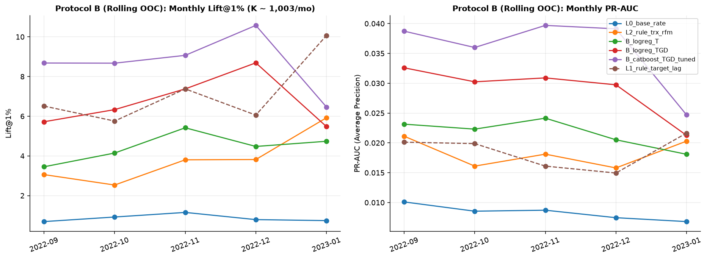
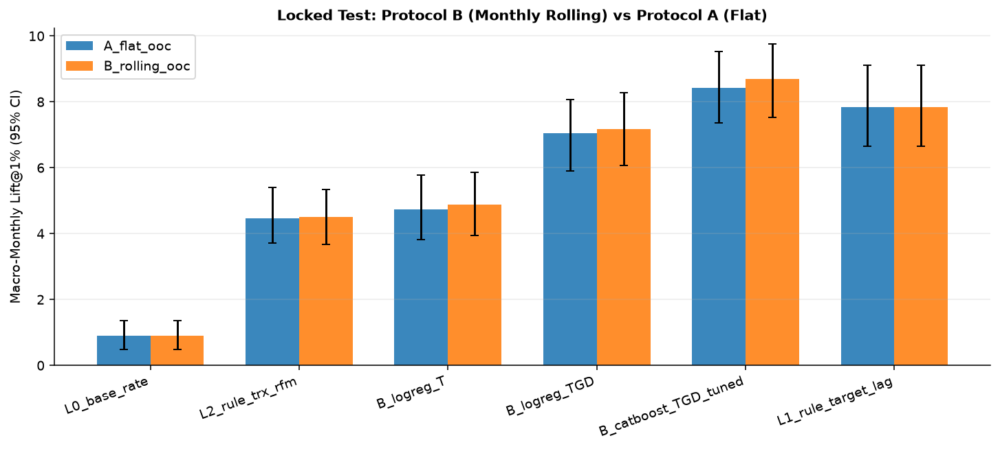

# Báo Cáo Chi Tiết Baseline v2 — Giao Thức Rolling Theo Tháng × Tách Khách (`Protocol B`)

> **Trạng thái:** Đã khóa đặc tả (`FROZEN`) & hoàn thành thực nghiệm đầy đủ (`--phase all`).
> **Spec ID:** `baseline_v2_monthly_rolling_ooc_v1` (`v2.0.0`) · **JSON SHA-256:** `5ab70bd89a07ca6e9bdd6bd078fa633e007cf7e0d6a686b3a0343b54ea73e8d4` · **MD SHA-256:** `01c68948ff35af8894cc4912819ef8267d4dacbeb763bac99a0f8cc7aec9248d`
> **Tài liệu đặc tả đóng băng:** [`configs/baseline_v2_evaluation_spec.json`](configs/baseline_v2_evaluation_spec.json) · [`docs/BASELINE_V2_FROZEN_SPEC.md`](docs/BASELINE_V2_FROZEN_SPEC.md)
> **Báo cáo đối chiếu v1 vs v2:** [`docs/BASELINE_V1_VS_V2_DIFF.md`](docs/BASELINE_V1_VS_V2_DIFF.md)
> **Di sản kế thừa:** Toàn bộ hệ thống Baseline v1 ([`BASELINE.md`](BASELINE.md), `outputs/baseline_moscow_v1/`, `outputs/fe_v1_ablation/`) được giữ nguyên vẹn, không chỉnh sửa hoặc ghi đè.

---

## Tóm Tắt Điều Hành (Executive Summary)

1. **Tách giao thức đánh giá khỏi mô hình:** `Protocol B` (**Out-of-Client 5-fold × Expanding Rolling theo tháng**) là giao thức chính vì mô phỏng sát cách chiến dịch vận hành thật — mỗi tháng huấn luyện lại trên toàn bộ lịch sử hợp lệ tính đến tháng `m-1` (`fold != k`), rồi chấm điểm tập khách hàng mới (`fold == k`, `0%` trùng `client_id`) ở tháng `m` với ngân sách gọi cố định hàng tháng **`K = ceil(1% × 100.224) = 1.003` cuộc gọi/tháng**. `Protocol A` (`Flat OOC`, fit 1 lần cho cả giai đoạn) được giữ song song làm đối chiếu.
2. **Đảo chiều kết quả giữa họ cây (CatBoost) và tuyến tính (LogReg):** Ở Baseline v1, CatBoost mặc định (`depth=6, l2_leaf_reg=3, 500 trees`) bị overfit và thua `LogReg` trên cùng 14 biến thô. Trong v2, khi tune nhẹ CatBoost **hoàn toàn trên Val** với cơ chế **temporal early stopping không rò rỉ** (cấu hình thắng: `learning_rate=0.03, depth=6, l2_leaf_reg=25.0`, `median_best_iter=432`), **`B_catboost_TGD_tuned` vượt `B_logreg_TGD` toàn diện trên Locked Test (`Protocol B`):**
   - **Macro-Monthly `Lift@1%`:** **`8.7023× ± 0.2203×`** `[7.5304; 9.7467]` vs `7.1809×` `[6.0590; 8.2769]` ($\Delta = +1.5214\times$, **`+21.19%`**, $p_{\text{Holm}} = 0.008$).
   - **Macro-Monthly `PR-AUC`:** **`0.03450 ± 0.00011`** `[0.03140; 0.03965]` vs `0.02730` `[0.02520; 0.03080]` ($\Delta = +0.00721$, **`+26.41%`**, $p_{\text{Holm}} = 0.0$).
   - **ROC-AUC & Hiệu chỉnh xác suất:** `ROC-AUC = 0.7723` vs `0.7627` ($p = 0.0$); `LogLoss = 0.04086` vs `0.04147` ($p = 0.0$); `Brier = 0.007497` vs `0.007544` ($p = 0.0$).
   - `B_catboost_TGD_tuned` trên 14 biến thô thậm chí vượt nhẹ ngay cả mốc tham chiếu `L1_rule_target_lag` ở trung bình Macro `Lift@1%` (`8.7023×` vs `7.8329×`, $p_{\text{Holm}} = 0.84$ do biến động tháng `2023-01`) và bỏ xa gấp gần đôi trên `PR-AUC` (`0.03450` vs `0.01756`, $+96.46\%$, $p_{\text{Holm}} = 0.0$).
3. **Động lực hiệu năng theo nguồn dữ liệu & đặc trưng (trên Val):**
   - **Nguồn `DIALOG` quyết định phần lớn bước nhảy vượt `TRX`:** `B_catboost` trên `T+D` (11 biến) đạt `8.8629×` / `PR-AUC 0.03786`, trong khi `T+G` (11 biến) chỉ đạt `5.6812×` / `0.02698`.
   - **Biến `trx_all_days_since_first_event` (cắt trái tại `01/2021`):** Bỏ hẳn biến này làm `Lift@1%` tụt mạnh (CatBoost: `8.9368× -> 7.5228×`; LogReg: `6.0264× -> 4.8506×`), trong khi chặn trên 12 tháng (`cap365`) giữ gần nguyên `PR-AUC` (`0.03729` vs `0.03738`) và `ROC-AUC` (`0.7707` vs `0.7705`), chỉ giảm phần `Lift@1%` cực hẹp (`8.0735×` vs `8.9368×`).
   - **Ensemble đơn giản `LogReg + CatBoost`:** Tổ hợp `30% LogReg + 70% CatBoost` không vượt được `CatBoost` thuần ở `Lift@1%` (`8.7230×` vs `8.9368×`) và `PR-AUC` (`0.03700` vs `0.03738`) trên Val, nhưng nhỉnh hơn ở `Lift@0.5%` (`11.0389×` vs `10.6116×`) và `Lift@5%` (`4.8125×` vs `4.7171×`).

---

## 1. Thiết Kế Khung Đánh Giá & Hợp Đồng Dữ Liệu

### 1.1 Nguồn dữ liệu, múi giờ & chuẩn hóa snapshot
- **Bảng đầu vào:** [`outputs/baseline_moscow_v1/panel_moscow.parquet`](outputs/baseline_moscow_v1/panel_moscow.parquet) (`1.002.240` dòng = `100.224` khách hàng duy nhất × `10` tháng modeling; `135` cột).
- **Múi giờ & Cutoff:** `Europe/Moscow (UTC+3)`. Toàn bộ biến lịch sử tháng `m` chỉ sử dụng sự kiện thỏa:
  $$\text{event\_time\_msk} = \text{event\_time\_utc} + 3\text{h} < \text{YYYY-MM-01 00:00:00 MSK}$$
- **Lịch sử tích lũy `TRX` & Burn-in:**
  - Giữ toàn bộ lịch sử `TRX` sớm từ `2021-01-01 00:00:02 MSK` (không cắt bỏ giai đoạn `2021` chưa có nhãn).
  - Burn-in tối thiểu 2 tháng (`2022-02`, `2022-03`) để cửa sổ `90d` của bảng `GEO` (bắt đầu từ `11/12/2021`) đủ phủ 90 ngày liên tục kể từ tháng modeling đầu tiên `2022-04`.
- **Không resample nhãn:** Giữ nguyên phân phối tự nhiên (`~99:1`, tỷ lệ mua dao động từ `1.0107%` tháng `2022-09` xuống `0.6735%` tháng `2023-01`) để bảo toàn xếp hạng và xác suất nền tự nhiên.

### 1.2 Giao thức chính `Protocol B` (Monthly Rolling × 5-Fold OOC) vs `Protocol A` (Flat OOC)
Trên mọi tháng đánh giá $m$ và mọi fold $k \in \{0, 1, 2, 3, 4\}$:
- **Train:** Toàn bộ các tháng $t \in [\text{2022-04}, m - 1]$ thuộc **`fold != k`** (`~80.179` khách/tháng × số tháng train).
- **Eval:** Duy nhất tháng $m$ thuộc **`fold == k`** (`~20.045` khách, **`0%` trùng `client_id`** với tập train).

| Giai đoạn | Tháng đánh giá (`m`) | `N_month` | Positives (`Prevalence`) | Số tháng train (`Protocol B`) | `Protocol A` (Flat đối chiếu) | Vai trò cổng quyết định |
|---|---|---:|---:|---|---|---|
| **Val** | `2022-09` | `100.224` | `1.013` (`1.0107%`) | `5` (`2022-04 .. 2022-08`) | `2022-04 .. 2022-08` (fit 1 lần cho `09..10`) | Chẩn đoán, tuning, ablation, PI, slice |
| **Val** | `2022-10` | `100.224` | `868` (`0.8661%`) | `6` (`2022-04 .. 2022-09`) | Fit chung với `2022-09` | Chẩn đoán, tuning, ablation, PI, slice |
| **Test** | `2022-11` | `100.224` | `867` (`0.8651%`) | `7` (`2022-04 .. 2022-10`) | `2022-04 .. 2022-10` (fit 1 lần cho `11..01`) | **Locked Test (chỉ mở 1 lần)** |
| **Test** | `2022-12` | `100.224` | `759` (`0.7573%`) | `8` (`2022-04 .. 2022-11`) | Fit chung `2022-04 .. 2022-10` | **Locked Test (chỉ mở 1 lần)** |
| **Test** | `2023-01` | `100.224` | `675` (`0.6735%`) | `9` (`2022-04 .. 2022-12`) | Fit chung `2022-04 .. 2022-10` | **Locked Test (chỉ mở 1 lần)** |

### 1.3 Cơ chế tính chỉ số & Ngân sách `K` theo tháng
- **Ngân sách gọi cố định hàng tháng:** $K = \lceil 0.01 \times 100.224 \rceil = 1.003$ cuộc gọi/tháng (cũng báo cáo phụ `0.5%` = `502` và `5%` = `5.012`).
- **Thứ tự tính bắt buộc:**
  1. Ghép 5 fold OOC trong tháng `m` để được đủ `100.224` điểm số khách hàng của tháng `m`, tính chỉ số và **95% CI** (`1.000` lần client-clustered bootstrap theo `client_id`) **trên từng tháng trước**.
  2. **Macro-Monthly Average:** Trung bình cộng đều qua các tháng trong giai đoạn (`2` tháng Val, `3` tháng Test), kèm 95% CI bootstrap cụm `client_id` giữ nguyên cơ chế cắt top-$K$ theo từng tháng.
  3. **Pooled OOF (chỉ để đối chiếu):** Gộp chung `200.448` dòng Val hoặc `300.672` dòng Test để so trực tiếp với Protocol A và Baseline v1.
- **Đa seed & Phá hòa:** `seeds = [42, 142, 242]` cho các mô hình ngẫu nhiên (`LogReg`, `CatBoost`); `tie_break_seed = 42` phá hòa tất định theo nhiễu `1e-12` tại top-$K$ cho các mốc rời rạc/hằng số (`L0`, `L1`, `L2`).

### 1.4 Thang 6 Mốc Baseline v2 & Cảnh báo `L1`
| Thứ tự | `exp_id` | Vai trò & Tiền xử lý (`src/baseline_v2/models.py`) | Số biến | Câu hỏi trả lời |
|---|---|---|---:|---|
| 1 | `L0_base_rate` | Dự báo tỷ lệ mua trung bình trên tập train tháng đó (`PrevalenceModel`) | `0` | Sàn ngẫu nhiên theo từng tháng |
| 2 | `L2_rule_trx_rfm` | Trung bình phân vị RFM thuần `TRX` trên `6` biến, không dùng nhãn (`RuleTrxRfmModel`) | `6` | Luật đơn giản có đủ chưa & snapshot có sạch không? |
| 3 | `B_logreg_T` | `SimpleImputer(median, add_indicator=True)` + `StandardScaler` + `LogisticRegression(C=1.0, lbfgs, max_iter=300)` | `8` (`raw_T_8`) | Mốc tuyến tính chỉ dữ liệu giao dịch |
| 4 | `B_logreg_TGD` | Pipeline LogReg L2 trên `14` biến thô `TRX + GEO + DIALOG` | `14` (`raw_TGD_14`) | Ngưỡng tuyến tính đa nguồn mạnh nhất cần vượt |
| 5 | `B_catboost_TGD_tuned` | `CatBoostClassifier` giữ nguyên `NaN` ngữ nghĩa trên `14` biến thô, tune nhẹ & temporal early stopping trên Val | `14` (`raw_TGD_14`) | Mốc họ cây công bằng đạt mức nào? |
| 6 | `L1_rule_target_lag` *(Tham chiếu)* | $3 \cdot \text{prior\_1m} + 2 \cdot \text{prior\_3m} + 1 \cdot \text{prior\_6m}$ (`RuleTargetLagModel`) | `3` | Đánh dấu **"dùng nhãn quá khứ"**, không làm baseline triển khai mặc định |

> [!WARNING]
> **Cảnh báo bắt buộc về độ trễ nhãn của `L1_rule_target_lag`:** Kiểm toán tính sẵn sàng nhãn tại [`docs/propensity_feasibility/remaining_questions/assessment.md`](docs/propensity_feasibility/remaining_questions/assessment.md) cho thấy dữ liệu gốc `targets` (435 shard) **không có cột timestamp công bố nhãn (`available_at`)**. Do đó `prior_1m_bought_any` giả định `label_delay = 0` (nhãn mua tháng `m-1` đã chốt xong ngay `00:00` ngày `01` tháng `m`). Nếu vận hành ngân hàng chốt nhãn trễ $\ge 1$ ngày, `L1` là mốc **"thiên đường" (upper bound)** chứ không triển khai được ở thời điểm chấm điểm đầu tháng.

---

## 2. Kết Quả Trên Tập Validation (`2022-09`, `2022-10`) — Tuning, Ablation & Chẩn Đoán

Tất cả bước chọn siêu tham số, ablation nguồn/tenure/ensemble, Permutation Importance, phân tích lát cắt và kiểm tra nhãn xáo trộn đều được khóa chặt trên Val trước khi chạy Locked Test.

### 2.1 Tuning nhẹ CatBoost trên Val (`val_catboost_tuning_grid.csv`)
Lưới `9` cấu hình chạy trên `Protocol B` Val (`seed=42`, `max_iterations=1500`, `early_stopping_rounds=100`, `border_count=128`, `loss_function=Logloss`, `eval_metric=Logloss`). Với mỗi bước `(m, fold k)`, mô hình dùng tháng `m-1` (`fold != k`) làm `eval_set` tìm `best_iteration_`, sau đó refit trên toàn bộ `2022-04..m-1` (`fold != k`) đúng `best_iteration_` cây.

| `candidate_id` | `lr` | `depth` | `l2_leaf_reg` | Median `best_iter` `[min; max]` | Val Macro `Lift@1%` `[95% CI]` | Val Macro `PR-AUC` `[95% CI]` | Val `ROC-AUC` | Val `LogLoss` | Thời gian |
|---|---:|---:|---:|---|---:|---:|---:|---:|---:|
| **`TuneCB_4_lr0.03_d6_l2_25.0`** *(Chọn)* | `0.03` | `6` | `25.0` | `432` `[362; 580]` | **`8.9368×`** `[7.7654; 10.0576]` | **`0.03738`** `[0.03410; 0.04266]` | **`0.7705`** | `0.04847` | `613.5s` |
| `TuneCB_8_lr0.05_d6_l2_25.0` | `0.05` | `6` | `25.0` | `246` `[166; 424]` | `8.7148×` `[7.5713; 9.9356]` | `0.03725` `[0.03398; 0.04277]` | `0.7697` | `0.04855` | `399.4s` |
| `TuneCB_5_lr0.05_d4_l2_10.0` | `0.05` | `4` | `10.0` | `264` `[230; 332]` | `8.6737×` `[7.5828; 9.9032]` | `0.03668` `[0.03355; 0.04180]` | `0.7700` | `0.04853` | `343.7s` |
| `TuneCB_2_lr0.03_d4_l2_10.0` | `0.03` | `4` | `10.0` | `461` `[404; 488]` | `8.6655×` `[7.5488; 9.8690]` | `0.03721` `[0.03415; 0.04264]` | `0.7701` | `0.04852` | `536.9s` |
| `TuneCB_7_lr0.05_d6_l2_10.0` | `0.05` | `6` | `10.0` | `241` `[181; 438]` | `8.5421×` `[7.4601; 9.7286]` | `0.03658` `[0.03336; 0.04144]` | `0.7700` | `0.04853` | `375.1s` |
| `TuneCB_1_lr0.03_d4_l2_3.0` | `0.03` | `4` | `3.0` | `419` `[375; 561]` | `8.5258×` `[7.4216; 9.7175]` | `0.03664` `[0.03348; 0.04164]` | `0.7701` | `0.04853` | `506.1s` |
| `TuneCB_3_lr0.03_d6_l2_10.0` | `0.03` | `6` | `10.0` | `348` `[271; 432]` | `8.4928×` `[7.4711; 9.7912]` | `0.03727` `[0.03404; 0.04264]` | `0.7703` | **`0.04847`** | `511.6s` |
| `TuneCB_9_lr0.08_d4_l2_15.0` | `0.08` | `4` | `15.0` | `178` `[140; 200]` | `8.3696×` `[7.3197; 9.5865]` | `0.03614` `[0.03316; 0.04126]` | `0.7693` | `0.04864` | `210.0s` |
| `TuneCB_6_lr0.05_d4_l2_25.0` | `0.05` | `4` | `25.0` | `272` `[254; 650]` | `8.2132×` `[7.1327; 9.4799]` | `0.03671` `[0.03359; 0.04212]` | `0.7698` | `0.04855` | `396.8s` |

> [!TIP]
> **Tại sao L2 regularization mạnh + tốc độ học nhỏ cứu CatBoost?** Ở v1, CatBoost mặc định (`depth=6, l2=3, 500 iter`, không early stopping) học thuộc nhiễu ở cây sâu và đạt `PR-AUC` Val chỉ `0.02444`. Khi tăng `l2_leaf_reg` từ `3.0` lên `25.0`, hạ `lr=0.03` và dừng theo chuỗi thời gian, `TuneCB_4` nhảy vọt lên `8.9368×` (`PR-AUC 0.03738`, `ROC-AUC 0.7705`), còn chạy đa 3 seed Val (`42, 142, 242`) cho trung bình **`8.6764× ± 0.2513×`** / **`PR-AUC 0.03736 ± 0.00002`**.

### 2.2 Hiệu năng 6 mốc chính trên Val (`Protocol B`, 3 seeds cho mô hình ML)
- **Từng tháng Val (`monthly_metrics_all.csv`):**
  - `2022-09` (`1.013` pos, `1.0107%`): `L0 = 0.6905×` / `0.01010`; `L2 = 3.0579×` / `0.02112`; `B_logreg_T = 3.4525×` / `0.02314`; `B_logreg_TGD = 5.7212×` / `0.03259`; **`B_catboost_TGD_tuned = 8.6805× ± 0.0986×`** `[7.0824; 10.1738]` / **`0.03873 ± 0.00020`** (`ROC-AUC 0.7637`, `Prec@1% 8.774%`); `L1` *(ref)* `= 6.5104×` / `0.02012`.
  - `2022-10` (`868` pos, `0.8661%`): `L0 = 0.9210×` / `0.00855`; `L2 = 2.5326×` / `0.01611`; `B_logreg_T = 4.1443×` / `0.02231`; `B_logreg_TGD = 6.3316×` / `0.03024`; **`B_catboost_TGD_tuned = 8.6724× ± 0.4043×`** `[7.0685; 10.3609]` / **`0.03599 ± 0.00023`** (`ROC-AUC 0.7780`, `Prec@1% 7.511%`); `L1` *(ref)* `= 5.7560×` / `0.01988`.
- **Macro-Monthly Val (`macro_monthly_summary.csv`):** `B_catboost_TGD_tuned` (`8.6764×`, `PR-AUC 0.03736`) vượt `B_logreg_TGD` (`6.0264×`, `0.03141`) với $\Delta\text{Lift@1\%} = +2.6500\times$ (`+43.97%`, $p_{\text{Holm}}=0.0$) và $\Delta\text{PR-AUC} = +0.00595$ (`+18.93%`, $p_{\text{Holm}}=0.0$).

### 2.3 Val-Only Ablations: Tách nguồn (`T+G` / `T+D`), Tenure & Blend (`val_ablation_macro.csv`, seed=42)

| Nhóm ablation | `exp_id` | Số biến | Val Macro `Lift@1%` `[95% CI]` | Val Macro `PR-AUC` `[95% CI]` | `ROC-AUC` | `Lift@0.5%` | `Lift@5%` | `LogLoss` |
|---|---|---:|---:|---:|---:|---:|---:|---:|
| Đối chiếu chính | `B_logreg_T` | `8` | `3.7984×` `[2.9747; 4.7539]` | `0.02272` `[0.02088; 0.02550]` | `0.7257` | `5.2731×` | `3.0602×` | `0.05022` |
| Đối chiếu chính | `B_logreg_TGD` | `14` | `6.0264×` `[5.0410; 7.0777]` | `0.03141` `[0.02891; 0.03558]` | `0.7631` | `7.1621×` | `4.4670×` | `0.04910` |
| Đối chiếu chính | `B_catboost_TGD_tuned` | `14` | **`8.9368×`** `[7.7654; 10.0576]` | `0.03738` `[0.03410; 0.04266]` | `0.7705` | `10.6116×` | `4.7171×` | `0.04847` |
| Tách nguồn | `Abl_logreg_TG` (`T+G`) | `11` | `4.1848×` `[3.2446; 5.1074]` | `0.02306` `[0.02120; 0.02598]` | `0.7273` | `5.3881×` | `3.0290×` | `0.05016` |
| Tách nguồn | `Abl_logreg_TD` (`T+D`) | `11` | `6.0182×` `[4.9930; 7.0676]` | `0.03115` `[0.02873; 0.03507]` | `0.7624` | `6.6365×` | `4.3946×` | `0.04914` |
| Tách nguồn | `Abl_catboost_TG` (`T+G`) | `11` | `5.6812×` `[4.6707; 6.8241]` | `0.02698` `[0.02414; 0.03114]` | `0.7311` | `6.5215×` | `3.6114×` | `0.04995` |
| Tách nguồn | `Abl_catboost_TD` (`T+D`) | `11` | `8.8629×` `[7.6731; 9.9827]` | **`0.03786`** `[0.03453; 0.04321]` | `0.7700` | `10.7266×` | **`4.8964×`** | **`0.04847`** |
| Xử lý Tenure | `Abl_logreg_TGD_no_tenure` | `13` | `4.8506×` `[3.9276; 5.8439]` | `0.02831` `[0.02630; 0.03138]` | `0.7559` | `4.7802×` | `4.1297×` | `0.04976` |
| Xử lý Tenure | `Abl_logreg_TGD_cap365` | `14` | `5.4755×` `[4.5634; 6.5410]` | `0.03104` `[0.02861; 0.03520]` | `0.7648` | `6.4888×` | `4.3797×` | `0.04943` |
| Xử lý Tenure | `Abl_catboost_TGD_no_tenure` | `13` | `7.5228×` `[6.5059; 8.8652]` | `0.03539` `[0.03235; 0.04028]` | `0.7623` | `9.7083×` | `4.8190×` | `0.04918` |
| Xử lý Tenure | `Abl_catboost_TGD_cap365` | `14` | `8.0735×` `[7.0543; 9.3494]` | `0.03729` `[0.03407; 0.04225]` | `0.7707` | `9.9874×` | `4.8947×` | `0.04881` |
| Blend tuyến tính + cây | `Abl_blend_prob_30_70` | `14` | `8.7230×` `[7.6411; 9.9548]` | `0.03700` `[0.03371; 0.04249]` | **`0.7708`** | **`11.0389×`** | `4.8125×` | `0.04850` |
| Blend tuyến tính + cây | `Abl_blend_prob_50_50` | `14` | `8.2626×` `[7.0977; 9.4213]` | `0.03604` `[0.03297; 0.04119]` | `0.7700` | `9.7576×` | `4.6512×` | `0.04859` |
| Blend tuyến tính + cây | `Abl_blend_logit_50_50` | `14` | `8.2626×` `[7.0744; 9.4560]` | `0.03625` `[0.03308; 0.04165]` | `0.7700` | `9.7576×` | `4.6644×` | `0.04856` |
| Blend tuyến tính + cây | `Abl_blend_rank_50_50` | `14` | `7.6953×` `[6.5923; 8.8269]` | `0.03574` `[0.03263; 0.04109]` | `0.7700` | `8.6734×` | `4.6825×` | `0.96302` *(uncalibrated)* |
| Blend tuyến tính + cây | `Abl_blend_prob_70_30` | `14` | `7.6460×` `[6.4781; 8.7488]` | `0.03440` `[0.03151; 0.03926]` | `0.7682` | `8.7720×` | `4.6957×` | `0.04874` |

**Nhận xét chính từ Val Ablations:**
1. **`DIALOG` là động lực tăng trưởng áp đảo; `GEO` thô đóng góp nhỏ:** Thêm `GEO` thô vào `TRX` tăng nhẹ ở LogReg (`+0.39×` Lift, `+0.00034` PR-AUC) và đáng kể hơn ở CatBoost phi tuyến (`+0.00426` PR-AUC so với `B_logreg_T`, nhưng vẫn thấp hơn `T+D` rất xa). Thêm `DIALOG` vào `TRX` tái tạo `~99%` sức mạnh của cả bộ `14` biến (`T+D` CatBoost đạt `0.03786` PR-AUC và `8.8629×` Lift@1%).
2. **Đánh giá biến `trx_all_days_since_first_event`:** Dù biến này bị cắt trái tại `01/2021` và tăng đơn điệu theo lịch, nó mang thông tin phân biệt thật (tuổi quan hệ giao dịch với ngân hàng). Chặn trên tại `365` ngày (`cap365`) giữ gần như nguyên vẹn `PR-AUC` (`0.03729` vs `0.03738`) và thậm chí nhích nhẹ `ROC-AUC` (`0.7707` vs `0.7705`), song làm giảm phần phân tầng tinh ở đỉnh `1%` (`8.0735×` vs `8.9368×`) — cho thấy nhóm khách có thâm niên `> 12` tháng từ `01/2021` thực sự có tỷ lệ chuyển đổi khác biệt ở top `1%`.
3. **Ensemble `LogReg + CatBoost`:** Không giống v1 (khi cây chưa tune yếu hơn LogReg ở AUC/PR-AUC), trong v2 **`B_catboost_TGD_tuned` thắng `B_logreg_TGD` trên tất cả chỉ số**. Do đó trộn `LogReg + CatBoost` (`30/70`) không vượt CatBoost ở chỉ số chính (`Lift@1%` / `PR-AUC`), nhưng vẫn đáng lưu tâm cho các vòng sau vì cải thiện `Lift@0.5%` (`11.0389×`), `Lift@5%` (`4.8125×`) và `Brier` (`0.009175` vs `0.009176`).

### 2.4 Chẩn đoán Val: Permutation Importance, Phân tích Lát cắt & Shuffled-Label Sanity
- **Permutation Importance (5 repeats trên Val, [`val_permutation_importance.csv`](outputs/baseline_v2/metrics/val_permutation_importance.csv)):**
  - Top 6 biến của **`B_catboost_TGD_tuned`** (theo `pr_auc_drop_mean` | `lift_1pct_drop_mean`):
    1. `trx_all_days_since_first_event` (`TRX`): `0.01415` | `4.923×`
    2. `dialog_90d_has_event` (`DIALOG`): `0.01288` | `4.979×`
    3. `dialog_90d_days_since_last_event` (`DIALOG`): `0.01059` | `3.241×`
    4. `trx_30d_log1p_event_count` (`TRX`): `0.00703` | `1.238×`
    5. `trx_90d_log1p_event_count` (`TRX`): `0.00521` | `2.054×`
    6. `dialog_90d_event_count` (`DIALOG`): `0.00359` | `1.186×`
  - Ngược lại, cả 3 biến `geo_90d_*` đều gần `0` (`pr_auc_drop` từ `-0.00003` đến `+0.00008`, `lift_drop` `0.02–0.09×`).
  - Với **`B_logreg_TGD`**, 3 biến quan trọng nhất theo `pr_auc_drop` là `trx_30d_log1p_event_count` (`0.00998`), `trx_all_days_since_first_event` (`0.00963`) và `dialog_90d_days_since_last_event` (`0.00695`).
- **Phân tích Lát cắt (Pooled Val `N=200.448`, [`val_slice_metrics.csv`](outputs/baseline_v2/metrics/val_slice_metrics.csv)):**
  - Khách **không có `TRX` trong 90d** (`trx_90d_has_event = 0`, `29.289` dòng, `209` pos, `0.7136%`): `L2_rule_trx_rfm` đạt `0.00714` AP / `1.43×` Lift (gần như bất lực), trong khi `B_catboost_TGD_tuned` đạt **`0.05919` AP / `19.61×` Lift@1%** (`ROC 0.8179`) và `B_logreg_TGD` đạt `0.05754` AP / `17.70×` (`ROC 0.8222`) nhờ tín hiệu `DIALOG` và lịch sử `TRX` dài hạn.
  - Khách **có `DIALOG` trong 90d** (`dialog_90d_has_event = 1`, `35.118` dòng, `822` pos, `2.3407%` — cao gấp `3.65×` nhóm không có dialog `0.6405%`): `B_catboost_TGD_tuned` đạt `0.05604` AP (`ROC 0.6949`, `4.25×` nội lát cắt), bỏ xa `B_logreg_TGD` (`0.04545` AP) và `L1` (`0.03522` AP).
  - Khách **Cold-start (`cold_start = 1`, `3.456` dòng, `49` pos, `1.4178%`)**: vẫn là điểm yếu chung của cả hệ — `B_catboost_TGD_tuned` chỉ đạt `0.01479` AP (`ROC 0.5204`, `1/35` hits, `2.02×` nội lát cắt), trong khi `B_logreg_TGD` đạt `0.01967` AP (`ROC 0.5625`, `2/35` hits, `4.03×`).
- **Shuffled-Label Sanity Check ([`val_shuffled_sanity.csv`](outputs/baseline_v2/metrics/val_shuffled_sanity.csv)):**
  - *Lưu ý triển khai trong [`src/baseline_v2/diagnostics.py`](src/baseline_v2/diagnostics.py):* Hàm `run_val_shuffled_sanity` xáo trộn `y_train` (`shuffle_labels=True`, `1` lần lặp mỗi tháng) nhưng giữ `y_eval` thật để kiểm tra độ chênh `|PR-AUC - prevalence| <= 0.005`.
  - Kết quả: `B_catboost_TGD_tuned` đạt chuẩn ở cả 2 tháng (`2022-09`: `0.01175` vs prev `0.01011`, gap `0.00165`, `passed=True`; `2022-10`: `0.01029` vs prev `0.00866`, gap `0.00163`, `passed=True`). `B_logreg_TGD` đạt chuẩn ở `2022-09` (`0.00937`, gap `0.00073`, `passed=True`) và vượt nhẹ ngưỡng `0.005` ở `2022-10` (`0.01430` vs `0.00866`, gap `0.00564`, `passed=False`). Nguyên nhân là khi chỉ xáo trộn `y_train` 1 lần trên không gian tuyến tính `28` chiều (14 biến + 14 missing indicator) mà giữ nguyên `y_eval` thật, một vector hệ số ngẫu nhiên vẫn có xác suất nhỏ trùng hướng với một số tổ hợp tuyến tính thực (khác với v1 chạy `10` lần lặp cả `shuffle_y_train` lẫn `shuffle_y_eval`).

---

## 3. Kết Quả Locked Test (`2022-11`, `2022-12`, `2023-01`) — Chỉ Mở Một Lần

### 3.1 Kết quả từng tháng dưới giao thức chính `Protocol B` (`K = 1.003` cuộc gọi/tháng)



| Tháng (`N=100.224`) | `exp_id` | Seeds | `Lift@1%` (`± SD`) | `95% CI Lift@1%` | `PR-AUC` (`± SD`) | `95% CI PR-AUC` | `ROC-AUC` | `Prec@1%` | `Lift@5%` | `LogLoss` |
|---|---|---:|---:|---|---:|---|---:|---:|---:|---:|
| **`2022-11`** (`867` pos, `0.8651%`) | `L0_base_rate` | `1` | `1.1525×` | `[0.4642; 1.8863]` | `0.00871` | `[0.00806; 0.00944]` | `0.5042` | `0.997%` | `0.9687×` | `0.05005` |
| | `L2_rule_trx_rfm` | `1` | `3.8033×` | `[2.6021; 5.0712]` | `0.01811` | `[0.01590; 0.02168]` | `0.6480` | `3.290%` | `2.9522×` | — |
| | `B_logreg_T` | `3` | `5.4169×` | `[4.0443; 6.9398]` | `0.02414` | `[0.02137; 0.02809]` | `0.7493` | `4.686%` | `3.4597×` | `0.04634` |
| | `B_logreg_TGD` | `3` | `7.3762×` | `[5.6160; 9.0618]` | `0.03089` | `[0.02716; 0.03602]` | `0.7736` | `6.381%` | `4.5437×` | `0.04553` |
| | **`B_catboost_TGD_tuned`** | `3` | **`9.0666×`** `± 0.1761×` | `[7.2699; 11.0380]` | **`0.03969`** `± 0.00042` | `[0.03345; 0.04864]` | **`0.7765`** | **`7.843%`** | **`5.0895×`** | **`0.04497`** |
| | `L1_rule_target_lag` *(ref)* | `1` | `7.3762×` | `[5.6579; 9.0848]` | `0.01610` | `[0.01374; 0.02003]` | `0.5705` | `6.381%` | `3.5519×` | — |
| **`2022-12`** (`759` pos, `0.7573%`) | `L0_base_rate` | `1` | `0.7899×` | `[0.2555; 1.4938]` | `0.00746` | `[0.00681; 0.00813]` | `0.4908` | `0.598%` | `0.8958×` | `0.04513` |
| | `L2_rule_trx_rfm` | `1` | `3.8179×` | `[2.5790; 5.3058]` | `0.01580` | `[0.01383; 0.01874]` | `0.6404` | `2.891%` | `3.3196×` | — |
| | `B_logreg_T` | `3` | `4.4762×` | `[3.0723; 6.0007]` | `0.02052` | `[0.01800; 0.02398]` | `0.7291` | `3.390%` | `3.5041×` | `0.04213` |
| | `B_logreg_TGD` | `3` | `8.6891×` | `[6.6527; 10.8962]` | `0.02973` | `[0.02519; 0.03666]` | `0.7599` | `6.580%` | `4.7950×` | `0.04111` |
| | **`B_catboost_TGD_tuned`** | `3` | **`10.5761×`** `± 0.3800×` | `[8.4869; 12.6589]` | **`0.03912`** `± 0.00076` | `[0.03247; 0.05019]` | **`0.7704`** | **`8.009%`** | **`5.5766×`** | **`0.04046`** |
| | `L1_rule_target_lag` *(ref)* | `1` | `6.0560×` | `[4.5537; 7.9415]` | `0.01495` | `[0.01242; 0.01914]` | `0.5822` | `4.586%` | `4.0837×` | — |
| **`2023-01`** (`675` pos, `0.6735%`) | `L0_base_rate` | `1` | `0.7402×` | `[0.1489; 1.4399]` | `0.00680` | `[0.00617; 0.00750]` | `0.5047` | `0.499%` | `0.7999×` | `0.04121` |
| | `L2_rule_trx_rfm` | `1` | `5.9214×` | `[4.1893; 7.5588]` | `0.02029` | `[0.01712; 0.02550]` | `0.7303` | `3.988%` | `4.0290×` | — |
| | `B_logreg_T` | `3` | `4.7371×` | `[3.1650; 6.4094]` | `0.01809` | `[0.01558; 0.02215]` | `0.7379` | `3.190%` | `3.4069×` | `0.03806` |
| | `B_logreg_TGD` | `3` | `5.4773×` | `[3.8150; 7.0946]` | `0.02126` | `[0.01816; 0.02625]` | `0.7546` | `3.689%` | `4.3549×` | `0.03776` |
| | **`B_catboost_TGD_tuned`** | `3` | `6.4642×` `± 0.3725×` | `[4.5750; 8.0548]` | **`0.02469`** `± 0.00012` | `[0.02109; 0.02992]` | **`0.7701`** | `4.354%` | **`4.7499×`** | **`0.03715`** |
| | `L1_rule_target_lag` *(ref)* | `1` | **`10.0664×`** | `[7.8043; 12.3817]` | `0.02164` | `[0.01739; 0.02806]` | `0.6284` | **`6.780%`** | **`6.0435×`** | — |

### 3.2 Tổng hợp Test: Macro-Monthly & Pooled OOF (`Protocol B` vs `Protocol A`)



**Bảng A — Test Macro-Monthly (`n_months=3`, ngân sách `K=1.003` từng tháng, [`macro_monthly_summary.csv`](outputs/baseline_v2/metrics/macro_monthly_summary.csv)):**

| Giao thức | `exp_id` | `Lift@1%` (`± SD`) | `95% CI Lift@1%` | `PR-AUC` (`± SD`) | `95% CI PR-AUC` | `ROC-AUC` | `Recall@5%` | `LogLoss` | `Brier` |
|---|---|---:|---|---:|---|---:|---:|---:|---:|
| **`B_rolling_ooc`** | `L0_base_rate` | `0.8942×` | `[0.4771; 1.3563]` | `0.00766` | `[0.00725; 0.00810]` | `0.4999` | `4.44%` | `0.04546` | `0.007605` |
| **`B_rolling_ooc`** | `L2_rule_trx_rfm` | `4.5142×` | `[3.6650; 5.3492]` | `0.01807` | `[0.01669; 0.02058]` | `0.6729` | `17.17%` | — | — |
| **`B_rolling_ooc`** | `B_logreg_T` | `4.8767×` | `[3.9343; 5.8660]` | `0.02092` | `[0.01941; 0.02352]` | `0.7388` | `17.29%` | `0.04218` | `0.007554` |
| **`B_rolling_ooc`** | `B_logreg_TGD` | `7.1809×` | `[6.0590; 8.2769]` | `0.02730` | `[0.02520; 0.03080]` | `0.7627` | `22.83%` | `0.04147` | `0.007544` |
| **`B_rolling_ooc`** | **`B_catboost_TGD_tuned`** | **`8.7023×`** `± 0.2203×` | `[7.5304; 9.7467]` | **`0.03450`** `± 0.00011` | `[0.03140; 0.03965]` | **`0.7723`** | **`25.70%`** | **`0.04086`** | **`0.007497`** |
| **`B_rolling_ooc`** | `L1_rule_target_lag` *(ref)* | `7.8329×` | `[6.6440; 9.1162]` | `0.01756` | `[0.01541; 0.02070]` | `0.5937` | `22.80%` | — | — |
| `A_flat_ooc` | `B_logreg_T` | `4.7342×` | `[3.8250; 5.7772]` | `0.02079` | `[0.01930; 0.02336]` | `0.7379` | `16.85%` | `0.04221` | `0.007556` |
| `A_flat_ooc` | `B_logreg_TGD` | `7.0492×` | `[5.8937; 8.0603]` | `0.02731` | `[0.02518; 0.03075]` | `0.7625` | `22.87%` | `0.04150` | `0.007548` |
| `A_flat_ooc` | `B_catboost_TGD_tuned` | `8.4171×` `± 0.1018×` | `[7.3510; 9.5358]` | `0.03464` `± 0.00021` | `[0.03138; 0.03980]` | `0.7722` | `25.60%` | `0.04094` | `0.007498` |

**Bảng B — Test Pooled OOF đối chiếu (`300.672` dòng, `2.301` positives, [`pooled_oof_summary.csv`](outputs/baseline_v2/metrics/pooled_oof_summary.csv)):**
- `B_rolling_ooc`: `B_catboost_TGD_tuned` đạt **`Lift@1% = 8.8939× ± 0.1756×`** `[7.7467; 9.9995]`, **`PR-AUC = 0.03442 ± 0.00008`** `[0.03102; 0.03896]`, **`ROC-AUC = 0.7734`**; `B_logreg_TGD` đạt `7.3874×` / `0.02708` / `0.7641`; `L0` đạt `ROC-AUC = 0.5280` (lớn hơn `0.50` vì `p_train` giảm đơn điệu theo tháng trùng với xu hướng giảm base rate của Test `11 -> 12 -> 01`, một lý do thực chứng cho thấy đánh giá **từng tháng trước** sạch hơn Pooled OOF).
- `A_flat_ooc`: `B_catboost_TGD_tuned` đạt `8.8649× ± 0.0869×` / `0.03452` / `0.7728`; `B_logreg_TGD` đạt `7.1267×` / `0.02700` / `0.7640` (khớp chính xác Baseline v1).

### 3.3 Kiểm định ghép cặp Client-Clustered Bootstrap & Holm-Bonferroni (`Protocol B` Test)
Trích từ [`paired_models_protocol_b.csv`](outputs/baseline_v2/metrics/paired_models_protocol_b.csv) (`1.000` replicates, hiệu chỉnh Holm cho `6` cặp chính mỗi stage):

| Cặp so sánh (`model_b - model_a`) | $\Delta\text{Lift@1\%}$ `[95% CI]` | $p_{\text{Holm}}$ Lift | $\Delta\text{PR-AUC}$ (`%`) | $p_{\text{Holm}}$ PR-AUC | $\Delta\text{ROC-AUC}$ ($p$) | Kết luận |
|---|---|---:|---:|---:|---:|---|
| `L2_rule_trx_rfm - L0_base_rate` | `+3.6200×` `[+2.6974; +4.5038]` | `0.000` | `+0.01041` (`+135.9%`) | `0.000` | `+0.1729` (`0.0`) | Luật RFM thuần TRX vượt sàn ngẫu nhiên rõ rệt |
| `B_logreg_T - L2_rule_trx_rfm` | `+0.3625×` `[-0.6843; +1.5303]` | `0.840` | `+0.00285` (`+15.8%`) | `0.012` | `+0.0659` (`0.0`) | Hồi quy 8 biến vượt luật RFM về tổng thể ranking (`PR-AUC`, `ROC-AUC`), nhưng ở `1%` hẹp chưa có ý nghĩa thống kê |
| `B_logreg_TGD - B_logreg_T` | `+2.3041×` `[+1.1811; +3.3593]` | `0.000` | `+0.00638` (`+30.5%`) | `0.000` | `+0.0239` (`0.0`) | Bổ sung `GEO+DIALOG` thô mang lại bước nhảy cực lớn |
| **`B_catboost_TGD_tuned - B_logreg_TGD`** | **`+1.5214×`** `[+0.5435; +2.4724]` | **`0.008`** | **`+0.00721`** (`+26.4%`) | **`0.000`** | **`+0.0096`** (`0.0`) | **Họ cây tune nhẹ + early stopping vượt tuyến tính có ý nghĩa thống kê trên mọi chỉ số** |
| `B_logreg_TGD - L1_rule_target_lag` | `-0.6520×` `[-2.1807; +0.7883]` | `0.840` | `+0.00973` (`+55.4%`) | `0.000` | `+0.1690` (`0.0`) | LogReg thua nhẹ top `1%` trước `L1` (vì tháng `01/2023`) nhưng thắng áp đảo trên toàn đường cong |
| `B_catboost_TGD_tuned - L1_rule_target_lag` | `+0.8694×` `[-0.6963; +2.3429]` | `0.840` | `+0.01694` (`+96.5%`) | `0.000` | `+0.1786` (`0.0`) | CatBoost vượt gần gấp đôi `L1` về `PR-AUC`, nhỉnh hơn ở `Lift@1%` (chưa đạt Holm do đỉnh `L1` tháng `01/2023`) |

---

## 4. Hạn Chế, Tính Di Động Colab & Tái Lập Thực Nghiệm

### 4.1 Hạn chế đã ghi nhận
1. **Biến động tháng `2023-01` sau Tết Dương lịch:** Tỷ lệ mua giảm còn `0.6735%` (`675` pos). Trên tháng này, `L1_rule_target_lag` tăng vọt lên `10.0664×` (khách mới vừa mua trong mùa cao điểm Q4/2022 mua lặp lại vào tháng `1`), trong khi các mô hình thuần hành vi giảm về `5.48×` (`LogReg`) và `6.46×` (`CatBoost`). Cải tiến FE vòng 2 cần khai thác tốt hơn tín hiệu mùa vụ/lịch hoặc đặc trưng chuyển tiếp qua Tết, đồng thời kiểm tra SLA nhãn `m-1`.
2. **Nhóm `cold_start = 1` & tính năng `GEO` thô:** Với khách chưa từng có `TRX/GEO/DIALOG` dài hạn (`3.456` dòng trên Val), CatBoost chỉ đạt `0.01479` AP (`ROC 0.5204`), ngang ngưỡng ngẫu nhiên. Ngoài ra, 3 biến `GEO` thô gần như bằng 0 trong Permutation Importance — cần chuyển sang feature engineering không gian (`geohash` / độ ổn định vùng / kết hợp kênh) ở các vòng FE tiếp theo.
3. **Suy giảm hiệu năng khi huấn luyện trên CPU local cũ:** Chạy đầy đủ `--phase all` trên máy local (`Intel Core i3-8145U, 2 cores / 4 logical, 7.9 GB RAM`) mất **`21.884,16s` (~6.08 giờ)** và CatBoost ở bước `A_flat_ooc` Test chạm nhẹ giới hạn bộ nhớ `2GiB` (`2.03–2.10 GiB`, cảnh báo không lỗi). Trong [`val_shuffled_sanity.csv`](outputs/baseline_v2/metrics/val_shuffled_sanity.csv), kiểm tra chỉ xáo trộn `y_train` 1 lần khiến `B_logreg_TGD` tháng `2022-10` có gap `0.00564` (hơi quá ngưỡng `0.005`), khuyến nghị tăng lặp kiểm tra hoặc thêm nhánh xáo trộn `y_eval` nếu audit lại sanity check.

### 4.2 Tái lập thực nghiệm
- **Kiểm thử đơn vị & E2E giả lập (5 tests):**
  ```powershell
  .\.venv\Scripts\python.exe -B -X utf8 -m unittest tests/test_baseline_v2.py -v
  ```
- **Chạy đầy đủ trên máy local (`configs/baseline_v2_evaluation_spec.json`):**
  ```powershell
  .\.venv\Scripts\python.exe -B -X utf8 src\scripts\run_baseline_v2.py --phase all --threads 4
  ```
- **Chạy trên Google Colab (T4 GPU / High-RAM CPU):** Mở [`notebooks/11_baseline_v2_colab.ipynb`](notebooks/11_baseline_v2_colab.ipynb), trỏ `PANEL_PATH` tới `panel_moscow.parquet` trên Google Drive hoặc upload trực tiếp.
- **Thư mục đầu ra đầy đủ:** [`outputs/baseline_v2/`](outputs/baseline_v2/) (`metrics/*.csv`, `figures/*.png`, `v2_manifest.json`, `tuned_catboost_config.json`, `BASELINE_V2_REPORT.md`).
