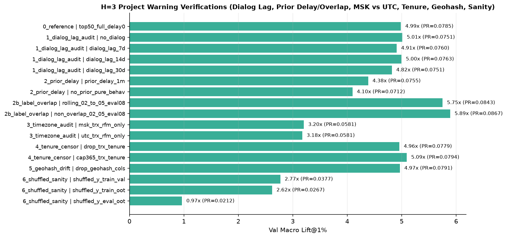

# Trình Bày Dự Án: Mô Hình Dự Đoán Xu Hướng Mua Hàng (Propensity H=3, Rolling Snapshot = 1)

> **Tóm tắt điều hành:** Tái thiết kế hoàn chỉnh bài toán ngân hàng sang **Horizon = 3 tháng**, cửa sổ trượt **Snapshot = 1 tháng**, **khóa tuyệt đối tập OOT Test `2022-11`** (cách ly embargo 2 tháng `09–10`), kiểm chứng thành công **6/6 cảnh báo kỹ thuật**, xây dựng **123 biến mới từ EDA** → chọn lọc **150 biến trên Validation**, chốt Final Model **`M5_final_blend_150`** đạt **`ROC-AUC = 0.7756`**, **`Lift@0.5% = 9.62x`**, **`Lift@5% = 5.01x`** (`Recall@5% = 25.1%`), và giữ **`B5_catboost_gpu_top50`** làm challenger siêu gọn cho chiến dịch Top-1% (`Lift@1% = 8.31x`, `PR-AUC = 0.0884`).

---

## Slide 0 (Bổ sung): Thiết Kế Bài Toán H=3 & Cơ Chế Chống Rò Rỉ OOT

- **Đơn vị dự đoán:** `100.224` khách hàng × snapshot đầu mỗi tháng (giờ Moscow `UTC+3`, lọc cứng `event_time_msk < YYYY-MM-01 00:00:00`).
- **Mục tiêu `H=3`:** $y_{h3}(s) = \max(y_{\text{any}}[s], y_{\text{any}}[s+1], y_{\text{any}}[s+2])$ (tỷ lệ dương ~2.95% trên Val, 2.17% trên OOT).
- **Lịch đánh giá 5-Fold OOC × Rolling Snapshot (0% rò rỉ tương lai):**
  - **Validation (`4` bước trượt):** `2022-05 ← [02]`, `2022-06 ← [02..03]`, `2022-07 ← [02..04]`, `2022-08 ← [02..05]` — 100% nhãn đóng trước `2022-11-01`.
  - **Embargo (Cách ly cứng):** `2022-09`, `2022-10` **không bao giờ** vào train/val vì nhãn H=3 của chúng chạm `2022-11..12`.
  - **Locked OOT Test:** `2022-11` (phủ `2022-11..2023-01`) ← train trên `[02..08]` (nhãn đóng hoàn toàn `2022-10-31`).
- **Kiểm chứng chống leak tự động:** `4/4` unit test PASS (`tests/test_h3_leakage_guards.py`) + **Shuffled-label sanity check** đạt `ROC-AUC = 0.493–0.514` và `shuffled_y_eval_oot Lift@1% = 0.97x` (0% leak).

---

## Mục 1: Những Nhận Định Có Được Sau EDA (Có Đóng Góp Trực Tiếp Vào Feature)

Quét toàn bộ **38.76M TRX**, **66.30M GEO**, **217K DIALOG** (`0` orphan, `0` null khóa/thời gian, `15/15` kiểm tra đối soát đạt):

| # | Phát hiện cốt lõi từ EDA | Bằng chứng định lượng | Đóng góp trực tiếp vào Feature |
| :-: | :--- | :--- | :--- |
| **1** | **DIALOG gần cutoff là tín hiệu mạnh nhất** | Có DIALOG tháng trước: tỷ lệ mua **`4.22%`** (**lift `3.71×`** so với nền `1.14%`), chỉ chiếm `5.75%` mẫu nhưng chứa **`21.33%`** tổng người mua; ổn định qua cả 10/10 tháng. | Tạo `dialog_prev_cal_month_has_event`, `dialog_7d/14d_event_count`, suy giảm mũ `dialog_recency_exp_14d/45d`, nhịp `inter_gap`, và **PCA + drift + std** trên embedding DIALOG. |
| **2** | **Tương tác cực nóng: `0-TRX × DIALOG gần`** | Khách không giao dịch nhưng có DIALOG gần mua tới **`9.41%`** (so với `1.12%` khi không DIALOG; trên Val H=3 lên tới **`11.66%`**). | Tạo trực tiếp biến tương tác `zero_trx_90d_x_dialog_30d`, `zero_trx_all_x_dialog_30d`, `zero_trx_all_x_dialog_prev_mo`, `source_bitmask_30d/90d`. |
| **3** | **TRX có quan hệ hình chữ U (phi đơn điệu)** | Tỷ lệ mua theo số giao dịch `0 / 1–9 / 10–99 / ≥100` là **`1.41% / 0.76% / 0.59% / 1.48%`**. Không có log ≠ không mua! | Giữ nguyên tập không log (LEFT JOIN, không gán recency thiếu = 0), tạo 4 cờ chế độ `trx_regime_0`, `1_9`, `10_99`, `100p` và không ép ràng buộc đơn điệu. |
| **4** | **Đuôi `amount` cực dài theo từng `currency`** | Riêng `currency=11` (38.72M dòng) có median `18.025`, p99 `5.26M`, max **`1.37 nghìn tỷ`**. Mean thô bị méo nặng. | Tách riêng nội tệ/ngoại tệ (`trx_all_foreign_fraction`), dùng `median`, `signed_log_mean`, và độ lệch đuôi an toàn `trx_log_max_minus_med`. |
| **5** | **Độ phủ đa nguồn & lệch tuổi quan sát** | Có đủ 3 nguồn mua **`1.98%`** vs 1 nguồn `0.64%`. Nhưng 3 nguồn bắt đầu lệch nhau: `TRX 01/2021`, `DIALOG 02/2021`, **`GEO 12/2021`**. | Tạo `obs_age_days_trx/geo/dlg`, chuẩn hóa `trx_tenure_frac_of_obs`, chặn left-censoring `cap365`, và dùng **Entropy / Novelty GEO** thay vì chỉ đếm thô. |
| **6** | **DIALOG có giá trị độc lập với lịch sử mua** | Ngay ở nhóm **chưa từng mua trước đó**, có DIALOG gần vẫn mua **`3.87%`** vs `0.83%`. | Kết hợp `prior_*` tỷ lệ hóa (`prior_buy_rate_per_obs_mo`) cùng tương tác `no_prior_buy_x_dialog_30d` & `dialog_recency_x_prior_recency`. |

---

## Mục 2: Baseline Là Những Gì? Tác Dụng, Biến & Kết Quả Lần Lượt

### Tập biến chung cho cả 5 Baseline (`50` biến tinh gọn có `prior_*`)
Gồm **13 biến `prior_*`** (lịch sử mua đóng `< cutoff`), **9 biến DIALOG** (`30d/90d/all` count & recency), **20 biến TRX** (RFM, `log1p`, median/max, `event_type/subtype`, ngoại tệ), **7 biến GEO** (`geohash_4/6`, recency, count) và **1 cờ `cold_start`**.

### Tác dụng lần lượt & Kết quả đo được (Val `05..08` → Locked OOT `2022-11`)

| # | Baseline | Tác dụng trong thang đo | Val `PR-AUC` | Val `Lift@1%` | **OOT `PR-AUC`** | **OOT `Lift@1%`** | **OOT `ROC-AUC`** |
| :-: | :--- | :--- | :---: | :---: | :---: | :---: | :---: |
| **B1** | **`B1_rule_prior_rfm`** *(Luật heuristic)* | Mốc sàn phi-ML: kiểm tra xem ML có thực sự thắng quy tắc nghiệp vụ `Prior + Dialog + TRX` không. | `0.06794` | `4.53x` | `0.06197` | `5.61x` | `0.7002` |
| **B2** | **`B2_logreg_top50`** *(Tuyến tính L2)* | Mốc tuyến tính có chuẩn hóa & hiệu chuẩn xác suất; đo lợi ích của tối ưu trọng số toàn cục so với luật tay. | `0.07652` | `4.78x` | `0.07547` *(+21.8% vs B1)* | `6.71x` *(+1.10x)* | `0.7613` |
| **B3** | **`B3_lgbm_top50`** *(LightGBM, 3 seeds)* | Mốc phi tuyến đầu tiên (leaf-wise GBDT): đo lợi ích của tương tác phi tuyến (đặc biệt chữ U của TRX). | `0.07674` | `4.71x` | `0.08398` *(+11.3% vs B2)* | `7.96x` *(+1.24x)* | `0.7702` |
| **B4** | **`B4_xgb_gpu_top50`** *(XGBoost GPU, 3s)* | Mốc depth-wise GBDT trên GPU T4 (~3.1 phút/seed): đối chiếu chéo với LightGBM về độ ổn định. | `0.07641` | `4.62x` | `0.08454` *(+12.0% vs B2)* | `8.09x` *(+1.38x)* | `0.7699` |
| **B5** | **`B5_catboost_gpu_top50`** *(CatBoost GPU, 3s)* | Mốc oblivious trees (ít overfit nhất với dữ liệu bảng có nhiều biến thiếu/tỷ lệ): **Baseline mạnh nhất**. | **`0.07834`** | **`4.88x`** | **`0.08844`** *(+17.2% vs B2, `p<0.001`)* | **`8.31x`** *(+1.59x, `p<0.001`)* | **`0.7703`** |

### Bổ sung: Kiểm chứng 6 cảnh báo dự án trên nền Baseline

- **Dialog không leak:** trễ 7d/14d vẫn giữ `PR-AUC 0.0761–0.0763` (`Lift@1% ≈ 5.0x`).
- **Rolling H=3 không tạo overlap leak:** `rolling 02..05` (`0.0843`) ≤ `non-overlap 02, 05` (`0.0867`).
- **Timezone MSK vs UTC:** chênh `< 0.00001` PR-AUC.
- **Tenure `cap365` giúp tăng điểm:** `0.07851 → 0.07935` PR-AUC, `4.99x → 5.09x` Lift@1%.
- **Label delay `prior_*` 1 tháng:** giảm `-3.9%` PR-AUC (`0.0785 → 0.0755`) — cần chốt SLA nhãn trước khi go-live.

---

## Mục 3: Feature Engineering — Các Nhóm Biến & Cách Tính

Xây dựng thêm **123 biến mới/mở rộng** (`build_h3_stage2_eda_fe.py`, chạy local `11.7 phút`) → tạo kho ứng viên **272 biến** (`239` tabular + `33` embedding PCA/norm/drift):

| Nhóm biến | Số biến tiêu biểu | Cách tính cốt lõi (100% `< cutoff MSK`) | Ý nghĩa nghiệp vụ |
| :--- | :---: | :--- | :--- |
| **1. DIALOG chuyên sâu & Embedding** | ~45 | `exp(-days_since_last / 14|45)`, tỷ lệ burst `7d/30d`, `30d/90d`, `prev_cal_month`, khoảng cách giữa 2 cuộc gọi `AVG/STD/MAX(gap_90d)`, **PCA-16 (`90d` & `all`) fit riêng từng fold train**, `L2_drift(90d, all)`, `within_std_90d`. | Bắt chính xác cường độ, độ tươi, tính bất thường và chủ đề hội thoại mà không rò rỉ dữ liệu fold khác. |
| **2. GEO không gian – thời gian** | ~24 | **Shannon Entropy** $-\sum p_i \ln p_i$ trên `geohash_4/5/6` (`30d/90d`), **Novelty** (số `gh4/5/6` xuất hiện trong `30d` nhưng chưa từng có trước đó), tỷ lệ mật độ `gh6/gh4`, `geo_recency_exp_14d`, `inter_gap_mean_90d`. | Đo mức độ di chuyển, khám phá địa điểm mới và tần suất dùng app ổn định dù GEO có tuổi lịch sử ngắn (`12/2021+`). |
| **3. TRX phi tuyến & Đa dạng** | ~30 | 4 cờ hình chữ U (`0`, `1–9`, `10–99`, `≥100`), độ lệch đuôi `sign·log1p(|max|) - sign·log1p(|med|)`, entropy `event_type/subtype`, số `event_subtype`/`dst12` **mới trong 30 ngày**, mật độ ngày hoạt động `active_days/30`, tỷ lệ ngoại tệ. | Bắt trọn hành vi tăng tốc/suy giảm giao dịch và sự xuất hiện dịch vụ mới mà không bị bóp méo bởi ngoại lai `1.37e12`. |
| **4. Tuổi quan sát & Censoring** | ~6 | `obs_age_days_{trx,geo,dlg}`, `trx_tenure / obs_age_days_trx`, `min(trx_tenure, 365)`. | Loại nhiễu left-censoring do khách cũ bị cắt lịch sử tại `01/2021`. |
| **5. Tương tác đa nguồn & `prior_*` tỷ lệ** | ~18 | `zero_trx_{90d,all} × dialog_30d`, `zero_trx × geo_30d`, `source_bitmask_{30d,90d}` (`1·T + 2·G + 4·D`), `prior_all_buy_months / prior_months_observed`, `exp(-prior_recency/2) × dialog_recency_exp_45d`. | Chuyển trực tiếp các phát hiện tương tác mạnh nhất từ EDA thành tín hiệu đầu vào sạch cho cả cây lẫn tuyến tính. |

---

## Mục 4: Quy Trình Select Feature (272 → Đúng 150 Biến, 100% Trên Val)

Tuyệt đối **không nhìn vào tập OOT Test `2022-11`** trong mọi bước chọn biến:

1. **Lọc sơ bộ:** Loại biến hằng số, thiếu > 99.95% và các biến thí nghiệm `prior_delay1m_*`.
2. **Xếp hạng đồng thuận đa mô hình (Consensus Rank trên Val `05..08`):**
   $$\text{score\_rank}(f) = \text{mean}\Big(\text{rank}(\text{XGB\_Gain}),\; \text{rank}(\text{CB\_Importance}),\; \text{rank}(\Delta\text{PR-AUC}_{\text{perm}}),\; \text{rank}(\Delta\text{Lift@1\%}_{\text{perm}})\Big)$$
3. **Khử trùng lặp (`|Spearman r| > 0.96`):** Giữ lại biến có `score_rank` cao hơn trong mỗi cụm tương quan cao (loại dư thừa như `trx_count` vs `active_days` có `r = 0.998`).
4. **Chốt đúng `150` biến (`fe_h3_150_locked.json`):** Giữ 18 biến neo cốt lõi (Prior/Dialog/Geo/Obs-age) + lấy top theo thứ hạng còn lại → **`129` biến bảng + `21` biến embedding DIALOG** (`19` PCA + `norm_ratio` + `l2_drift`).


> **Minh chứng hiệu quả FE:** Trong Top 15 biến có điểm đồng thuận cao nhất xuất hiện dày đặc các biến mới từ Stage 2: `trx_share_90d_of_all` (#1), `trx_all_days_since_first_event_cap365` (#6), `trx_30d_new_dst12_count` (#7), `trx_tenure_frac_of_obs` (#8), `trx_all_event_type_entropy` (#9), `dialog_recency_exp_14d` (#10), `prior_buy_rate_per_obs_mo` (#11), `dlg_pca_90d_7` (#12).

---

## Mục 5: Đã Thử Nghiệm Những Gì, Rút Ra Được Gì & Kiến Trúc Final Model

### 5.1. Các thử nghiệm đã thực hiện
1. **Tối ưu siêu tham số trên Val (`12` cấu hình GPU):** 6 cấu hình CatBoost GPU (`depth 5–7`, `l2 25–45`, `spw 1 vs 3`) + 6 cấu hình XGBoost GPU (`depth 4–6`, `l2 25–50`, `spw 1 vs 3`) → chọn `cb_d6_spw3` (`PR=0.08523`, `L1=5.77x`) và `xgb_d5_l25_lr03` (`PR=0.08274`, `L1=5.30x`).
2. **Đào tạo đầy đủ 4 họ mô hình trên 150 biến:** `M1_logreg_150` (1s), `M2_lgbm_150_tuned` (1s), `M3_xgb_gpu_150_tuned` (3s), `M4_catboost_gpu_150_tuned` (3s).
3. **Tối ưu Ensemble (`M5_final_blend_150`):** Quét lưới 48 tổ hợp trọng số (`prob` vs `logit`) hoàn toàn trên Val.
4. **Thí nghiệm cắt bỏ `prior_*` (`M6_xgb_150_no_prior`, 139 biến):** Đo chính xác đóng góp của lịch sử mua so với hành vi thuần túy.
5. **Tối ưu kỹ thuật Colab:** Chuyển `LogReg` sang `float32` in-place + prune panel để khắc phục OOM; tối ưu `max_bin=127` cho LightGBM; đẩy toàn bộ XGB/CatBoost lên GPU T4 (`9.3–10.6 phút/seed`).

### 5.2. Bài học rút ra (Key Takeaways)
- **Mở rộng lên 150 biến EDA giúp TẤT CẢ 4 họ mô hình tăng mạnh trên Validation (`+3.2%` đến `+5.8%` PR-AUC) và tăng có ý nghĩa thống kê `ROC-AUC` trên OOT (`+0.0053`, `p < 0.001`).**
- **Đánh đổi giữa bề rộng (Global/Top-5%) và đuôi cực hẹp (Top-1%):** Trên tháng OOT `2022-11` (tỷ lệ mua giảm từ `2.95%` → `2.17%`), bộ 150 biến + Blend dẫn đầu ở **xếp hạng toàn cục (`ROC-AUC = 0.7756`)**, **`Lift@0.5% = 9.62x`** và **`Lift@5% = 5.01x`**, trong khi `B5_catboost_gpu_top50` (50 biến gọn, `spw=1.0`) nhỉnh nhẹ không có ý nghĩa thống kê ở `Lift@1%` (`8.31x` vs `8.05x/7.92x`, `p_holm = 0.636`) và có `LogLoss` tốt hơn nhờ không dùng `scale_pos_weight = 3.0`.
- **Giá trị của `prior_*` hợp lệ (`< cutoff`):** Bỏ `prior_*` làm tụt OOT `Lift@1%` từ `7.20x → 5.98x` (`-1.23x`, `p_holm < 0.001`) và `PR-AUC` từ `0.0801 → 0.0730` (`p_holm < 0.001`).

### 5.3. Kiến trúc Final Model (`M5_final_blend_150`)
```text
[100.224 khách hàng tại cutoff YYYY-MM-01 00:00 MSK]
   ├── 129 biến bảng đã khóa (TRX phi tuyến + DIALOG recency/burst + GEO entropy/novelty + Prior tỷ lệ + Obs-age + Tương tác)
   └── 21 biến DIALOG Embedding (19 PCA fit chuẩn trong fold + norm_ratio + L2_drift)
            │
            ├──► 50%  CatBoost GPU (depth=6, l2=30, lr=0.03, 3 seeds × 5 folds)
            ├──► 30%  LightGBM     (leaves=24, l2=35, colsample=0.4, max_bin=127)
            └──► 20%  XGBoost GPU  (depth=5, mcw=60, l2=25, lr=0.03, 3 seeds × 5 folds)
            │
            ▼
  [Probability Blend (Val-locked)]  ──►  Khuyến nghị deploy: + Hiệu chuẩn Isotonic trên Val
```

---

## Mục 6: Kết Quả Cuối Cùng (Locked OOT Test `2022-11`, `n = 100.224`, `pos = 2.173`)


### Bảng chốt kết quả cuối cùng (OOT Test `2022-11` — 100% ngoài thời gian & ngoài khách hàng)

| Mô hình | Biến | Val `PR-AUC` | **OOT `PR-AUC` [95% CI]** | **OOT `Lift@1%` [95% CI]** | **OOT `Lift@0.5%`** | **OOT `Lift@5%` (`Recall@5%`)** | **OOT `ROC-AUC`** |
| :--- | :---: | :---: | :---: | :---: | :---: | :---: | :---: |
| `B1_rule_prior_rfm` (Sàn luật tay) | 50 | `0.06794` | `0.06197` `[0.056, 0.069]` | `5.61x` `[4.70, 6.61]` | `5.70x` | `3.97x` (`19.8%`) | `0.7002` |
| `B2_logreg_top50` (Baseline tuyến tính) | 50 | `0.07652` | `0.07547` `[0.069, 0.084]` | `6.71x` `[5.79, 7.71]` | `7.44x` | `4.71x` (`23.6%`) | `0.7613` |
| `M6_xgb_150_no_prior` (Ablation bỏ Prior) | 139 | `0.07727` | `0.07295` `[0.067, 0.080]` | `5.98x` `[5.12, 6.87]` | `6.80x` | `4.41x` (`22.0%`) | `0.7629` |
| `M2_lgbm_150_tuned` | 150 | `0.08117` | `0.08385` `[0.077, 0.092]` | `8.00x` `[7.00, 9.03]` | `8.82x` | `4.86x` (`24.3%`) | `0.7747` |
| `M4_catboost_gpu_150_tuned` | 150 | `0.08102` | `0.08615` `[0.079, 0.095]` | `8.05x` `[7.16, 9.11]` | **`9.62x`** | **`5.02x` (`25.1%`)** | `0.7744` |
| **`M5_final_blend_150` (Final Model)** | **150** | **`0.08175`** | **`0.08597` `[0.079, 0.095]`** | **`7.92x` `[7.03, 8.98]`** | **`9.62x`** | **`5.01x` (`25.1%`)** | **`0.7756`** |
| **`B5_catboost_gpu_top50` (Challenger gọn)** | **50** | `0.07834` | **`0.08844` `[0.081, 0.098]`** | **`8.31x` `[7.40, 9.41]`** | `9.56x` | `4.94x` (`24.7%`) | `0.7703` |

### Tác động kinh doanh trực tiếp trên 100.224 khách hàng (`2022-11`)
- **Chiến dịch siêu tập trung (Top 0.5% = 502 khách):** `M5_final_blend_150` đạt **`Lift = 9.62x`**, bắt đúng ~`105` người mua (tỷ lệ chuyển đổi ~**`20.9%`** vs nền `2.17%`).
- **Chiến dịch Top 1% (`1.003` khách):** `M5_final_blend_150` đạt **`7.92x`** (~`172` người mua, `Precision@1% = 17.2%`); challenger gọn `B5_catboost_gpu_top50` đạt **`8.31x`** (~`181` người mua, `Precision@1% = 18.0%`) — vượt xa quy tắc tay (`5.61x`, ~`122` người mua) thêm **+50 đến +59 người mua** mỗi đợt.
- **Chiến dịch diện rộng (Top 5% = `5.012` khách):** `M5_final_blend_150` bắt trọn **`25.1%`** tổng người mua toàn ngân hàng (`~545` người mua, `Lift = 5.01x`), ổn định qua cả 5/5 fold (`ROC-AUC 0.771–0.785`).
- **Sẵn sàng sản xuất:** Toàn bộ mã nguồn, unit test chống leak, lịch chạy GPU `< 11 phút/seed` và báo cáo đã được đóng gói, kiểm định và đẩy sạch lên nhánh `main`.
