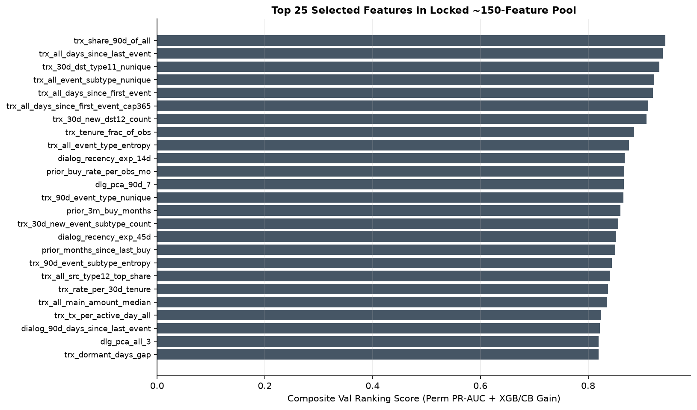
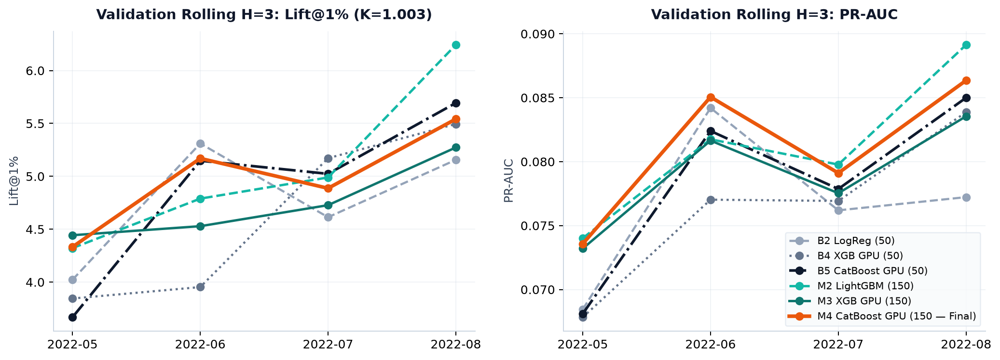
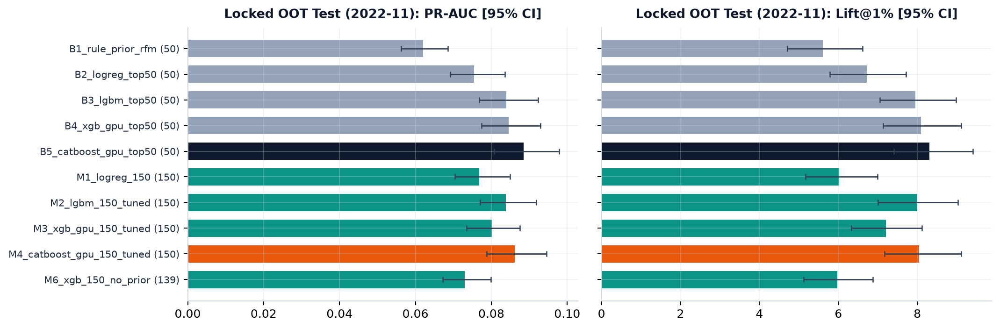

# Trình Bày Dự Án: Mô Hình Dự Đoán Xu Hướng Mua Hàng (Propensity H=3, Rolling Snapshot = 1)

> **Tóm tắt điều hành:** Tái thiết kế hoàn chỉnh bài toán ngân hàng sang **Horizon = 3 tháng**, cửa sổ trượt **Snapshot = 1 tháng**, **khóa tuyệt đối tập OOT Test `2022-11`** (cách ly embargo 2 tháng `09–10`), kiểm chứng thành công **6/6 cảnh báo kỹ thuật**, xây dựng **123 biến mới từ EDA** → chọn lọc **150 biến trên Validation**, chốt Final Model đơn **`M4_catboost_gpu_150_tuned`** đạt **`Lift@0.5% = 9.62x`**, **`Lift@1% = 8.05x`**, **`Lift@5% = 5.02x` (`Recall@5% = 25.1%`)**, **`PR-AUC = 0.0862`** và **`ROC-AUC = 0.7744`** (`p < 0.001` vs Top-50), kèm phương án gọn nhẹ 50 biến **`B5_catboost_gpu_top50`** (`Lift@1% = 8.31x`, `LogLoss = 0.0941`).

---

## Slide 0 (Bổ sung): Thiết Kế Bài Toán H=3 & Cơ Chế Chống Rò Rỉ OOT

- **Đơn vị dự đoán:** `100.224` khách hàng × snapshot đầu mỗi tháng (giờ Moscow `UTC+3`, lọc cứng `event_time_msk < YYYY-MM-01 00:00:00`).
- **Mục tiêu `H=3`:** $y_{h3}(s) = \max(y_{\text{any}}[s], y_{\text{any}}[s+1], y_{\text{any}}[s+2])$ (tỷ lệ dương ~2.95% trên Val, 2.17% trên OOT).
- **Lịch đánh giá 5-Fold OOC × Rolling Snapshot (0% rò rỉ tương lai):**
  - **Validation (`4` bước trượt):** `2022-05 ← [02]`, `2022-06 ← [02..03]`, `2022-07 ← [02..04]`, `2022-08 ← [02..05]` — 100% nhãn đóng trước `2022-11-01`.
  - **Embargo (Cách ly cứng):** `2022-09`, `2022-10` **không làm dòng nhãn train `y_h3`** vì nhãn 3-tháng của chúng chạm `2022-11..12` (log hành vi tháng `09–10` vẫn được dùng đầy đủ làm feature cho OOT `2022-11`).
  - **Locked OOT Test:** `2022-11` (phủ `2022-11..2023-01`) ← train trên toàn bộ `[02..08]` (nhãn đóng hoàn toàn `2022-10-31`).
- **Kiểm chứng chống leak tự động:** `4/4` unit test PASS (`tests/test_h3_leakage_guards.py`) + **Shuffled-label sanity check** đạt `ROC-AUC = 0.493–0.509` và `shuffled_y_eval_oot Lift@1% = 0.97x` (0% leak).

---

## Mục 1: Những Nhận Định Có Được Sau EDA (Có Đóng Góp Trực Tiếp Vào Feature)

Quét toàn bộ **38.76M TRX**, **66.30M GEO**, **217K DIALOG** (`0` orphan, `0` null khóa/thời gian, `15/15` kiểm tra đối soát đạt):

| # | Phát hiện cốt lõi từ EDA | Bằng chứng định lượng | Đóng góp trực tiếp vào Feature |
| :-: | :--- | :--- | :--- |
| **1** | **DIALOG gần cutoff là tín hiệu mạnh nhất** | Có DIALOG tháng trước: tỷ lệ mua **`4.22%`** (**lift `3.71×`** so với nền `1.14%`), chỉ chiếm `5.75%` mẫu nhưng chứa **`21.33%`** tổng người mua; ổn định qua cả 10/10 tháng. | Tạo `dialog_prev_cal_month_has_event`, `dialog_7d/14d_event_count`, suy giảm mũ `dialog_recency_exp_14d/45d`, nhịp `inter_gap`, và **PCA + drift + std** trên embedding DIALOG. |
| **2** | **Tương tác cực nóng: `0-TRX × DIALOG gần`** | Khách không giao dịch nhưng có DIALOG gần mua tới **`9.41%`** (so với `1.12%` khi không DIALOG; trên Val H=3 lên tới **`11.66%`**). | Tạo trực tiếp biến tương tác `zero_trx_90d_x_dialog_30d`, `zero_trx_all_x_dialog_30d`, `zero_trx_all_x_dialog_prev_mo`, `source_bitmask_30d/90d`. |
| **3** | **TRX có quan hệ hình chữ U (phi đơn điệu)** | Tỷ lệ mua theo số giao dịch `0 / 1–9 / 10–99 / ≥100` là **`1.41% / 0.76% / 0.59% / 1.48%`**. Không có log ≠ không mua! | Giữ nguyên tập không log (LEFT JOIN, không gán recency thiếu = 0), tạo 4 cờ chế độ `trx_regime_0`, `1_9`, `10_99`, `100p` và không ép ràng buộc đơn điệu. |
| **4** | **Đuôi `amount` cực dài theo từng `currency`** | Riêng `currency=11` (38.72M dòng) có median `18.025`, p99 `5.26M`, max **`1.37 nghìn tỷ`**. Mean thô bị méo nặng. | Tách riêng nội tệ/ngoại tệ (`trx_all_foreign_fraction`), dùng `median`, `signed_log_mean`, và độ lệch đuôi an toàn `trx_log_max_minus_med`. |
| **5** | **Độ phủ đa nguồn & lệch tuổi quan sát** | Có đủ 3 nguồn mua **`1.98%`** vs 1 nguồn `0.64%`. Nhưng 3 nguồn bắt đầu lệch nhau: `TRX 01/2021`, `DIALOG 02/2021`, **`GEO 12/2021`**. | Tạo `obs_age_days_trx/geo/dlg`, chuẩn hóa `trx_tenure_frac_of_obs`, chặn left-censoring `cap365`, và dùng **Entropy / Novelty GEO** thay vì chỉ đếm thô. |
| **6** | **DIALOG có giá trị độc lập với lịch sử mua** | Ngay ở nhóm **chưa từng mua trước đó**, có DIALOG gần vẫn mua **`3.87%`** vs `0.83%`. | Kết hợp `prior_*` tỷ lệ hóa (`prior_buy_rate_per_obs_mo`) cùng tương tác `no_prior_buy_x_dialog_30d` & `dialog_recency_x_prior_recency`. |

---

## Mục 2: Baseline Là Những Gì? 50 Biến Ban Đầu, Tác Dụng & Kết Quả Lần Lượt

### Cấu trúc 50 biến ban đầu (`top50_features`, 100% `< YYYY-MM-01 00:00 MSK`)
- **TRX (`20` biến — 40%):** `count / log1p`, `active_days`, `days_since_last/first`, `median / max / signed_log_mean` (`30d/90d/all`), `nunique(event_type/subtype)`, `foreign_fraction`.
- **Prior (`13` biến — 26%):** Lịch sử mua 1-tháng đã đóng `t ≤ s - 1` (`bought_1m`, `3m/6m/all_buy_months`, `months_since_last_buy`, `p1..p4`, `months_observed`; tháng `02/2022` giữ `NaN`).
- **DIALOG (`9` biến — 18%):** `has_event`, `event_count`, `days_since_last_event` (`30d/90d/all`) và `days_since_first_event`.
- **GEO (`7` biến — 14%):** `event_count`, `days_since_last`, `geohash_4_nunique` (`30d/all`), `top_geohash_6_share`, `geo_90d_has_event`.
- **Cold-start (`1` biến — 2%):** Cờ `cold_start = 1` khi khách chưa có log ở cả 3 nguồn.

### Tác dụng lần lượt & Kết quả đo được (Val `05..08` → Locked OOT `2022-11`)

| # | Baseline | Tác dụng trong thang đo | Val `PR-AUC` | Val `Lift@1%` | **OOT `PR-AUC`** | **OOT `Lift@1%`** | **OOT `ROC-AUC`** |
| :-: | :--- | :--- | :---: | :---: | :---: | :---: | :---: |
| **B1** | **`B1_rule_prior_rfm`** *(Luật heuristic)* | Mốc sàn phi-ML: kiểm tra xem ML có thực sự thắng quy tắc nghiệp vụ `Prior + Dialog + TRX` không. | `0.06794` | `4.53x` | `0.06197` | `5.61x` | `0.7002` |
| **B2** | **`B2_logreg_top50`** *(Tuyến tính L2)* | Mốc tuyến tính có chuẩn hóa & hiệu chuẩn xác suất; đo lợi ích tối ưu trọng số toàn cục so với luật tay. | `0.07652` | `4.78x` | `0.07547` *(+21.8% vs B1)* | `6.71x` *(+1.10x)* | `0.7613` |
| **B3** | **`B3_lgbm_top50`** *(LightGBM, 3 seeds)* | Mốc phi tuyến đầu tiên (leaf-wise GBDT): đo lợi ích của tương tác phi tuyến (đặc biệt chữ U TRX). | `0.07674` | `4.71x` | `0.08398` *(+11.3% vs B2)* | `7.96x` *(+1.24x)* | `0.7702` |
| **B4** | **`B4_xgb_gpu_top50`** *(XGBoost GPU, 3s)* | Mốc depth-wise GBDT trên GPU T4: đối chiếu chéo với LightGBM về độ ổn định. | `0.07641` | `4.62x` | `0.08454` *(+12.0% vs B2)* | `8.09x` *(+1.38x)* | `0.7699` |
| **B5** | **`B5_catboost_gpu_top50`** *(CatBoost GPU, 3s)* | Mốc oblivious trees (ít overfit nhất với biến thiếu/tỷ lệ): **Baseline mạnh nhất**. | **`0.07834`** | **`4.88x`** | **`0.08844`** *(+17.2% vs B2, `p<0.001`)* | **`8.31x`** *(+1.59x, `p<0.001`)* | **`0.7703`** |

### Kiểm chứng 6 cảnh báo kỹ thuật (tách riêng từng kiểm định)
1. **DIALOG Lag (`0/7/14/30d` vs `no_dialog`):** Cắt lùi 7–14 ngày vẫn giữ `PR-AUC 0.0761–0.0763`, `Lift@1% 4.91–5.00x` (cao hơn hẳn `no_dialog = 0.0751`) → **không có leak sát cutoff**, suy giảm tự nhiên theo thời gian.
2. **Độ trễ nhãn `prior_*`:** Trễ 1 tháng giảm `-3.9%` PR-AUC (`0.0785 → 0.0755`), bỏ hẳn giảm `-9.3%` (`0.0712`) → cần chốt SLA nhãn trước ngày `01`.
3. **Label Overlap H=3:** `rolling 02..05` (`0.0843`, `5.75x`) ≤ `non-overlap 02, 05` (`0.0867`, `5.89x`) → **0% thổi phồng điểm**.
4. **Múi giờ MSK vs UTC:** Chênh `< 0.00001` PR-AUC (`0.05807 vs 0.05807`).
5. **Tenure Left-Censoring:** Chặn trần `cap365` **tăng Val PR** (`0.0785 → 0.0794`, `Lift 5.09x`) → đưa vào Stage 2.
6. **Geohash Drift & Shuffled Sanity:** Bỏ geohash thô tăng nhẹ Val PR (`0.0791`) → đổi sang Entropy/Novelty; Shuffled Train `ROC-AUC ≈ 0.50`, Shuffled Eval OOT `Lift@1% = 0.97x` (**0% leak**).

---

## Mục 3: Feature Engineering — Các Nhóm Biến & Cách Tính

Xây dựng thêm **123 biến mới/mở rộng** (`build_h3_stage2_eda_fe.py`) → tạo kho ứng viên **272 biến** (`239` tabular + `33` embedding PCA/norm/drift):

| Nhóm biến | Số biến tiêu biểu | Cách tính cốt lõi (100% `< cutoff MSK`) | Ý nghĩa nghiệp vụ |
| :--- | :---: | :--- | :--- |
| **1. DIALOG chuyên sâu & Embedding** | ~45 | `exp(-days_since_last / 14|45)`, burst `7d/30d`, `30d/90d`, `prev_cal_month`, `AVG/STD/MAX(gap_90d)`, **PCA-16 (`90d` & `all`) fit riêng từng fold train**, `L2_drift(90d, all)`, `within_std_90d`. | Bắt chính xác cường độ, độ tươi, tính bất thường và chủ đề hội thoại mà không rò rỉ dữ liệu fold khác. |
| **2. GEO không gian – thời gian** | ~24 | **Shannon Entropy** $-\sum p_i \ln p_i$ trên `geohash_4/5/6` (`30d/90d`), **Novelty** (`new_gh4/5/6_count` trong `30d`), mật độ `gh6/gh4`, `geo_recency_exp_14d`, `inter_gap_mean_90d`. | Đo mức độ di chuyển, khám phá địa điểm mới và tần suất dùng app ổn định dù GEO có tuổi lịch sử ngắn (`12/2021+`). |
| **3. TRX phi tuyến & Đa dạng** | ~30 | 4 cờ hình chữ U (`0`, `1–9`, `10–99`, `≥100`), độ lệch đuôi `sign·log1p(|max|) - sign·log1p(|med|)`, entropy `event_type/subtype`, số `event_subtype`/`dst12` mới 30d, tỷ lệ ngoại tệ. | Bắt trọn hành vi tăng tốc/suy giảm giao dịch và sự xuất hiện dịch vụ mới mà không bị bóp méo bởi ngoại lai `1.37e12`. |
| **4. Tuổi quan sát & Censoring** | ~6 | `obs_age_days_{trx,geo,dlg}`, `trx_tenure / obs_age_days_trx`, `min(trx_tenure, 365)`. | Loại nhiễu left-censoring do khách cũ bị cắt lịch sử tại `01/2021`. |
| **5. Tương tác đa nguồn & `prior_*` tỷ lệ** | ~18 | `zero_trx_{90d,all} × dialog_30d`, `zero_trx × geo_30d`, `source_bitmask_{30d,90d}` (`1·T + 2·G + 4·D`), `prior_all_buy_months / prior_months_observed`, `exp(-prior_recency/2) × dialog_recency_exp_45d`. | Chuyển trực tiếp các phát hiện tương tác mạnh nhất từ EDA thành tín hiệu đầu vào sạch. |

---

## Mục 4: Quy Trình Select Feature (272 → Đúng 150 Biến, 100% Trên Val)

Tuyệt đối **không nhìn vào tập OOT Test `2022-11`** trong mọi bước chọn biến:

1. **Lọc sơ bộ:** Loại biến hằng số, thiếu > 99.95% và các biến thí nghiệm `prior_delay1m_*`.
2. **Xếp hạng đồng thuận đa mô hình (Consensus Rank trên Val `05..08`):** Trung bình thứ hạng `XGB Gain`, `CatBoost Importance`, `Permutation ΔPR-AUC` và `Permutation ΔLift@1%`.
3. **Khử trùng lặp (`|Spearman r| > 0.96`):** Giữ biến có thứ hạng cao hơn trong mỗi cụm tương quan cao.
4. **Chốt đúng `150` biến (`fe_h3_150_locked.json`):** Giữ 18 biến neo cốt lõi + lấy top rank → **`129` biến bảng + `21` biến embedding DIALOG** (`19` PCA + `norm_ratio` + `l2_drift`).



---

## Mục 5: Đã Thử Nghiệm Những Gì, Rút Ra Được Gì & Kiến Trúc Final Model

### Các thử nghiệm & bài học rút ra
1. **Tối ưu siêu tham số trên Val (`12` cấu hình GPU):** 6 cấu hình CatBoost GPU + 6 cấu hình XGBoost GPU → chọn `cb_d6_spw3` (`Val PR=0.08523, L1=5.77x`) và `xgb_d5_l25_lr03` (`Val PR=0.08274, L1=5.30x`).
2. **Đào tạo 4 họ mô hình đơn trên 150 biến:** `M1_logreg_150`, `M2_lgbm_150_tuned`, `M3_xgb_gpu_150_tuned`, **`M4_catboost_gpu_150_tuned`**. Cả 4 họ đều tăng mạnh `+3.2%` đến `+5.8%` PR-AUC trên Validation.
3. **Ablation cắt bỏ `prior_*` (`M6_xgb_150_no_prior`, 139 biến):** OOT `Lift@1%` tụt từ `7.20x → 5.98x` (**`-1.23x`, `p_holm < 0.001`**), `PR-AUC` tụt `-9.8%` (`p_holm < 0.001`).
4. **Tối ưu kỹ thuật Colab:** Viết lại `LogReg` `float32` in-place + prune panel để triệt tiêu OOM.

### Kiến trúc Final Model đơn (`M4_catboost_gpu_150_tuned`)
```text
[100.224 khách hàng tại cutoff YYYY-MM-01 00:00 MSK]
   ├── 129 biến bảng đã khóa (TRX phi tuyến + DIALOG recency/burst + GEO entropy/novelty + Prior tỷ lệ + Obs-age)
   └── 21 biến DIALOG Embedding (19 PCA fit chuẩn trong fold + norm_ratio + L2_drift)
            │
            ▼
  [CatBoost GPU Oblivious Trees — depth=6, l2=30, lr=0.03, spw=3.0, 3 seeds × 5 folds]
            │
            ▼
  [+ Isotonic Calibration trên Val khi deploy để tối ưu LogLoss]
```

---

## Mục 6: Kết Quả Cuối Cùng (Locked OOT Test `2022-11`, `n = 100.224`, `pos = 2.173`)





| Mô hình đơn | Biến | Val `PR-AUC` | **OOT `PR-AUC` [95% CI]** | **OOT `Lift@1%` [95% CI]** | **OOT `Lift@0.5%`** | **OOT `Lift@5%` (`Recall@5%`)** | **OOT `ROC-AUC`** |
| :--- | :---: | :---: | :---: | :---: | :---: | :---: | :---: |
| `B1_rule_prior_rfm` | 50 | `0.06794` | `0.06197` `[0.056, 0.069]` | `5.61x` `[4.70, 6.61]` | `5.70x` | `3.97x` (`19.8%`) | `0.7002` |
| `B2_logreg_top50` | 50 | `0.07652` | `0.07547` `[0.069, 0.084]` | `6.71x` `[5.79, 7.71]` | `7.44x` | `4.71x` (`23.6%`) | `0.7613` |
| `M6_xgb_150_no_prior` (Ablation) | 139 | `0.07727` | `0.07295` `[0.067, 0.080]` | `5.98x` `[5.12, 6.87]` | `6.80x` | `4.41x` (`22.0%`) | `0.7629` |
| `M2_lgbm_150_tuned` | 150 | **`0.08117`** | `0.08385` `[0.077, 0.092]` | `8.00x` `[7.00, 9.03]` | `8.82x` | `4.86x` (`24.3%`) | `0.7747` |
| `M3_xgb_gpu_150_tuned` | 150 | `0.07898` | `0.08008` `[0.074, 0.088]` | `7.20x` `[6.33, 8.11]` | `8.42x` | `4.80x` (`24.0%`) | `0.7720` |
| **`M4_catboost_gpu_150_tuned` (Final Model)** | **150** | `0.08102` | **`0.08615` `[0.079, 0.095]`** | **`8.05x` `[7.16, 9.11]`** | **`9.62x`** | **`5.02x` (`25.1%`)** | **`0.7744`** |
| **`B5_catboost_gpu_top50` (Challenger gọn)** | **50** | `0.07834` | **`0.08844` `[0.081, 0.098]`** | **`8.31x` `[7.40, 9.41]`** | `9.56x` | `4.94x` (`24.7%`) | `0.7703` |

### Tác động kinh doanh của Final Model (`M4_catboost_gpu_150_tuned`)
- **Top 0.5% (`502` KH):** `Lift = 9.62x` (~`105` người mua, tỷ lệ chốt ~**`20.9%`** vs nền `2.17%`).
- **Top 1% (`1.003` KH):** `Lift = 8.05x` (~`175` người mua, `Precision@1% = 17.5%`, vượt luật tay `B1` thêm **+53 khách mua/đợt**).
- **Top 5% (`5.012` KH):** Phủ trọn **`25.1%`** tổng người mua toàn ngân hàng (`~545` người mua, `Lift = 5.02x`).
- **Phương án gọn nhẹ thay thế:** Nếu cần tối giản pipeline không PCA & xác suất chuẩn sẵn (`LogLoss = 0.0941`) cho chiến dịch hẹp Top-1%, chọn **`B5_catboost_gpu_top50`** (`Lift@1% = 8.31x`).
