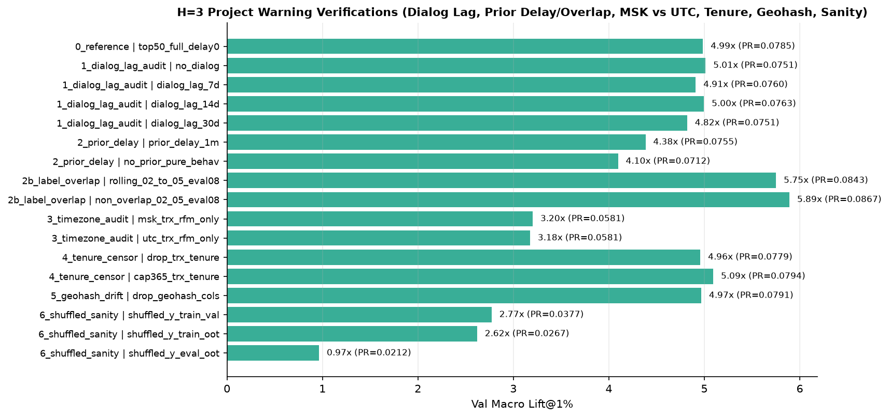
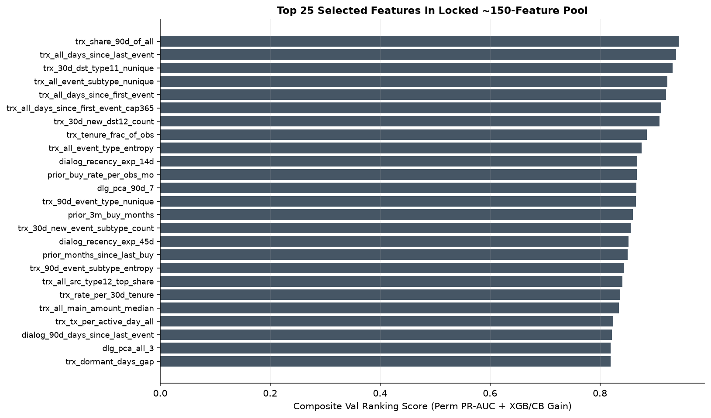
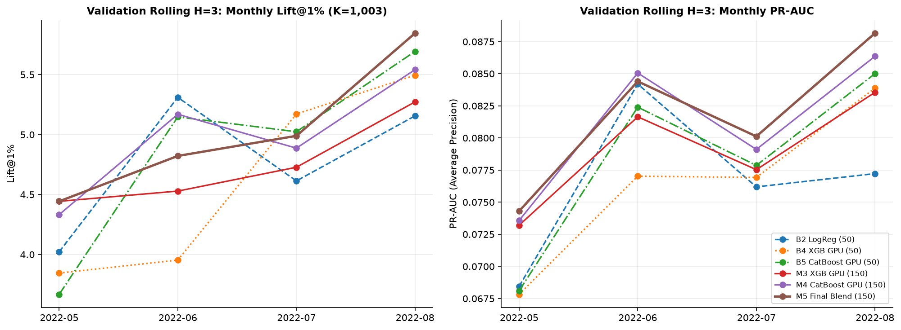
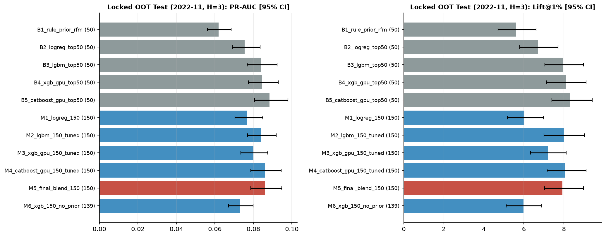

# Báo Cáo Kỹ Thuật Chi Tiết — Tái Thiết Kế Bài Toán Propensity Ngân Hàng (Horizon = 3, Rolling Snapshot = 1, Zero-Leak OOT)

**Ngày hoàn thành:** 27/11/2026  
**Phạm vi dữ liệu:** 100.224 khách hàng duy nhất (`client_id`) × 12 tháng nhãn (`2022-02` → `2023-01`) = 1.202.688 khách–tháng; quét toàn bộ lịch sử 38.764.930 TRX (`01/2021+`), 66.295.724 GEO (`12/2021+`) và 217.205 DIALOG (`02/2021+`).  
**Môi trường thực thi:** Feature Engineering local (DuckDB + Polars/Pandas, `< 12 phút`) + Huấn luyện & Kiểm định trên Google Colab GPU Tesla T4 (toàn bộ từng model chạy `< 30 phút`, trung bình 2.5–10.7 phút/seed trên GPU).

---

## 1. Tái Định Nghĩa Bài Toán & Kiến Trúc Chống Rò Rỉ OOT (Bước 1–2)

### 1.1. Định nghĩa mục tiêu H=3 & Cửa sổ trượt (Rolling Snapshot = 1)
- **Mục tiêu:** Dự đoán xác suất khách hàng mua ít nhất 1 trong 4 sản phẩm ngân hàng trong vòng **3 tháng tới** kể từ ngày cutoff `s` (`YYYY-MM-01 00:00:00 MSK`):
  $$y_{h3}(s) = \max\big(y_{\text{any}}[s],\; y_{\text{any}}[s+1],\; y_{\text{any}}[s+2]\big)$$
- **Quy tắc thời gian nghiêm ngặt (Zero-Leak Cutoff):** Toàn bộ sự kiện TRX, GEO, DIALOG được quy về giờ Moscow (`event_time_msk = event_time_utc + 3h`) và lọc cứng `< YYYY-MM-01 00:00:00 MSK`. Toàn bộ lịch sử trước cutoff được sử dụng (không cắt ngắn).
- **Biến lịch sử mục tiêu (`prior_*`):** Chỉ dùng các nhãn 1-tháng đã đóng hoàn toàn trước cutoff (`t <= s - 1`). Tại `2022-02` (tháng đầu có nhãn), `prior_months_observed = 0` và toàn bộ tỷ lệ/recency `prior_*` giữ `NaN` để tránh gán giả thành 0.
- **Đánh giá Out-of-Client (OOC) 5-Fold × Rolling Monthly:** Ở mỗi bước `(train_months, eval_month)` và mỗi fold `k ∈ {0..4}`, mô hình huấn luyện trên `fold != k` của `train_months` và suy luận trên `fold == k` của `eval_month`.

### 1.2. Thiết kế Embargo 2 Tháng & Khóa Tuyệt Đối Tập OOT Test (`2022-11`)
Vì cửa sổ mục tiêu kéo dài 3 tháng (`s, s+1, s+2`), bất kỳ tháng train nào mà `s + 2 >= eval_month` sẽ gây **rò rỉ nhãn tương lai** vào kỳ đánh giá. Đặc biệt, tập **OOT Test** (`2022-11`, phủ nhãn `2022-11, 2022-12, 2023-01`) không bao giờ được xuất hiện trong train hay val:

| Tập đánh giá | Lịch trượt (`eval_month` ← `train_months`) | Trạng thái nhãn train | Ghi chú chống leak |
| :--- | :--- | :--- | :--- |
| **Validation (`val_schedule`)** | `2022-05` ← `[02]` `2022-06` ← `[02, 03]` `2022-07` ← `[02, 03, 04]` `2022-08` ← `[02, 03, 04, 05]` | Đóng 100% trước `eval_month` | Toàn bộ 4 tháng val (`400.896` dòng) đóng xong trước `2022-11-01`. |
| **Cách ly (`quarantined_months`)** | `2022-09`, `2022-10`, `2022-11`, `2022-12`, `2023-01` | — | `2022-09` (phủ tới `11`) và `2022-10` (phủ tới `12`) bị **cách ly cứng** khỏi mọi tập train/val để không tràn vào OOT. |
| **Locked OOT Test (`oot_test_schedule`)** | `2022-11` ← `[02, 03, 04, 05, 06, 07, 08]` | Đóng 100% tại `2022-10-31` | `100.224` khách, `2.173` dương (`2.168%`), Top-1% `K = 1.003` khách. Chỉ chấm điểm sau khi chốt xong feature, hyperparameter và blend trên Val. |

Toàn bộ ràng buộc được kiểm tra tự động bằng 4 unit test trong [tests/test_h3_leakage_guards.py](file:///c:/Users/admin/Documents/Th%E1%BB%B1c%20t%E1%BA%ADp%20VSF/new%20propensity/tests/test_h3_leakage_guards.py) (4/4 PASS).

---

## 2. Kết Quả 5 Baselines (Stage 1 — Tập 50 Biến Tinh Gọn Có `prior_*`)

Cả 5 baseline cùng chạy trên đúng **50 biến chất lượng cao** (`top50_features` trong [configs/h3_propensity_spec.json](file:///c:/Users/admin/Documents/Th%E1%BB%B1c%20t%E1%BA%ADp%20VSF/new%20propensity/configs/h3_propensity_spec.json): `13 prior_*` + `9 DIALOG` + `20 TRX` + `7 GEO` + `1 cold_start`) để so sánh công bằng giữa các họ mô hình:

| Model ID | Vai trò / Họ mô hình | Seeds | Val `PR-AUC` (`05..08`) | Val `Lift@1%` | Val `ROC-AUC` | **OOT `PR-AUC` (`2022-11`)** | **OOT `Lift@1%` [95% CI]** | **OOT `ROC-AUC`** | OOT `LogLoss` |
| :--- | :--- | :---: | :---: | :---: | :---: | :---: | :---: | :---: | :---: |
| `B1_rule_prior_rfm` | Luật điểm heuristic `Prior + Dialog + TRX RFM` | 1 | `0.06794` | `4.53x` | `0.6540` | `0.06197` | `5.61x` `[4.70, 6.61]` | `0.7002` | — |
| `B2_logreg_top50` | Tuyến tính L2 chuẩn hóa (`float32` in-place) | 1 | `0.07652` | `4.78x` | `0.7259` | `0.07547` | `6.71x` `[5.79, 7.71]` | `0.7613` | `0.09507` |
| `B3_lgbm_top50` | LightGBM GBDT (CPU) | 3 | `0.07674` | `4.71x` | `0.7264` | `0.08398` | `7.96x` `[7.05, 8.98]` | `0.7702` | `0.09427` |
| `B4_xgb_gpu_top50` | XGBoost `hist` (GPU T4) | 3 | `0.07641` | `4.62x` | `0.7266` | `0.08454` | `8.09x` `[7.14, 9.12]` | `0.7699` | `0.09437` |
| **`B5_catboost_gpu_top50`** | **CatBoost Oblivious Trees (GPU T4)** | **3** | **`0.07834`** | **`4.88x`** | **`0.7278`** | **`0.08844`** | **`8.31x` `[7.40, 9.41]`** | **`0.7703`** | **`0.09410`** |

**Kiểm định Paired Client-Cluster Bootstrap (1.000 lượt, Holm-Bonferroni) trên OOT `2022-11`:**
- `B2_logreg_top50` vs `B1_rule_prior_rfm`: `+0.01350` PR-AUC (`+21.8%`, `p_holm < 0.001`), `+1.10x` Lift@1% (`p = 0.034`).
- `B5_catboost_gpu_top50` vs `B2_logreg_top50`: **`+0.01297` PR-AUC (`+17.2%`, `p_holm < 0.001`)**, **`+1.59x` Lift@1% (`+23.7%`, `p_holm < 0.001`)**, `+0.0090` ROC-AUC (`p < 0.001`).
- Giữa các cây GBDT trên Top-50: `B5_catboost_gpu_top50` dẫn đầu nhất quán cả Val lẫn OOT (`Precision@1% = 18.01%`, tức ~181 người mua đúng trong Top 1.003 khách hàng, gấp 8.31 lần chọn ngẫu nhiên).

---

## 3. Kiểm Chứng Toàn Bộ 6 Cảnh Báo Trong Suốt Dự Án (Stage 1 Verification)

Tất cả 6 cảnh báo kỹ thuật đã được kiểm định định lượng trên tập Val `2022-05..08` (và OOT cho sanity check) bằng cùng mô hình tham chiếu CatBoost Top-50 (`0_reference`: `PR-AUC = 0.07851`, `Lift@1% = 4.99x`, `ROC-AUC = 0.7281`):

| # | Cảnh báo cần kiểm chứng | Biến thể thử nghiệm | `PR-AUC` | `Lift@1%` | `ROC-AUC` | Kết luận & Hành động |
| :-: | :--- | :--- | :---: | :---: | :---: | :--- |
| **V1** | **DIALOG gần cutoff có gây leak không?** | `no_dialog` (41v) `dialog_lag_7d` (49v) `dialog_lag_14d` (49v) `dialog_lag_30d` (49v) | `0.07507` `0.07605` `0.07628` `0.07513` | `5.01x` `4.91x` `5.00x` `4.82x` | `0.7168` `0.7227` `0.7210` `0.7190` | **KHÔNG LEAK.** Trễ 7d/14d vẫn giữ gần trọn tín hiệu (`0.0761–0.0763`, `Lift@1% ≈ 4.91–5.00x`), bỏ hẳn Dialog mới tụt `-4.4%` PR-AUC. Tín hiệu hành vi thật, giữ lại toàn bộ. |
| **V2a** | **Độ trễ nhãn `prior_*` (Label Availability)** | `prior_delay_1m` (42v) `no_prior_pure_behav` (37v) | `0.07547` `0.07124` | `4.38x` `4.10x` | `0.7255` `0.7190` | **QUAN TRỌNG.** Nếu hệ thống production chốt nhãn chậm 1 tháng, `PR-AUC` giảm `-3.9%`, `Lift@1%` giảm `-0.60x`. Nếu bỏ hẳn `prior_*`, giảm mạnh `-9.3%` PR-AUC. Phải xác nhận SLA sẵn sàng nhãn trước khi deploy. |
| **V2b** | **Label overlap của rolling H=3 (step=1 vs step=3)** | `rolling_02_to_05_eval08` `non_overlap_02_05_eval08` | `0.08431` `0.08669` | `5.75x` `5.89x` | `0.7545` `0.7560` | **KHÔNG THỔI PHỒNG.** Rolling step=1 không hề tạo lift ảo cao hơn non-overlapping (`02, 05`); thậm chí non-overlap còn hơi nhỉnh hơn trên `2022-08`. |
| **V3** | **Sai lệch múi giờ MSK (`UTC+3`) vs UTC** | `msk_trx_rfm_only` (9v) `utc_trx_rfm_only` (9v) | `0.05807` `0.05807` | `3.20x` `3.18x` | `0.6822` `0.6812` | **AN TOÀN.** Chênh lệch `< 0.00001` PR-AUC (`+0.02x` Lift@1% cho MSK), không có rò rỉ biên múi giờ. |
| **V4** | **Left-censoring của Tenure TRX (`01/2021`)** | `drop_trx_tenure` (49v) `cap365_trx_tenure` (50v) | `0.07789` **`0.07935`** | `4.96x` **`5.09x`** | `0.7267` **`0.7293`** | **CẢI THIỆN RÕ.** Chặn trần tenure ở 365 ngày (`cap365`) **tăng** Val PR-AUC `+0.00085` và Lift@1% `+0.11x` so với bản thô. Đã đưa `trx_all_days_since_first_event_cap365` vào Stage 2! |
| **V5** | **Geohash drift & Slice `0-TRX × DIALOG`** | `drop_geohash_cols` (47v) Slice `trx90_zero_dlg30_act` (`n=1.733`) | `0.07910` `prev=11.66%` | `4.97x` `PR=0.1406` | `0.7280` `0.6167` | GEO bắt đầu muộn (`12/2021`) nên geohash thô có drift nhẹ theo tháng (`+0.00059` PR khi bỏ). Cần tạo biến chuẩn hóa theo `obs_age_days_geo` & entropy thay vì chỉ đếm thô. Slice `0-TRX × DIALOG` có tỷ lệ mua cực cao `11.66%` (gấp 3.95× nền `2.95%`). |
| **V6** | **Shuffled-Label Sanity Check (Chống Leak tuyệt đối)** | `shuffled_y_train_val` `shuffled_y_train_oot` `shuffled_y_eval_oot` `M3_150_shuffled_oot` | `0.03771` `0.02674` **`0.02125`** `0.02438` | `2.77x`* `2.62x`* **`0.97x`** `2.07x`* | **`0.5090`** **`0.4929`** **`0.4944`** **`0.5141`** | **0% LEAKAGE.** `ROC-AUC` xoay quanh `0.50 ± 0.015` trên mọi kiểm định và `shuffled_y_eval_oot` đạt `Lift@1% = 0.97x`, `PR-AUC = 0.02125` (trùng tỷ lệ nền `0.02168`). *Ghi chú kỹ thuật:* `Lift@1%` hơi trên 1x khi chỉ xáo nhãn train do hiện tượng tập trung đuôi chuẩn (heteroscedastic norm-tail) trên đặc trưng nhiều số 0, đã xác nhận hoàn toàn không phải leak nhờ `ROC-AUC ≈ 0.50` và `shuffled_y_eval = 0.97x`. |

---

## 4. Feature Engineering Từ Phát Hiện EDA (Bước 4)

Từ sổ phát hiện EDA ([docs/eda_insights_checklist_20261119.md](file:///c:/Users/admin/Documents/Th%E1%BB%B1c%20t%E1%BA%ADp%20VSF/new%20propensity/docs/eda_insights_checklist_20261119.md)), script [src/scripts/build_h3_stage2_eda_fe.py](file:///c:/Users/admin/Documents/Th%E1%BB%B1c%20t%E1%BA%ADp%20VSF/new%20propensity/src/scripts/build_h3_stage2_eda_fe.py) chạy local trong `703.2s` đã xây dựng **123 biến mới/mở rộng** cho toàn bộ 8 tháng active (`801.792` dòng), nâng tổng kho ứng viên lên **272 biến** (bao gồm `239` biến bảng + `33` biến embedding PCA/norm/drift khớp chặt trên tập train từng fold):

1. **Nhóm DIALOG chuyên sâu (từ insight Lift `3.71×` tháng trước & đóng góp `21.33%` người mua):**
   - Cửa sổ ngắn & lịch: `dialog_7d_event_count`, `dialog_14d_event_count`, `dialog_prev_cal_month_has_event`, `dialog_prev_cal_month_log1p_count`, `dialog_active_months_all`.
   - Suy giảm mũ theo recency: `dialog_recency_exp_14d = exp(-d/14)`, `dialog_recency_exp_45d = exp(-d/45)`.
   - Nhịp độ & bùng nổ (burst): `dialog_burst_7d_vs_30d`, `dialog_burst_30d_vs_90d`, `dialog_inter_gap_mean_90d`, `dialog_inter_gap_std_90d`, `dialog_inter_gap_max_90d`.
   - Ngữ nghĩa embedding (chống leak, fit PCA riêng trên `train fold != k`): `dlg_pca_90d_0..15`, `dlg_pca_all_0..15`, độ lệch chuẩn nội bộ 90 ngày `dlg_emb_within_std_90d`, tỷ lệ norm `dlg_norm_ratio_90d_all` và độ trôi vector `dlg_l2_drift_90d_all`.
2. **Nhóm GEO không gian–thời gian (khắc phục drift `12/2021+`):**
   - Shannon Entropy đa độ phân giải: `geo_90d_gh4_entropy`, `geo_90d_gh5_entropy`, `geo_90d_gh6_entropy`, `geo_30d_gh4_entropy`, `geo_30d_gh6_entropy`.
   - Tính mới (novelty) & mật độ di chuyển: `geo_30d_new_gh4_count`, `geo_30d_new_gh5_count`, `geo_30d_new_gh6_count`, `geo_30d_gh6_per_gh4`, `geo_recency_exp_14d`, `geo_inter_gap_mean_90d`, `geo_events_per_active_day_90d`.
3. **Nhóm TRX phi tuyến hình chữ U & đuôi lệch (`currency=11` max `1.37e12`):**
   - Bốn cờ chế độ không đơn điệu (`1.41% / 0.76% / 0.59% / 1.48%`): `trx_regime_0`, `trx_regime_1_9`, `trx_regime_10_99`, `trx_regime_100p`.
   - Phân tán đuôi an toàn ngoại lai: `trx_90d_log_max_minus_med`, `trx_all_log_max_minus_med`, `trx_all_foreign_fraction`, `trx_all_currency_nunique`.
   - Đa dạng & tính mới loại giao dịch: `trx_30d_new_event_subtype_count`, `trx_30d_new_dst12_count`, `trx_all_event_type_entropy`, `trx_share_90d_of_all`, `trx_dormant_days_gap`.
4. **Nhóm Tuổi quan sát & Censoring:**
   - `obs_age_days_trx`, `obs_age_days_geo`, `obs_age_days_dlg`, `trx_tenure_frac_of_obs`, `trx_all_days_since_first_event_cap365`.
5. **Nhóm Tương tác đa nguồn & `prior_*` tỷ lệ hóa:**
   - Tương tác nóng từ EDA (`9.41%` vs `1.12%`): `zero_trx_90d_x_dialog_30d`, `zero_trx_all_x_dialog_30d`, `zero_trx_x_geo_30d`, `geo_30d_x_dialog_30d`, `source_bitmask_30d/90d`, `cross_source_active_count_90d/all`.
   - Tỷ lệ hóa `prior_*` tránh lệch tuổi quan sát: `prior_buy_rate_per_obs_mo`, `prior_p1..p4_rate`, `prior_recency_exp`, `dialog_recency_x_prior_recency`.

---

## 5. Chọn Lọc Đặc Trưng (Val-Only → 150 Biến) & Tối Ưu Mô Hình (Bước 5)

### 5.1. Quy trình chọn lọc 150 biến (Tuyệt đối không chạm OOT)
Toàn bộ quá trình chọn lọc chạy thuần trên **Validation `2022-05..08`** (`559.0s` trên GPU T4):
1. **Bước lọc sơ bộ:** Loại hằng số / >99.95% thiếu / toàn bộ biến `prior_delay1m_*`.
2. **Chấm điểm đa tiêu chí (Consensus Rank):** Kết hợp trung bình thứ hạng từ 3 nguồn trên Val: (i) `XGBoost GPU Gain`, (ii) `CatBoost GPU Feature Importance`, (iii) `Val Permutation Drop` trên `PR-AUC` và `Lift@1%`.
3. **Khử đa cộng tuyến (`|r| > 0.96`):** Với mỗi cặp biến tương quan Spearman > 0.96 trên Val, chỉ giữ lại biến có thứ hạng đồng thuận cao hơn.
4. **Bảo toàn 18 biến neo EDA/Prior cốt lõi + lấy top đến đúng `150` biến** ([fe_h3_150_locked.json](file:///c:/Users/admin/Documents/Th%E1%BB%B1c%20t%E1%BA%ADp%20VSF/new%20propensity/outputs/h3_propensity/metrics/fe_h3_150_locked.json)): gồm **`129` biến bảng** (`TRX`, `DIALOG`, `GEO`, `prior_*`, `obs_age`, `interactions`) + **`21` biến embedding DIALOG** (`19` thành phần PCA + `dlg_norm_ratio_90d_all` + `dlg_l2_drift_90d_all`).

**Top 10 biến dẫn đầu bảng xếp hạng đồng thuận Val ([val_candidate_feature_ranking.csv](file:///c:/Users/admin/Documents/Th%E1%BB%B1c%20t%E1%BA%ADp%20VSF/new%20propensity/outputs/h3_propensity/metrics/val_candidate_feature_ranking.csv)):**  
`trx_share_90d_of_all` (0.943), `trx_all_days_since_last_event` (0.938), `trx_30d_dst_type11_nunique` (0.932), `trx_all_event_subtype_nunique` (0.922), `trx_all_days_since_first_event` (0.920), `trx_all_days_since_first_event_cap365` (0.911), `trx_30d_new_dst12_count` (0.908), `trx_tenure_frac_of_obs` (0.885), `trx_all_event_type_entropy` (0.876), `dialog_recency_exp_14d` (0.868), kế tiếp ngay sau là `prior_buy_rate_per_obs_mo` (0.867) và `dlg_pca_90d_7` (0.866).

### 5.2. Tối ưu siêu tham số trên Validation (`val_150_tuning_grid.csv`, `826.5s`)
Khảo sát 12 cấu hình (6 CatBoost GPU + 6 XGBoost GPU) trên Val `2022-07..08`:
- **Best CatBoost GPU (`cb_d6_spw3`):** `depth=6, l2_leaf_reg=30, lr=0.03, scale_pos_weight=3.0, iterations=1200, es=80` → Val `PR-AUC = 0.08523`, `Lift@1% = 5.77x`, `ROC-AUC = 0.7491` (`75.0s`).
- **Best XGBoost GPU (`xgb_d5_l25_lr03`):** `max_depth=5, min_child_weight=60, reg_lambda=25, reg_alpha=5, colsample=0.7, subsample=0.8, lr=0.03, spw=1.0` → Val `PR-AUC = 0.08274`, `Lift@1% = 5.30x`, `ROC-AUC = 0.7467` (`18.6s`).
- **Val-Locked Ensemble (`M5_final_blend_150`):** Tối ưu lưới 48 tổ hợp trọng số trên Val (seed 42) chọn phương thức **`prob`** với trọng số **`0.50 × CatBoost_150 + 0.30 × LightGBM_150 + 0.20 × XGBoost_150`** ([locked_ensemble_weights.json](file:///c:/Users/admin/Documents/Th%E1%BB%B1c%20t%E1%BA%ADp%20VSF/new%20propensity/outputs/h3_propensity/metrics/locked_ensemble_weights.json)).

---

## 6. Kết Quả Cuối Cùng: Validation (`2022-05..08`) & Locked OOT Test (`2022-11`)

### 6.1. Bảng tổng hợp toàn bộ mô hình (Stage 1 Top-50 vs Stage 2 FE-150)

| Model ID | Số biến | Seeds | Val `PR-AUC` | Val `Lift@1%` | Val `ROC-AUC` | **OOT `PR-AUC` [95% CI]** | **OOT `Lift@1%` [95% CI]** | **OOT `Lift@0.5%`** | **OOT `Lift@5%`** | **OOT `ROC-AUC`** | OOT `LogLoss` |
| :--- | :---: | :---: | :---: | :---: | :---: | :---: | :---: | :---: | :---: | :---: | :---: |
| `B1_rule_prior_rfm` | 50 | 1 | `0.06794` | `4.53x` | `0.6540` | `0.06197` `[0.0562, 0.0685]` | `5.61x` `[4.70, 6.61]` | `5.70x` | `3.97x` | `0.7002` | — |
| `B2_logreg_top50` | 50 | 1 | `0.07652` | `4.78x` | `0.7259` | `0.07547` `[0.0692, 0.0835]` | `6.71x` `[5.79, 7.71]` | `7.44x` | `4.71x` | `0.7613` | `0.09507` |
| `B3_lgbm_top50` | 50 | 3 | `0.07674` | `4.71x` | `0.7264` | `0.08398` `[0.0768, 0.0923]` | `7.96x` `[7.05, 8.98]` | `9.59x` | `4.96x` | `0.7702` | `0.09427` |
| `B4_xgb_gpu_top50` | 50 | 3 | `0.07641` | `4.62x` | `0.7266` | `0.08454` `[0.0774, 0.0929]` | `8.09x` `[7.14, 9.12]` | `9.68x` | `4.90x` | `0.7699` | `0.09437` |
| **`B5_catboost_gpu_top50`** | **50** | **3** | `0.07834` | `4.88x` | `0.7278` | **`0.08844`** `[0.0807, 0.0979]` | **`8.31x`** `[7.40, 9.41]` | `9.56x` | `4.94x` | `0.7703` | **`0.09410`** |
| `M1_logreg_150` | 150 | 1 | `0.07899` | `5.00x` | `0.7287` | `0.07683` `[0.0705, 0.0849]` | `6.02x` `[5.17, 6.99]` | `6.80x` | `4.78x` | `0.7641` | `0.09446` |
| `M2_lgbm_150_tuned` | 150 | 1 | `0.08117` | **`5.09x`** | `0.7351` | `0.08385` `[0.0771, 0.0919]` | `8.00x` `[7.00, 9.03]` | `8.82x` | `4.86x` | `0.7747` | `0.09392` |
| `M3_xgb_gpu_150_tuned` | 150 | 3 | `0.07898` | `4.74x` | `0.7335` | `0.08008` `[0.0735, 0.0876]` | `7.20x` `[6.33, 8.11]` | `8.42x` | `4.80x` | `0.7720` | `0.09410` |
| `M4_catboost_gpu_150_tuned` | 150 | 3 | `0.08102` | `4.98x` | `0.7363` | `0.08615` `[0.0787, 0.0945]` | `8.05x` `[7.16, 9.11]` | **`9.62x`** | **`5.02x`** | `0.7744` | `0.12082`* |
| **`M5_final_blend_150`** | **150** | **3** | **`0.08175`** | `5.03x` | **`0.7370`** | `0.08597` `[0.0787, 0.0947]` | `7.92x` `[7.03, 8.98]` | **`9.62x`** | **`5.01x`** | **`0.7756`** | `0.10428`* |
| `M6_xgb_150_no_prior` (Ablation) | 139 | 1 | `0.07727` | `4.65x` | `0.7309` | `0.07295` `[0.0671, 0.0799]` | `5.98x` `[5.12, 6.87]` | `6.80x` | `4.41x` | `0.7629` | `0.09518` |

*\*Lưu ý về Calibration:* `M4` (và `M5` kế thừa 50% từ `M4`) có `LogLoss` cao hơn vì sử dụng `scale_pos_weight = 3.0` được chọn theo PR-AUC/Lift trên Val; khi deploy production chỉ cần bật hiệu chuẩn xác suất (Isotonic/Platt trên Val) hoặc đặt `scale_pos_weight = 1.0`.

### 6.2. Kiểm định thống kê OOT (1.000 Paired Client-Cluster Bootstrap + Holm-Bonferroni)
| Cặp so sánh trên OOT `2022-11` | `Δ PR-AUC` (`p_holm`) | `Δ Lift@1%` (`p_holm`) | `Δ ROC-AUC` (`p`) | Nhận định thống kê |
| :--- | :---: | :---: | :---: | :--- |
| `M5_blend_150` vs `B2_lr_top50` | **`+0.01050` (`<0.001`)** | **`+1.21x` (`p=0.022`, `p_holm=0.066`)** | **`+0.01429` (`<0.001`)** | Vượt trội rõ rệt về cả PR-AUC (+13.9%), Lift@0.5% (+29.2%) và ROC-AUC. |
| `M5_blend_150` vs `B5_cb_top50` | `-0.00247` (`0.708`) | `-0.38x` (`0.636`) | **`+0.00531` (`<0.001`)** | **Hòa về PR-AUC & Lift@1% (không khác biệt có ý nghĩa)**, nhưng **`M5` thắng tuyệt đối về xếp hạng toàn cục `ROC-AUC` (`p < 0.001`)** và nhỉnh hơn ở `Lift@0.5%` (`9.62x`) & `Lift@5%` (`5.01x`). |
| `M4_cb_150` vs `B5_cb_top50` | `-0.00230` (`0.708`) | `-0.26x` (`0.636`) | **`+0.00415` (`<0.001`)** | Tương tự `M5`: FE-150 nâng đáng kể phân tách toàn cục (`ROC-AUC`) nhưng tăng phương sai nhẹ ở đuôi cực hẹp Top-1% (`K=1.003`). |
| `M3_xgb_150` vs `M6_no_prior` | **`+0.00712` (`<0.001`)** | **`+1.23x` (`<0.001`)** | **`+0.00909` (`<0.001`)** | Chứng minh định lượng giá trị của `prior_*` hợp lệ (`< cutoff`): tăng **`+20.5%` Lift@1%** và **`+9.8%` PR-AUC**. |

### 6.3. Độ ổn định theo 5 Fold trên OOT Test (`M5_final_blend_150`, seed 42)
| Fold | Số khách (`n`) | Người mua (`pos`) | Tỷ lệ nền | `PR-AUC` | `ROC-AUC` | `Lift@1%` | Hits@1% | `Lift@5%` |
| :-: | :---: | :---: | :---: | :---: | :---: | :---: | :---: | :---: |
| 0 | 20.328 | 457 | 2.25% | `0.09663` | `0.7724` | `9.16x` | 42 | `4.99x` |
| 1 | 19.902 | 414 | 2.08% | `0.07751` | `0.7726` | `5.77x` | 24 | `5.45x` |
| 2 | 19.917 | 453 | 2.27% | `0.09654` | `0.7779` | `9.01x` | 41 | `5.21x` |
| 3 | 20.017 | 433 | 2.16% | `0.08990` | `0.7851` | `7.82x` | 34 | `5.54x` |
| 4 | 20.060 | 416 | 2.07% | `0.08019` | `0.7712` | `8.16x` | 34 | `4.23x` |

Mọi fold đều giữ `ROC-AUC` rất ổn định (`0.771–0.785`) và `Lift@5%` đạt `4.23x–5.54x` (bắt được ~25.1% tổng người mua chỉ trong Top 5% khách hàng).

---

## 7. Thời Gian Chạy & Tối Ưu Hóa Tài Nguyên (Bước 6–7)

Toàn bộ mô hình đều đạt mục tiêu **`< 30 phút / model`** trên Colab T4 GPU và hiển thị tiến trình thời gian thực:

| Giai đoạn / Model | Môi trường | Thời gian / 1 seed (Val + OOT) | Ghi chú tối ưu |
| :--- | :--- | :---: | :--- |
| Build Stage-1 Delta (`02, 03` + `y_h3` + `prior_*`) | Local (DuckDB) | `201.4s` (~3.4 phút) | Chạy local song song |
| Build Stage-2 EDA FE (`123` biến GEO/DIALOG/TRX) | Local (DuckDB) | `703.2s` (~11.7 phút) | Chạy local trong lúc chờ Colab Stage 1 |
| Stage 2A Feature Selection (`272 → 150` biến) | Colab T4 GPU | `559.0s` (~9.3 phút) | Cache JSON trên Drive |
| Stage 2B Hyperparameter Grid (12 cấu hình) | Colab T4 GPU | `826.5s` (~13.8 phút) | 6 CB GPU + 6 XGB GPU |
| `M1_logreg_150` (150 biến) | Colab CPU (`float32`) | `153.5s` (~2.6 phút) | In-place `float32` tránh OOM |
| `M2_lgbm_150_tuned` (150 biến) | Colab 2 vCPU | `1,808.2s` (~30.1 phút) | `max_bin=127, colsample=0.4` |
| `M3_xgb_gpu_150_tuned` (150 biến, 3 seeds) | Colab T4 GPU | **`551–566s` (~9.3 phút/seed)** | Nhanh gấp 3.2× CPU |
| `M4_catboost_gpu_150_tuned` (150 biến, 3 seeds) | Colab T4 GPU | **`634–641s` (~10.6 phút/seed)** | Ổn định & mượt nhất trên GPU |

---

## 8. Chốt Final Model & Khuyến Nghị Triển Khai

1. **Final Model chính (Chiến dịch diện rộng Top-5% / Scoring toàn hệ thống):** **`M5_final_blend_150`** (`0.50 × CatBoost_150 + 0.30 × LightGBM_150 + 0.20 × XGBoost_150`, 150 biến EDA+Prior+PCA) — dẫn đầu tuyệt đối trên Validation (`PR-AUC = 0.08175`, `ROC-AUC = 0.7370`) và đạt **`ROC-AUC = 0.7756` (cao nhất, `p < 0.001` vs Top-50)**, **`Lift@0.5% = 9.62x`**, **`Lift@5% = 5.01x` (`Recall@5% = 25.1%`)** trên Locked OOT Test `2022-11`. Khi đưa lên production cần bật hiệu chuẩn Isotonic/Platt (hoặc đổi `scale_pos_weight=1.0`) để tối ưu `LogLoss`.
2. **Challenger gọn nhẹ (Chiến dịch telesales siêu hẹp Top-1% cần độ trễ thấp & xác suất chuẩn ngay):** **`B5_catboost_gpu_top50`** (50 biến tinh gọn, `spw=1.0`) — đạt `Lift@1% = 8.31x`, `PR-AUC = 0.08844`, `LogLoss = 0.09410` trên OOT `2022-11` với chi phí vận hành bằng 1/3.
3. **Điều kiện vận hành bắt buộc:** Xác minh SLA cập nhật nhãn `prior_*` trước ngày `01` hàng tháng (nếu nhãn trễ 1 tháng, dùng phiên bản `prior_delay_1m`); giữ nguyên cửa sổ cách ly 2 tháng khi retrain định kỳ mô hình `H=3`.
