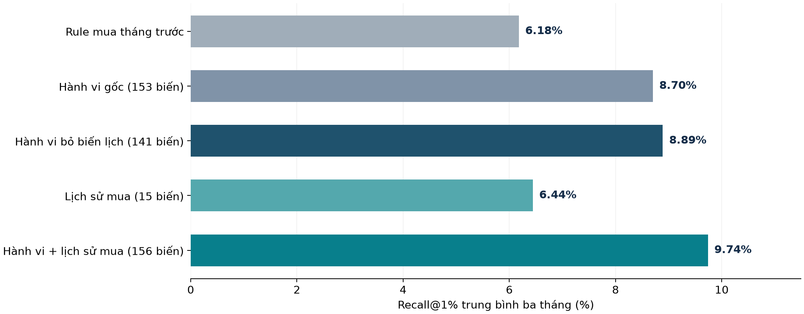
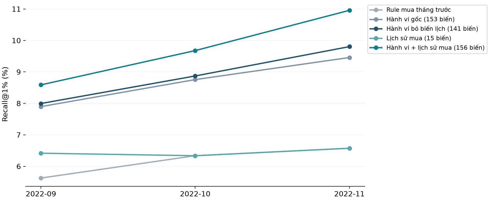

# Baseline propensity: kết quả và định hướng hoàn thiện

Cập nhật ngày **11/11/2026**. Phạm vi: nghiên cứu offline trên MBD-mini, dự đoán mua ít nhất một trong bốn sản phẩm có nhãn trong tháng tiếp theo. Kết quả công bố thuộc validation, test 01/2023 vẫn giữ kín.

## 1. Kết quả chính

Đã chạy **12 lần fit CatBoost trên dữ liệu thật**, gồm bốn bộ biến và ba fold thời gian, với một cấu hình cố định. Phương án có Recall@1% trung bình cao nhất trong lần chạy này là **Hành vi + lịch sử mua (156 biến): 9,74%**.

Mô hình kết hợp đạt **9,74%**, so với **6,44%** của mô hình lịch sử mua và **8,89%** của mô hình hành vi bỏ biến độ phủ theo lịch. Khoảng bootstrap nằm trên 0: kết hợp cải thiện Recall@1% trong các tháng đã quan sát.

| Phương pháp | Biến | Recall@1% | AP | ROC-AUC | Logloss |
| --- | --- | --- | --- | --- | --- |
| Rule mua tháng trước | 1 | 6,18% | 0.0125 | 0.5279 | Không áp dụng |
| Hành vi gốc (153 biến) | 153 | 8,70% | 0.0419 | 0.7846 | 0.04698 |
| Hành vi bỏ biến lịch (141 biến) | 141 | 8,89% | 0.0413 | 0.7839 | 0.04701 |
| Lịch sử mua (15 biến) | 15 | 6,44% | 0.0219 | 0.5959 | 0.05043 |
| Hành vi + lịch sử mua (156 biến) | 156 | 9,74% | 0.0455 | 0.7924 | 0.04663 |

Các chỉ số là trung bình đều của 09–11/2022, trên cùng 100.224 khách mỗi tháng. Mỗi phương pháp chọn đúng **1.003 khách/tháng**. AP là Average Precision. Logloss dùng xác suất gốc của model từng fold, chưa calibration. Rule chỉ có quyết định 0/1 nên không so Logloss như một mô hình xác suất.

## 2. Bài toán và quần thể

Mỗi mẫu là một cặp khách hàng–tháng. Target `y_any=1` khi có ít nhất một trong bốn target bằng 1, bằng 0 khi cả bốn bằng 0, còn lại giữ unknown. Dữ liệu có **100.224 khách × 12 tháng = 1.202.688 dòng**, với **12.854 dòng dương, khoảng 1,07%**. Các dòng cùng khách qua nhiều tháng có phụ thuộc, không phải những mẫu độc lập.

Tại đầu tháng M, chỉ tổng hợp sự kiện trước cutoff để dự đoán mua trong tháng M. Nhãn lịch sử chỉ trở thành predictor khi đã khả dụng tại cutoff của chính dòng đó. Không đưa ID, fold hoặc target cùng tháng vào X. Khách thiếu geo/dialog vẫn nằm trong quần thể đánh giá.

Mục đích là xếp hạng danh sách khách theo ngân sách mô phỏng. Chênh số người mua trong danh sách không đo số lượt mua do chiến dịch tạo thêm, doanh thu hay ROI.

## 3. Thiết kế đánh giá đã khóa

| Fold | Nhãn train | Validation | Dòng train |
| --- | --- | --- | --- |
| 1 | 02–08/2022 | 09/2022 | 701.568 |
| 2 | 02–09/2022 | 10/2022 | 801.792 |
| 3 | 02–10/2022 | 11/2022 | 902.016 |

Cùng khách có thể xuất hiện ở các tháng train và validation, phù hợp kịch bản khách hiện hữu. Chia năm fold theo client phục vụ câu hỏi khách chưa thấy hoặc đối chiếu benchmark riêng, không thay thế đánh giá tháng tương lai.

Giữ **UTC và giả định độ trễ nhãn 0**, chưa xác nhận SLA của nguồn. Tháng 12/2022 dành cho calibration trong protocol cũ. Lần ablation này không đọc feature/nhãn calibration hoặc test, không chọn lại hay ghi đè model cuối đã lưu. Chỉ đọc metadata nguồn chứa phạm vi toàn bộ tháng.

## 4. Các đối chứng thực sự đã chạy

| Mã | Đầu vào | Số biến | Mục đích |
| --- | --- | --- | --- |
| B gốc | Hành vi tháng gần nhất và lịch sử cũ | 153 | Tái lập kết quả đã công bố |
| B | B gốc bỏ overlap-days và history-truncated của từng nguồn/cửa sổ | 141 | Kiểm tra ảnh hưởng của biến độ phủ theo lịch |
| H | Lịch sử nhãn mua đã khả dụng | 15 | Đối chứng mạnh hơn rule một lag |
| B+H | B kết hợp H | 156 | Đo giá trị tăng thêm của hành vi khi đã có lịch sử mua |
| R | Mua tháng trước | 1 | Rule đơn giản, cùng ngân sách |

H gồm `y_any` của ba tháng lịch liền trước, bốn target của tháng trước, số tháng có nhãn/số tháng dương/tỷ lệ trong ba tháng và toàn lịch sử, số tháng từ lần mua gần nhất và cờ có nhãn tháng trước. Thiếu tháng không được thay bằng tháng gần nhất còn lại. Không có lịch sử được giữ NaN cho các đại lượng chưa xác định. Số tháng lịch sử có nhãn là biến độ phủ và cũng có thể gợi thời gian; H và B+H dùng cùng tập biến này.

Việc bỏ 12 biến ở B chỉ kiểm soát các biến độ phủ nguồn theo lịch được chỉ định. Thí nghiệm chưa chứng minh đã loại mọi khả năng suy ra thời gian từ các biến khác, và chưa phải ablation riêng trx/geo/dialog.

CatBoost CPU: **depth 4, 200 cây, learning rate 0,04, L2 leaf 5, seed 20261110, 2 threads**. Giữ phân bố tự nhiên, không class weight hoặc resampling. Không tuning theo kết quả mới, không early stopping. Có lưu model từng fold để tái kiểm tra.

## 5. Độ ổn định và bất định

| Tháng | Dương | Rule | Hành vi gốc | Hành vi bỏ biến lịch | Lịch sử mua | Kết hợp |
| --- | --- | --- | --- | --- | --- | --- |
| 2022-09 | 1013 | 5,63% | 7,90% | 8,00% | 6,42% | 8,59% |
| 2022-10 | 868 | 6,34% | 8,76% | 8,87% | 6,34% | 9,68% |
| 2022-11 | 867 | 6,57% | 9,46% | 9,80% | 6,57% | 10,96% |

| So sánh Recall@1% | Chênh lệch (đpt) | Khoảng bootstrap 95% (đpt) |
| --- | --- | --- |
| Hành vi bỏ biến lịch (141 biến) − Hành vi gốc (153 biến) | +0,19 | [-0,33; +0,59] |
| Lịch sử mua (15 biến) − Rule mua tháng trước | +0,26 | [-0,17; +0,75] |
| Hành vi + lịch sử mua (156 biến) − Lịch sử mua (15 biến) | +3,30 | [+2,12; +4,28] |
| Hành vi + lịch sử mua (156 biến) − Hành vi bỏ biến lịch (141 biến) | +0,85 | [+0,02; +1,65] |

Khoảng phân vị từ **500 lần paired bootstrap theo client**, lấy cùng khách ở mọi tháng và tính lại top-K trong quần thể resample. Các khoảng có điều kiện theo những model và tháng đã quan sát, chưa bao quát drift ở tháng tương lai, biến động khi train lại hoặc toàn bộ quá trình lựa chọn. Validation đã được dùng nhiều lần cho phát triển nên các so sánh mang tính khám phá. Không có bằng chứng test độc lập trong báo cáo này.

Các bảng CSV đi kèm công bố Precision/Recall/Lift tại ngân sách 0,5%, 1% và 5%. Không gộp thứ hạng giữa các tháng.

## 6. Định hướng khoảng 160 biến được điều chỉnh thế nào

Giữ hướng bảng phẳng và GBDT. Đề xuất ban đầu cộng đúng **trx 110 + dialog 38 + geo 12 = 160 biến**. Thêm dialog cho B1 tạo 148 biến, thêm CoLES 64 chiều tạo 224 biến, giữ 256 chiều tạo 416 biến. Các con số này là thiết kế, khác schema 141/153/156 biến thực sự đã chạy.

- Amount được tổng hợp theo currency. Mã 11 là nhóm chính theo quy ước dự án, chưa xác định tên tiền hay đơn vị gốc. Không cộng amount khác currency thành tổng tiền có nghĩa kinh tế.
- Xu hướng ưu tiên rate theo độ dài cửa sổ hoặc hai khoảng không chồng lấn. Khóa cách xử lý mẫu số 0, cửa sổ bị cắt và ít sự kiện.
- Geo dùng thống kê ba mã geohash đã có. Chưa suy khoảng cách địa lý từ các số mã. Ô mới được so với lịch sử trước cửa sổ đang xét.
- Count 0 nghĩa là không có log trong phạm vi được đếm. Mean, std, recency và embedding không xác định giữ NaN. Không tự gán nguyên nhân thiếu nguồn.
- Vocabulary, top-K, PCA và encoder chỉ học trên dữ liệu được phép của fold và cutoff. Không fit PCA bằng embedding thiếu đã điền 0. Benchmark khách chưa thấy còn cần loại ID holdout khỏi fit biểu diễn.
- Không đặt ngưỡng bắt buộc 60–80 biến hay nén CoLES chỉ từ số dòng dương. Chọn bằng đối chứng validation, độ ổn định và chi phí. Gain phục vụ chẩn đoán, chưa đủ để quyết định bỏ nhóm biến tương quan.
- Tháng trong năm là thông tin biết trước nhưng một năm nhãn chưa đủ kiểm chứng mùa vụ. Baseline hiện chưa thêm biến này. Tiếp tục loại `trans_count` và `diff_trans_date` nguồn cho đến khi xác minh công thức và thời điểm tạo.

## 7. Phần đã hoàn tất và giới hạn còn lại

**Đã hoàn tất:** sửa trainer để tái dựng protocol từ cấu hình preparation và từ chối mọi sai khác; thêm kiểm thử tháng tương lai, train trùng validation, timezone và thời điểm nhãn khả dụng; triển khai feature lịch sử mua có kiểm soát cutoff; chạy 12 model và rule; đối chiếu tái lập baseline gốc khớp ba tháng; xuất metric và bootstrap; giữ artifact cũ và test kín.

**Chưa thực hiện:** cửa sổ mới 7/14/30/90 ngày, ablation từng nguồn, dialog PCA, CoLES, tuning XGBoost/LightGBM, backtest calibration nhiều giai đoạn, inference vận hành và test 01/2023. Đây là thí nghiệm tiếp theo, không được trình bày như kết quả đã đạt.

Ưu tiên tiếp theo là xác nhận giá trị tăng thêm của từng nguồn trên cùng nền lịch sử mua. Sau đó thử cửa sổ ngắn và dialog embedding. CoLES là bước nâng cấp sau khi các đối chứng này ổn định. Cần khóa lựa chọn và kiểm tra quy trình calibration trước khi đánh giá test độc lập.

## 8. Tái lập và kiểm chứng

Chạy từ root bằng Python ≥3.11 và các extra baseline, plots: `.\.venv\Scripts\python.exe -u -B -X utf8 scripts/run_purchase_ablation.py --config configs/propensity_ablation.json`. Output cấu hình phải chưa tồn tại. Dùng config mới và output mới khi chạy lại, không ghi đè run cũ.

Xuất báo cáo bằng `scripts/publish_baseline_ablation.py --run outputs/propensity_ablation_20261111 --output deliverables/baseline-final`. Script xác minh hash artifact và metric tái lập trước khi công bố. Git chỉ chứa báo cáo, biểu đồ và bảng tổng hợp. Dự đoán theo khách, model từng fold và dữ liệu gốc nằm trong outputs/data đã được ignore.

Nguồn dự án: [báo cáo baseline gốc](../../BASELINE_REPORT.md), [thiết kế baseline](../../docs/propensity_baseline_design.md), [cấu hình ablation](../../configs/propensity_ablation.json), [mã tạo lịch sử mua](../../src/propensity_baseline/ablation.py). Nguồn phương pháp: [bài MBD](https://arxiv.org/html/2409.17587v1), [cross-validation theo thời gian](https://scikit-learn.org/stable/modules/cross_validation.html#cross-validation-of-time-series-data), [tránh rò rỉ tiền xử lý](https://scikit-learn.org/stable/common_pitfalls.html#data-leakage), [tham số XGBoost](https://xgboost.readthedocs.io/en/stable/parameter.html).
