# EDA MBD-mini — 7 bước

**Phạm vi:** raw toàn lịch sử; overview/nhãn theo tháng trên toàn cohort. Thống kê đặc trưng và liên hệ target chỉ dùng cutoff 02–08/2022. Không mở kết quả mô hình/test để lựa chọn biến; đây là EDA, không huấn luyện mô hình.

### Kết quả chính

- Có **100,224 khách**, **1,202,688 dòng nhãn**, 221 predictor được kiểm tra; EDA đặc trưng dùng **701,568 dòng train**.
- `y_any` có **12,854 nhãn dương / 1,202,688 dòng** (**1.0688%**). Tỷ lệ theo tháng từ 0.673% đến 1.694%. Dùng PR-AUC/AP, Precision/Recall/Lift theo ngân sách; accuracy đơn thuần ít hữu ích.
- Raw có 10 cột thiếu ở các bảng chính; train có 54 predictor thiếu, 40 predictor hằng trong phần quan sát. Không loại cohort vì thiếu nguồn. Xem missing_diff_context để phân biệt null phụ trợ với mất nhãn.
- Số dòng raw trùng toàn bộ: 0; xung đột nhãn sau DISTINCT: 0. Ứng viên cùng khách–timestamp phải so thuộc tính trước khi kết luận.
- Các liên hệ mạnh nhất theo |Pearson| trong train: `trx_30d_event_subtype_nunique` (r=0.0916); `trx_30d_event_type_nunique` (r=0.0904); `trx_30d_dst_type12_nunique` (r=0.0892); `trx_84d_event_subtype_nunique` (r=0.0890); `trx_84d_event_type_nunique` (r=0.0879). Đây là ứng viên feature, không phải bằng chứng nhân quả hay kết quả chọn mô hình.
- Có 259 cặp |r|≥0,90 trong mẫu train. Các cửa sổ/count/log-count có thể dư thừa; chỉ bỏ dựa trên validation và ý nghĩa biến.
- Ngoại lai dùng **IQR trên log1p** làm kết quả chính, tính cả hai đuôi theo currency. Currency 11: **584,139 dòng (1.5085%)**; thang gốc và ln chỉ là đối chiếu độ nhạy. Biến đã log không log lần hai; binary/biến hằng, IQR log bằng 0, nhóm ít hơn 30 giá trị và currency thiếu không kết luận ngoại lai. Giữ raw; gắn cờ không xác nhận lỗi.

### Giới hạn diễn giải

Khách xuất hiện lặp qua tháng nên các quan sát không độc lập; chưa tính p-value hoặc suy ra hiệu quả chiến dịch. Correlation pairwise có thể dùng tập dòng khác nhau; số lượng cặp được xuất riêng. Mẫu hash phục vụ đồ thị/Spearman/ma trận đa biến, không thay thống kê toàn tập. Chưa có từ điển giải mã nghiệp vụ các mã ẩn danh; không gán tên tiền thật cho currency. Độ phủ lịch sử không đồng nghĩa thời gian quan sát liên tục của từng khách. EDA này không huấn luyện hoặc đánh giá tập test; biến phụ trợ nhãn không dùng làm predictor.

## 1. Tổng quan
- [overview](tables/overview.csv): 10 dòng
- [schema](tables/schema.csv): 519 dòng

## 2. Thống kê mô tả
- [raw_numeric](tables/raw_numeric.csv): 3 dòng
- [categorical_summary](tables/categorical_summary.csv): 22 dòng
- [amount_by_currency](tables/amount_by_currency.csv): 14 dòng
- [feature_statistics_train](tables/feature_statistics_train.csv): 221 dòng

## 3. Thiếu và trùng lặp
- [missing_values](tables/missing_values.csv): 282 dòng
- [nested_element_quality](tables/nested_element_quality.csv): 20 dòng
- [dialog_vector_lengths](tables/dialog_vector_lengths.csv): 1 dòng
- [detail_sequence_reconciliation](tables/detail_sequence_reconciliation.csv): 3 dòng
- [duplicates](tables/duplicates.csv): 17 dòng
- [missing_diff_context](tables/missing_diff_context.csv): 2 dòng
- [label_conflicts](tables/label_conflicts.csv): 0 dòng

## 4. Đơn biến
- [target_monthly](tables/target_monthly.csv): 12 dòng
- [target_counts](tables/target_counts.csv): 1 dòng
- [source_coverage](tables/source_coverage.csv): 8 dòng

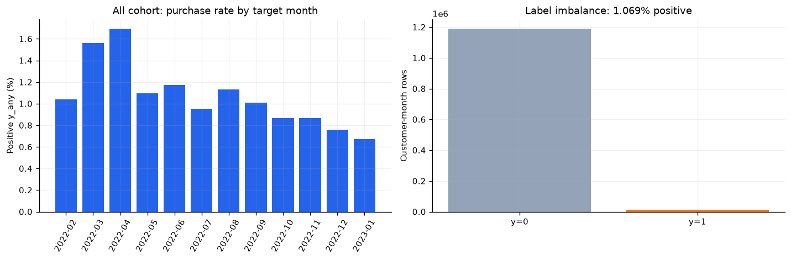

Toàn bộ 12 tháng; nhãn có/không mua. Tháng 12/2022–01/2023 chỉ mô tả độ phủ/nhãn, không lựa chọn biến.

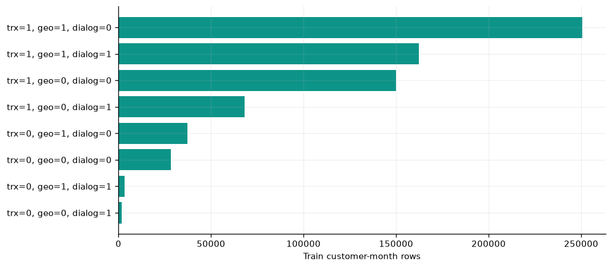

Độ phủ lịch sử trước cutoff, không phải số khách duy nhất; không loại khách thiếu nguồn.

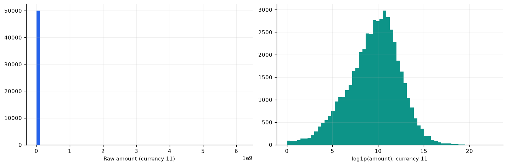

Mẫu hash cố định 50,000 giao dịch currency=11, seed 42. Trái giữ đơn vị gốc, phải bổ sung log1p; thống kê bảng dùng toàn bộ log.

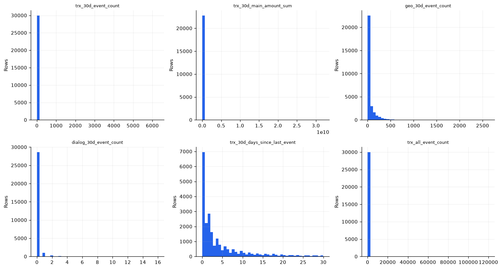

Train hash sample n=30,000; giữ trục gốc, null không xuất hiện trong histogram và được đếm riêng.

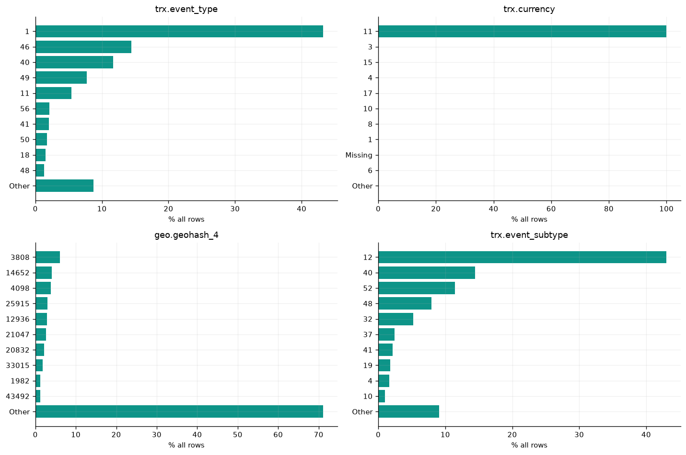

Toàn bộ raw; top 10 nhóm + Other, null hiển thị Missing nếu thuộc top. Mã số là biến phân loại ẩn danh.

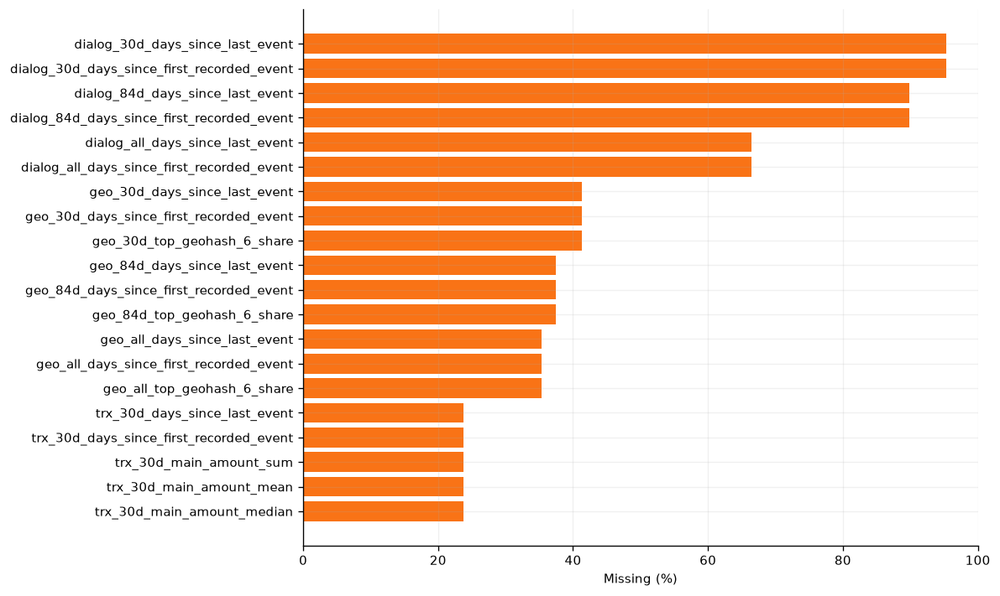

20 đặc trưng có tỷ lệ thiếu cao nhất trên toàn bộ train; kiểm tra độ phủ và trạng thái nguồn trước khi imputation.

## 5. Hai biến và đa biến
- [feature_target_associations](tables/feature_target_associations.csv): 221 dòng
- [high_correlation_pairs](tables/high_correlation_pairs.csv): 259 dòng
- [feature_band_target_rates](tables/feature_band_target_rates.csv): 20 dòng

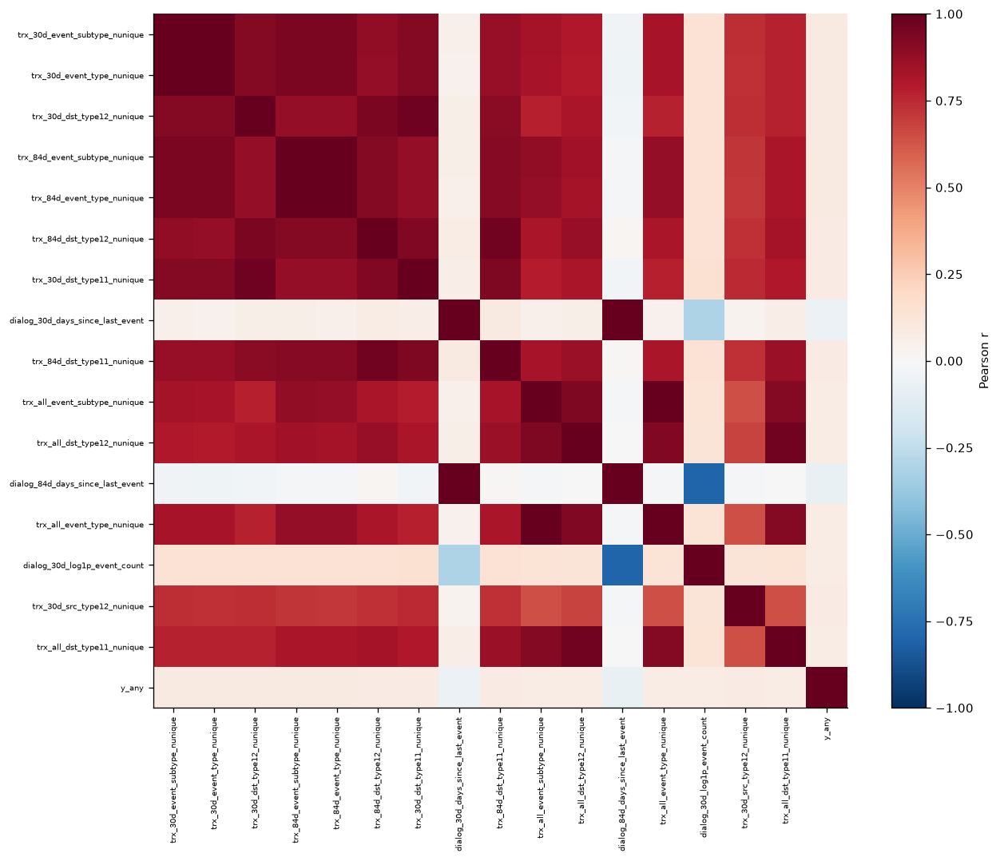

Heatmap 16 biến có |Pearson với target| lớn nhất trên train; ma trận hình dùng mẫu hash n=30,000, pairwise-complete (n cặp trong CSV). Không thay NaN thành 0.

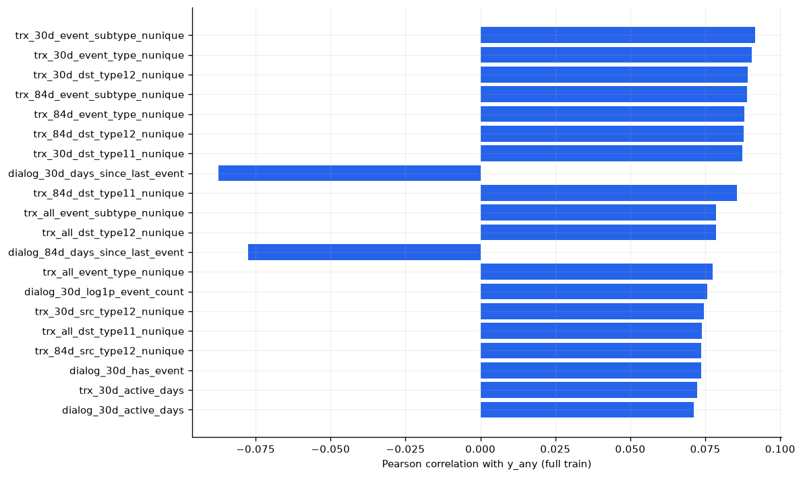

Tương quan với nhãn nhị phân trên toàn bộ train là mô tả liên hệ, chưa phải mức ảnh hưởng nhân quả hoặc feature importance.

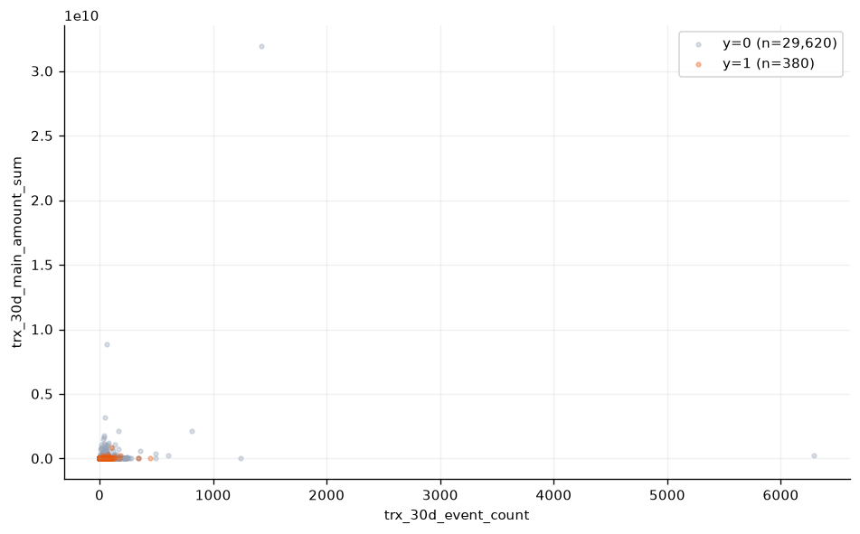

Số–số, mẫu hash train 30,000; trục tuyến tính. Nhãn hiện chỉ nhằm so sánh mô tả.

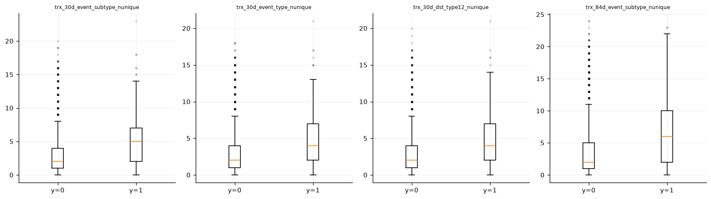

Số–phân loại trên cùng mẫu hash train n=30,000; giữ tỷ lệ lớp tự nhiên, không cân bằng lại mẫu. Râu 1,5×IQR.

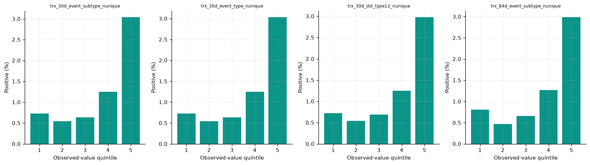

Toàn bộ train, 5 nhóm xếp theo giá trị hữu hạn. Giá trị bằng nhau có thể chia nhiều nhóm: đọc min/max trong bảng; liên hệ chưa kiểm soát tháng/khách.

## 6. Ngoại lai
- [amount_iqr_scale_comparison_currency11](tables/amount_iqr_scale_comparison_currency11.csv): 3 dòng
- [amount_outliers_by_currency](tables/amount_outliers_by_currency.csv): 14 dòng
- [feature_outliers_train](tables/feature_outliers_train.csv): 221 dòng

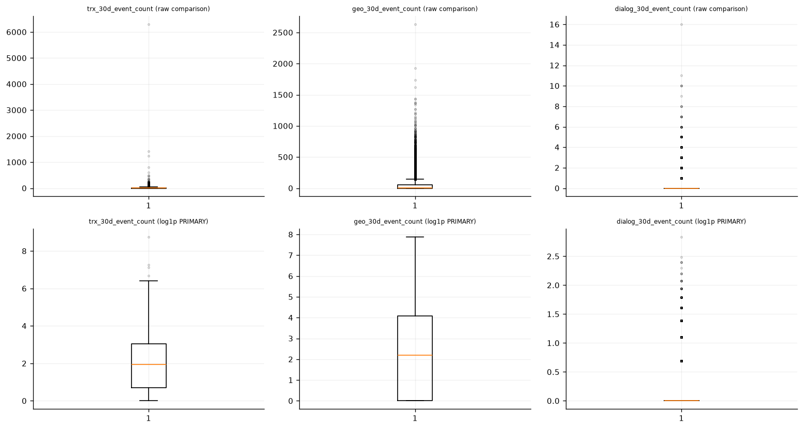

Trên: thang gốc đối chiếu; dưới: log1p dùng cho log-IQR. Mẫu hash train n=30,000; CSV tính ngưỡng/số đếm trên toàn train. Nếu IQR log bằng 0, điểm ngoài râu chỉ để xem phân phối, không dùng phân loại ngoại lai.

## 7. Feature Engineering
- [feature_engineering_plan](tables/feature_engineering_plan.csv): 12 dòng
