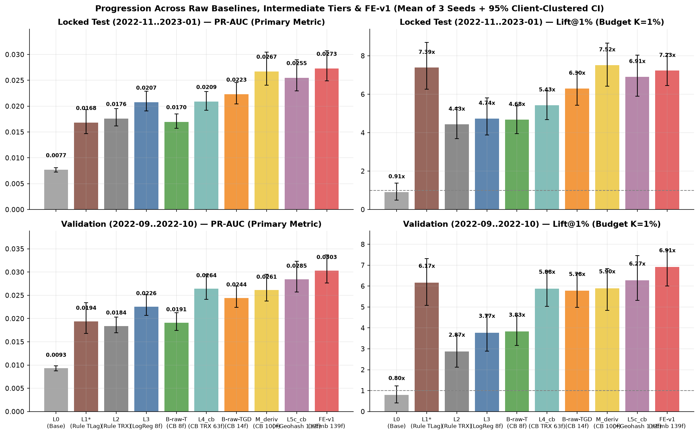
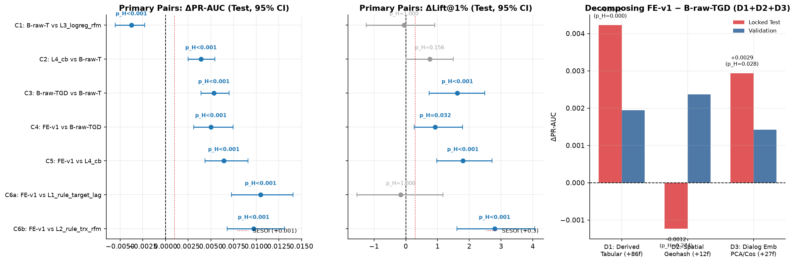
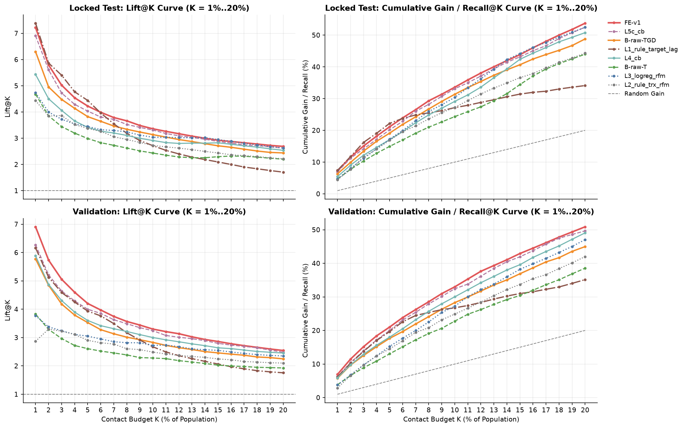
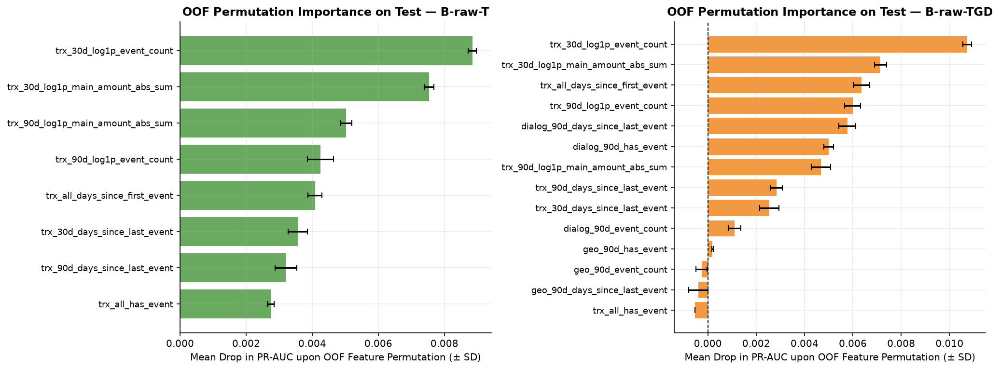
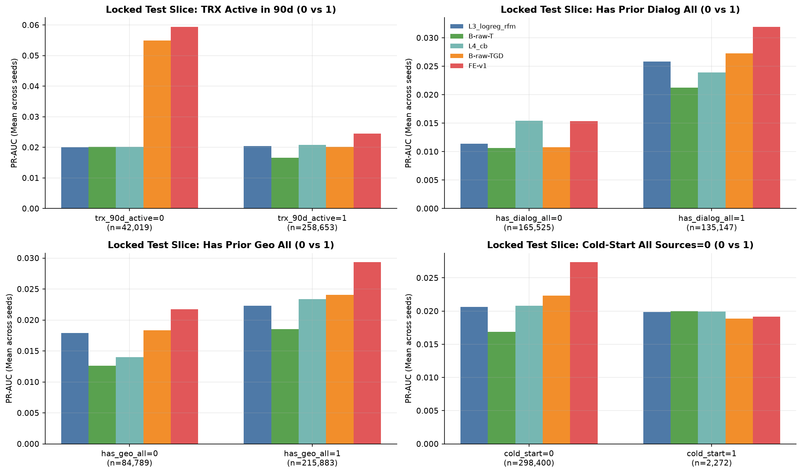

# Báo cáo Đánh giá Đóng góp Nguồn Dữ liệu, Họ Mô hình và Feature Engineering (`FE-v1`)

> **Tài liệu này tổng hợp kết quả thực thi đầy đủ Bước 0 – Bước 8** của quy trình kiểm định tách bạch đóng góp trên bài toán dự báo propensity mua mới (`panel_moscow.parquet`).
> **Cảnh báo minh bạch (Bước 2 & Bước 8):** Mốc `FE-v1` (đổi tên từ `L5d_cb_dialog_emb`, không chạy lại `seed=42`) được chốt sau khi Locked Test đã từng được xem ở vòng baseline trước; phần đánh giá đa seed (`42, 142, 242`) dưới đây bóc tách rõ phần may mắn chọn seed (`seed=42` đạt `7.87×` Lift@1% trên Test so với trung bình 3 seed `7.23× ± 0.63×`).

---

## 1. Thiết kế Đóng băng & Tính Toàn vẹn Spec (Bước 0 & Bước 2)

Thiết kế thí nghiệm, danh sách biến, ngân sách $K$, ngưỡng ý nghĩa thực tế (**SESOI**), cặp kiểm định và quy tắc đọc kết quả được khóa trước khi chạy và kiểm chứng lại mã băm SHA-256 sau toàn bộ quá trình chạy:

- **Spec máy đọc:** [`configs/fe_v1_evaluation_spec.json`](../configs/fe_v1_evaluation_spec.json) — SHA-256 không đổi: `c4b04c7154554b5648d96f9c3dcc263b8aa8eca29dea8f9b00ca8a0e12d2b62d`
- **Spec tài liệu:** [`docs/FE_V1_FROZEN_SPEC.md`](./FE_V1_FROZEN_SPEC.md) — SHA-256 không đổi: `226d194af39df555219a05177a127c0e55f72d15e413f58bd0a29655378ea347`
- **Khóa kiểm chứng:** [`outputs/fe_v1_ablation/spec_freeze_lock.json`](../outputs/fe_v1_ablation/spec_freeze_lock.json) và [`outputs/fe_v1_ablation/quality_checks.json`](../outputs/fe_v1_ablation/quality_checks.json)

### Thông số cốt lõi đã khóa
- **Metric chính:** `PR-AUC` (`average_precision`).
- **Ngân sách giả định:** `K = 1%` (`primary_budget_k = 0.01`, tương ứng `2,005` khách hàng/tháng gộp trên Validation và `3,007` trên Locked Test), đồng thời báo cáo `K = 5%`, `10%` và đường cong `K = 1%..20%` theo cả **Pooled OOF** (gộp 5 fold để xếp hạng chung) lẫn **Per-Fold Mean** (trung bình 5 fold).
- **Ngưỡng SESOI (có ý nghĩa thực tế):** đồng thời đạt $\Delta\text{PR-AUC}$ tương đối $\ge +5.0\%$ và tuyệt đối $\ge +0.0010$ (hoặc $\Delta\text{Lift@1\%} \ge +0.30\times$ tại ngân sách K).
- **Kiểm định thống kê:** Paired Client-Clustered Bootstrap (`1,000` lần lặp theo `client_id`) kết hợp hiệu chỉnh **Holm-Bonferroni** ($\alpha_{\text{Holm}} = 0.05$) trên toàn bộ họ $M = 7$ cặp chính (`C1..C6b`).
- **Đa seed & Split:** Giữ nguyên split, nhãn, 5-fold theo `client_id`, cấu hình CatBoost mặc định (`depth=6`, `500` trees); chạy 3 seed `[42, 142, 242]` cho các mô hình chính và báo cáo $\text{Mean} \pm \text{SD}$.
- **Đổi tên bậc (Bước 2):** `L5d_cb_dialog_emb` $\rightarrow$ `FE-v1` (và `FE-v1_cal`); [`outputs/baseline_moscow_v1/ladder_manifest.json`](../outputs/baseline_moscow_v1/ladder_manifest.json) giữ `rerun_performed = false` cho `seed=42`, giữ `L4_cb` và `L5c_cb` làm bậc trung gian, dành tên `FE-v2` cho vòng cải tiến tiếp theo.

### Dữ liệu & Tỷ lệ nền theo giai đoạn
| Tập đánh giá | Khoảng thời gian | Số dòng | Số dương | Tỷ lệ nền | Ngưỡng top 1% ($K=1\%$) |
|---|---|---:|---:|---:|---:|
| Train (Validation) | — | — | — | `1.210%` | — |
| **Validation** | `2022-09 .. 2022-10` | `200,448` | `1,881` | `0.9384%` | `2,005` calls |
| Train (Test) | — | — | — | `1.132%` | — |
| **Locked Test** | `2022-11 .. 2023-01` | `300,672` | `2,301` | `0.7653%` | `3,007` calls (`100,224` clients, `0%` overlap) |

*(Lưu ý: tháng `2023-01` rơi xuống mức đáy tỷ lệ nền `0.673%` do mùa nghỉ lễ đầu năm tại Nga.)*

---

## 2. Định nghĩa Hai Baseline Thô (Bước 1)

Cả hai baseline chỉ chọn cột trực tiếp từ `panel_moscow.parquet`, giữ nguyên `NaN`, **không** dùng tỷ lệ, biến liên cửa sổ, geohash, PCA/norm/cosine hay Target-Lag:

1. **`B-raw-T` (8 biến, CatBoost mặc định):** dùng đúng 8 biến TRX RFM của `L3_logreg_rfm`. Chênh lệch với `L3_logreg_rfm` chỉ phản ánh việc đổi họ mô hình (`LogReg` $\rightarrow$ `CatBoost`).
2. **`B-raw-TGD` (14 biến, CatBoost mặc định):** `B-raw-T` + `geo_90d_{has_event, event_count, days_since_last_event}` + `dialog_90d_{has_event, event_count, days_since_last_event}`.
   - **Quyết định đã chốt ở Bước 0:**
     - Không đưa `cold_start` vào `B-raw-TGD` (`include_cold_start_in_B_raw_TGD = false`) vì đây là biến tổng hợp đa nguồn/cửa sổ.
     - Chạy thêm mô hình phụ **`B-raw-TGD_logreg`** (`run_logreg_for_B_raw_TGD = true`, 14 biến thô với `LogReg`) để tạo thiết kế $2 \times 2$ đầy đủ giữa **(Tập biến: 8 vs 14) $\times$ (Họ mô hình: LogReg vs CatBoost)**.

---

## 3. Bảng Kết quả Tổng hợp Đa Seed (Bước 4)

Nguồn dữ liệu chi tiết: [`outputs/fe_v1_ablation/metrics/model_summary_multiseed.csv`](../outputs/fe_v1_ablation/metrics/model_summary_multiseed.csv) và [`outputs/fe_v1_ablation/metrics/per_seed_metrics.csv`](../outputs/fe_v1_ablation/metrics/per_seed_metrics.csv).

### 3A. Locked Test (`2022-11 .. 2023-01`, `300,672` dòng, `2,301` dương)

| Bậc / Mô hình | Số biến | Seeds | PR-AUC (Mean ± SD) [95% CI] | ROC-AUC | Lift@1% (Mean ± SD) [95% CI] | Recall@1% (Hits) | Lift@5% (R@5%) | Lift@10% (R@10%) | 5-Fold PR-AUC | 5-Fold Lift@1% |
|---|---:|---:|---|---:|---|---:|---:|---:|---:|---:|
| `L0_base_rate` | 0 | 1 | `0.0077` `[0.0073; 0.0081]` | `0.5022` | `0.91×` `[0.49; 1.38]` | `0.91%` (`21`) | `0.90×` (`4.48%`) | `0.93×` (`9.34%`) | `0.0077` | `0.89×` |
| `L1_rule_target_lag` *(Target-Lag)* | 3 | 1 | `0.0168` `[0.0147; 0.0194]` | `0.5914` | `7.39×` `[6.26; 8.70]` | `7.39%` (`170`) | `4.44×` (`22.21%`) | `2.72×` (`27.16%`) | `0.0172` | `7.40×` |
| `L2_rule_trx_rfm` | 6 | 1 | `0.0176` `[0.0161; 0.0195]` | `0.6694` | `4.43×` `[3.68; 5.30]` | `4.43%` (`102`) | `3.37×` (`16.86%`) | `2.72×` (`27.25%`) | `0.0182` | `4.39×` |
| `L3_logreg_rfm` | 8 | 3 | `0.0207 ± 0.0000` `[0.0191; 0.0229]` | `0.7394` | `4.74× ± 0.00×` `[3.89; 5.82]` | `4.74%` (`109.0`) | `3.45×` (`17.25%`) | `3.04×` (`30.38%`) | `0.0212` | `4.80×` |
| `B-raw-T` *(CatBoost thô TRX)* | 8 | 3 | `0.0170 ± 0.0002` `[0.0157; 0.0185]` | `0.6853 ± 0.0031` | `4.68× ± 0.13×` `[3.95; 5.39]` | `4.68%` (`107.7`) | `2.99×` (`14.95%`) | `2.43×` (`24.34%`) | `0.0175` | `4.73×` |
| `L4_cb` *(FE trên TRX)* | 63 | 3 | `0.0209 ± 0.0003` `[0.0192; 0.0228]` | `0.7212 ± 0.0035` | `5.43× ± 0.41×` `[4.68; 6.17]` | `5.43%` (`125.0`) | `3.41×` (`17.07%`) | `2.91×` (`29.13%`) | `0.0217` | `5.36×` |
| `B-raw-TGD` *(CatBoost thô 3 nguồn)* | 14 | 3 | `0.0223 ± 0.0005` `[0.0204; 0.0246]` | `0.7213 ± 0.0021` | `6.30× ± 0.24×` `[5.42; 7.14]` | `6.30%` (`145.0`) | `3.82×` (`19.12%`) | `3.14×` (`31.38%`) | `0.0231` | `6.19×` |
| `B-raw-TGD_logreg` *(phụ $2\times2$)* | 14 | 3 | `0.0270 ± 0.0000` `[0.0248; 0.0299]` | `0.7640` | `7.13× ± 0.00×` `[6.09; 8.25]` | `7.13%` (`164.0`) | `4.55×` (`22.73%`) | `3.55×` (`35.55%`) | `0.0278` | `7.17×` |
| `M_deriv_cb` *(cầu tách phái sinh)* | 100 | 1 (`42`) | `0.0267` `[0.0240; 0.0304]` | `0.7390` | `7.52×` `[6.41; 8.67]` | `7.52%` (`173`) | `4.30×` (`21.51%`) | `3.42×` (`34.16%`) | `0.0275` | `7.48×` |
| `L5c_cb` *(+ geohash, trung gian)* | 112 | 1 (`42`) | `0.0255` `[0.0230; 0.0290]` | `0.7370` | `6.91×` `[5.89; 8.04]` | `6.91%` (`159`) | `4.03×` (`20.17%`) | `3.31×` (`33.12%`) | `0.0263` | `6.71×` |
| **`FE-v1`** *(trước là `L5d`)* | **139** | **3** | **`0.0273 ± 0.0011`** `[0.0249; 0.0307]` | `0.7483 ± 0.0033` | **`7.23× ± 0.63×`** `[6.45; 8.13]` | `7.23%` (`166.3`) | `4.23×` (`21.14%`) | `3.36×` (`33.59%`) | `0.0282` | `7.33×` |

> **Biến thiên theo seed của `FE-v1` trên Test:** `seed=42` đạt PR-AUC `0.0284`, Lift@1% `7.87×` (`181` hits); `seed=142` giảm còn `0.0262` (`6.61×`, `152` hits); `seed=242` đạt `0.0272` (`7.21×`, `166` hits).

### 3B. Validation (`2022-09 .. 2022-10`, `200,448` dòng, `1,881` dương)

| Bậc / Mô hình | Số biến | Seeds | PR-AUC (Mean ± SD) [95% CI] | ROC-AUC | Lift@1% (Mean ± SD) [95% CI] | Recall@1% (Hits) | Lift@5% (R@5%) | Lift@10% (R@10%) | 5-Fold PR-AUC | 5-Fold Lift@1% |
|---|---:|---:|---|---:|---|---:|---:|---:|---:|---:|
| `L0_base_rate` | 0 | 1 | `0.0093` `[0.0087; 0.0098]` | `0.4989` | `0.80×` | `0.80%` (`15.0`) | `0.95×` (`4.73%`) | `1.00×` (`10.05%`) | `0.0094` | `1.38×` |
| `L1_rule_target_lag` *(Target-Lag)* | 3 | 1 | `0.0194` `[0.0168; 0.0234]` | `0.5895` | `6.17×` `[5.07; 7.32]` | `6.17%` (`116`) | `3.93×` (`19.67%`) | `2.67×` (`26.74%`) | `0.0204` | `6.25×` |
| `L2_rule_trx_rfm` | 6 | 1 | `0.0184` `[0.0169; 0.0203]` | `0.6481` | `2.87×` `[2.12; 3.66]` | `2.87%` (`54`) | `2.90×` (`14.51%`) | `2.49×` (`24.88%`) | `0.0189` | `2.89×` |
| `L3_logreg_rfm` | 8 | 3 | `0.0226 ± 0.0000` `[0.0207; 0.0251]` | `0.7255` | `3.77× ± 0.00×` `[2.89; 4.62]` | `3.77%` (`71.0`) | `3.05×` (`15.26%`) | `2.72×` (`27.22%`) | `0.0231` | `3.66×` |
| `B-raw-T` | 8 | 3 | `0.0191 ± 0.0001` `[0.0175; 0.0212]` | `0.6742 ± 0.0015` | `3.83× ± 0.30×` `[3.17; 4.58]` | `3.83%` (`72.0`) | `2.61×` (`13.04%`) | `2.28×` (`22.79%`) | `0.0203` | `3.82×` |
| `L4_cb` | 63 | 3 | `0.0264 ± 0.0004` `[0.0241; 0.0294]` | `0.7244 ± 0.0018` | `5.88× ± 0.27×` `[5.03; 6.70]` | `5.88%` (`110.7`) | `3.60×` (`18.02%`) | `3.00×` (`30.02%`) | `0.0274` | `5.87×` |
| `B-raw-TGD` | 14 | 3 | `0.0244 ± 0.0007` `[0.0224; 0.0270]` | `0.6982 ± 0.0049` | `5.78× ± 0.32×` `[4.99; 6.60]` | `5.78%` (`108.7`) | `3.53×` (`17.65%`) | `2.83×` (`28.30%`) | `0.0254` | `5.74×` |
| `B-raw-TGD_logreg` | 14 | 3 | `0.0314 ± 0.0000` `[0.0288; 0.0351]` | `0.7632` | `6.01× ± 0.00×` `[4.99; 7.05]` | `6.01%` (`113.0`) | `4.48×` (`22.38%`) | `3.44×` (`34.45%`) | `0.0329` | `5.87×` |
| `M_deriv_cb` | 100 | 1 (`42`) | `0.0261` `[0.0237; 0.0295]` | `0.7168` | `5.90×` `[4.84; 6.84]` | `5.90%` (`111`) | `3.87×` (`19.35%`) | `3.14×` (`31.37%`) | `0.0286` | `5.92×` |
| `L5c_cb` | 112 | 1 (`42`) | `0.0285` `[0.0257; 0.0323]` | `0.7212` | `6.27×` `[5.33; 7.46]` | `6.27%` (`118`) | `4.00×` (`19.99%`) | `3.24×` (`32.43%`) | `0.0299` | `6.19×` |
| **`FE-v1`** | **139** | **3** | **`0.0303 ± 0.0006`** `[0.0276; 0.0337]` | `0.7345 ± 0.0042` | **`6.91× ± 0.16×`** `[6.00; 7.74]` | `6.91%` (`130.0`) | `4.20×` (`21.02%`) | `3.30×` (`33.00%`) | `0.0314` | `6.83×` |

---

## 4. Kiểm định Bắt cặp (Paired Client-Clustered Bootstrap & Holm-Bonferroni, Bước 3)

Nguồn dữ liệu chi tiết: [`paired_holm_primary.csv`](../outputs/fe_v1_ablation/metrics/paired_holm_primary.csv), [`paired_holm_secondary_decomposition.csv`](../outputs/fe_v1_ablation/metrics/paired_holm_secondary_decomposition.csv), [`paired_auxiliary_2x2.csv`](../outputs/fe_v1_ablation/metrics/paired_auxiliary_2x2.csv).

### 4A. Họ 7 cặp chính trên Locked Test ($M = 7$, Holm $\alpha = 0.05$)

| Cặp | Câu hỏi nghiên cứu | $\Delta$PR-AUC (Rel %) [95% CI] | $p_{\text{Holm}}$ (PR-AUC) | $\Delta$Lift@1% [95% CI] | $p_{\text{Holm}}$ (Lift@1%) | Kết luận (SESOI + Holm) |
|---|---|---|---:|---|---:|---|
| **`C1`: `B-raw-T` − `L3_logreg_rfm`** | Chỉ đổi họ mô hình (LogReg $\rightarrow$ CatBoost), cùng 8 biến TRX | `-0.0038` (`-18.18%`) `[-0.0056; -0.0023]` | `<0.001` | `-0.06×` | `1.000` | CatBoost mặc định **kém hơn có ý nghĩa** LogReg trên 8 biến thô ($\Delta$ROC-AUC `-0.0541`, $p_{\text{Holm}}<0.001$) |
| **`C2`: `L4_cb` − `B-raw-T`** | FE trên chỉ TRX (`8` $\rightarrow$ `63` biến) | `+0.0039` (`+23.00%`) `[+0.0025; +0.0054]` | `<0.001` | `+0.75×` (`+16.10%`) `[0.00; +1.50]` | `0.156` *(raw `0.052`)* | **Đạt SESOI+Holm ở PR-AUC**; Lift@1% chưa qua ngưỡng Holm |
| **`C3`: `B-raw-TGD` − `B-raw-T`** | Thêm GEO + DIALOG ở mức thô (`8` $\rightarrow$ `14` biến) | `+0.0053` (`+31.38%`) `[+0.0039; +0.0070]` | `<0.001` | `+1.62×` (`+34.67%`) `[+0.74; +2.48]` | `<0.001` | **PASS hoàn toàn** cả PR-AUC lẫn Lift@1% |
| **`C4`: `FE-v1` − `B-raw-TGD`** | Biến phái sinh, geohash & embedding (`14` $\rightarrow$ `139` biến) | `+0.0050` (`+22.41%`) `[+0.0031; +0.0074]` | `<0.001` | `+0.93×` (`+14.71%`) `[+0.26; +1.78]` | `0.032` *(raw `0.008`)* | **PASS hoàn toàn** cả PR-AUC lẫn Lift@1% *(trên Val: $+24.14\%$ PR-AUC $p<0.001$; $+19.63\%$ Lift@1% $p_{\text{Holm}}=0.016$)* |
| **`C5`: `FE-v1` − `L4_cb`** | Đóng góp tổng của GEO + DIALOG | `+0.0064` (`+30.74%`) `[+0.0043; +0.0091]` | `<0.001` | `+1.80×` (`+33.07%`) `[+0.97; +2.72]` | `<0.001` | **PASS hoàn toàn** cả PR-AUC lẫn Lift@1% |
| **`C6a`: `FE-v1` − `L1_rule_target_lag`** | Vượt luật Target-Lag tại ngân sách $K=1\%$? | `+0.0105` (`+62.29%`) `[+0.0073; +0.0141]` | `<0.001` | `-0.16×` (`-2.16%`) `[-1.54; +1.17]` | `1.000` *(Val: `+0.74×`, `0.692`)* | Vượt vượt trội về PR-AUC, ROC-AUC (`+0.1569`), Lift@10% (`+0.64×`); **hòa thống kê tại $K=1\%$** |
| **`C6b`: `FE-v1` − `L2_rule_trx_rfm`** | Vượt luật TRX RFM tại ngân sách $K=1\%$? | `+0.0097` (`+55.17%`) `[+0.0068; +0.0131]` | `<0.001` | `+2.80×` (`+63.07%`) `[+1.61; +4.06]` | `<0.001` | **PASS hoàn toàn** cả PR-AUC lẫn Lift@1% |

### 4B. Bổ sung Phép thử Phụ $2 \times 2$ (`LogReg` vs `CatBoost` trên biến thô)
- **`A1` (`B-raw-TGD_logreg` − `L3_logreg_rfm`):** Thêm GEO + DIALOG mức thô giúp `LogReg` tăng vọt trên cả Val ($\Delta\text{PR-AUC} = +0.0088$, $+38.94\%$, $p<0.001$; $\Delta\text{Lift@1\%} = +2.23\times$, $p<0.001$) lẫn Test ($\Delta\text{PR-AUC} = +0.0063$, $+30.15\%$, $p<0.001$; $\Delta\text{Lift@1\%} = +2.39\times$, $p<0.001$).
- **`A2` (`B-raw-TGD` − `B-raw-TGD_logreg`):** Trên 14 biến thô, CatBoost mặc định tiếp tục **thua** LogReg có hiệu lực trên cả Val ($\Delta\text{PR-AUC} = -0.0069$, $-22.04\%$, $p<0.001$) và Test ($\Delta\text{PR-AUC} = -0.0047$, $-17.41\%$, $p<0.001$; $\Delta\text{Lift@1\%} = -0.83\times$, $p=0.144$).
- **Hệ quả quan trọng cho `FE-v2`:** `B-raw-TGD_logreg` (chỉ `14` biến thô) đạt PR-AUC `0.0270` (`7.13×`, ROC-AUC `0.7640`) trên Test và `0.0314` trên Val — **xấp xỉ hoặc vượt `FE-v1`** (`0.0273` Test / `0.0303` Val) về PR-AUC & ROC-AUC, chỉ kém nhẹ ở Lift@1% (`7.13×` vs `7.23×` trên Test; `6.01×` vs `6.91×` trên Val). Điều này cho thấy phần lớn mức tăng nội bộ của CatBoost ở `C4` đến từ việc nhiều feature phái sinh giúp CatBoost khắc phục điểm yếu của cây quyết định mặc định trên ít biến đếm thô, chứ chưa vượt xa ngưỡng tuyến tính điều chuẩn trên 14 biến thô.

### 4C. Phân rã Thứ cấp Có điều kiện (Quy tắc Bước 7 được kích hoạt bởi `C4 PASS`, tại `seed=42`)
Từ `B-raw-TGD` (`0.0225` Test / `0.0242` Val) đến `FE-v1` (`0.0284` Test / `0.0299` Val; tổng $\Delta = +0.0059$ Test / $+0.0057$ Val):

| Bước tách (`seed=42`) | Nhóm biến thêm vào | Test $\Delta$PR-AUC [Holm] | Test $\Delta$Lift@1% [Holm] | Val $\Delta$PR-AUC [raw / Holm] | Nhận xét |
|---|---|---:|---:|---:|---|
| **`D1`: `M_deriv_cb` − `B-raw-TGD`** | `+86` biến phái sinh bảng (đa cửa sổ `30d/90d/all`, tỷ lệ, `cold_start`) | `+0.0042` (`+18.77%`, **$p<0.001$ PASS**) | `+1.17×` (`p_raw=0.050`, `p_Holm=0.150`; Lift@5% `+0.46×` $p=0.012$) | `+0.0019` (`p_raw=0.062`, `0.138`) | Trụ cột chính trong họ CatBoost |
| **`D2`: `L5c_cb` − `M_deriv_cb`** | `+12` biến geohash | `-0.0012` (`-4.61%`, `p_Holm=0.274`) | `-0.61×` (`p_Holm=0.208`) | `+0.0024` (`p_raw=0.046`, `0.138`) | **Đảo dấu Val $\rightarrow$ Test**, thiếu ổn định |
| **`D3`: `FE-v1` − `L5c_cb`** | `+27` biến `DIALOG` embedding (PCA/norm/cosine) | `+0.0029` (`+11.52%`, **$p=0.028$ PASS**) | `+0.96×` (`p_raw=0.098`, `0.196`) | `+0.0014` (`p_raw=0.290`, `0.290`) | Bổ sung tín hiệu ngữ nghĩa bền vững trên Test |

---

## 5. Đường cong Lift/Gain (`K = 1%..20%`), Kiểm tra Chất lượng & Chẩn đoán (Bước 6)

- **Kiểm tra tự động & Xáo nhãn:** [`outputs/fe_v1_ablation/quality_checks.json`](../outputs/fe_v1_ablation/quality_checks.json) báo trạng thái `ALL_QUALITY_GATES_PASSED` cho toàn bộ 11 mô hình (`0` cột cấm, đúng số biến theo spec, `0` rò rỉ Target-Lag ngoại trừ `L1_rule_target_lag`). Cả 16 phép thử xáo nhãn (`y_train` lẫn `y_eval`, [`shuffled_label_sanity.csv`](../outputs/fe_v1_ablation/metrics/shuffled_label_sanity.csv)) đưa PR-AUC về xấp xỉ tỷ lệ nền. Kiểm tra hợp lý `B-raw-T` so với `L3` và `L4_cb` đạt (`passed = true`).
- **Đường cong Lift/Gain (`K = 1%..20%`):** [`lift_gain_curve_1_to_20pct.csv`](../outputs/fe_v1_ablation/metrics/lift_gain_curve_1_to_20pct.csv) & Hình 3.
- **Permutation Importance trên `B-raw-T` và `B-raw-TGD` (OOF, 5 repeats):** [`permutation_importance_b_raw.csv`](../outputs/fe_v1_ablation/metrics/permutation_importance_b_raw.csv) & Hình 4 — khẳng định bộ biến `DIALOG` (`dialog_90d_days_since_last_event`, `dialog_90d_has_event`, `dialog_90d_event_count`) gánh hầu hết mức tăng ngoài TRX, trong khi nhóm `geo_90d_*` có permutation importance xấp xỉ `0` đến hơi âm (`-0.0004` tới `+0.0002`).
- **Chẩn đoán theo Slice & Tháng:** [`slice_metrics.csv`](../outputs/fe_v1_ablation/metrics/slice_metrics.csv), [`monthly_metrics_test.csv`](../outputs/fe_v1_ablation/metrics/monthly_metrics_test.csv) & Hình 5.
- **Thời gian chạy & RAM:** [`fe_v1_timings.csv`](../outputs/fe_v1_ablation/metrics/fe_v1_timings.csv) — chạy tuần tự trên cấu hình hạn chế (`8.45 GB` RAM, `Intel i3-8145U` 2 nhân / 4 luồng), mức RSS đỉnh CatBoost đạt `1,984.4 MB` (`FE-v1` val `seed=142`) và `1,745.7 MB` (`M_deriv_cb` / `L5c_cb`).

| Hình 3: Lift & Gain Curve (`K=1%..20%`) | Hình 4: Permutation Importance (`B-raw`) | Hình 5: Slice Diagnostics |
|---|---|---|
|  |  |  |

---

## 6. Kết luận theo Quy tắc Bước 7

1. **Quy tắc R1 (`FE-v1` vượt `B-raw-TGD` qua SESOI & Holm):** **Kích hoạt và được xác nhận.** Trong họ CatBoost, vòng Feature Engineering v1 mang lại giá trị rõ rệt (`C4`: `+22.41%` PR-AUC, $p_{\text{Holm}}<0.001$; `+0.93×` Lift@1%, $p_{\text{Holm}}=0.032$). Phần phân rã `D1..D3` chứng minh đóng góp đến từ **biến phái sinh đa cửa sổ (`D1`)** và **`DIALOG` embedding (`D3`)**, trong khi **`geohash` (`D2`) gây nhiễu/lệch phân phối từ Val sang Test**.
2. **Quy tắc R2 (Diễn giải đa họ mô hình từ phép thử $2\times2$):** Khi đối chiếu thêm với `B-raw-TGD_logreg` (chỉ 14 biến thô), lợi thế lớn nhất mang tính bản chất vẫn đến từ **việc bổ sung nguồn dữ liệu `DIALOG`** (`C3` & `A1`: `+30%..+31%` PR-AUC, $+1.62\times..+2.39\times$ Lift@1%). `CatBoost` mặc định yếu hơn `LogReg` trên biến đếm thô thưa, nên `FE-v2` cần ưu tiên thử regularize CatBoost/LightGBM, tuyến tính hóa / đưa log-biến, hoặc kết hợp `DIALOG` embedding + biến phái sinh trọng yếu với `LogReg` / mô hình lai thay vì chỉ nhồi thêm feature cây.
3. **Quy tắc R3 (`B-raw-TGD` / `L4_cb` vs `L1` / `L2` ở ngân sách `K=1%`):** Cả `B-raw-TGD` (`6.30×`) và `L4_cb` (`5.43×`) đều vượt xa luật pure-TRX `L2` (`4.43×`) trên Test $\rightarrow$ pipeline snapshot và cửa sổ feature sạch, đáng tin cậy. So với luật `L1_rule_target_lag` (dùng target lag), `FE-v1` vượt trội toàn cục (`+62.3%` PR-AUC, `p<0.001`) và **hòa thống kê tại đỉnh $K=1\%$** (`7.23×` vs `7.39×`, $p_{\text{Holm}}=1.000$), chịu ảnh hưởng chính ở tháng `2023-01` khi nhóm mua lặp lại chiếm ưu thế.

---

## 7. Giả định và Hạn chế (Bước 8)

1. **Tập Locked Test đã từng được xem (Post-selection optimism):** `FE-v1` (`L5d`) được đặt làm mốc sau khi kết quả `seed=42` trên Test đã được quan sát ở vòng trước. Thực nghiệm 3 seed cho thấy `seed=42` (`7.87×` Lift@1%) nằm ở phía cao hơn trung bình 3 seed (`7.23× ± 0.63×`); do đó mọi cải tiến `FE-v2` về sau cần giữ Locked Test mới hoặc đánh giá nghiêm ngặt trên khung thời gian/đa seed tương đương trước khi kết luận.
2. **Chỉ có ~1 năm dữ liệu nhãn:** Sau giai đoạn burn-in `02–03/2022`, toàn bộ chuỗi huấn luyện–kiểm định chỉ trải dài 10 tháng có nhãn (`04/2022–01/2023`), chưa bao phủ đủ một chu kỳ mùa vụ đầy đủ 12 tháng trở lên.
3. **Tỷ lệ nền suy giảm liên tục & mùa vụ đầu năm:** Tỷ lệ dương tính giảm đều từ `1.210%` (Train Val) $\rightarrow$ `0.938%` (Val) $\rightarrow$ `0.765%` (Locked Test), riêng tháng `2023-01` tụt xuống `0.673%` trong kỳ nghỉ Tết Dương lịch Nga; điều này làm điểm số tuyệt đối (như PR-AUC, Precision@K) nhạy với thời điểm và đòi hỏi luôn đọc Lift kèm baseline theo tháng.
4. **Propensity không đồng nghĩa với Uplift (Observational vs Causal):** Mô hình hiện tại ước lượng xác suất chuyển đổi quan sát được $P(Y=1 \mid X)$ chứ **không** ước lượng hiệu ứng nhân quả ròng (CATE / Uplift) khi tác động chiến dịch vì thiếu dữ liệu thử nghiệm ngẫu nhiên có nhóm đối chứng (RCT treatment/control). Việc xếp hạng top 1% theo propensity có nguy cơ ưu tiên cả nhóm khách hàng "chắc chắn tự mua" (*sure things*) thay vì nhóm nhạy cảm nhất với tác động tiếp thị (*persuadables*).

---

## 8. Phụ lục Manifest & Lộ trình Google Colab cho Giai đoạn Tiếp theo

- **Manifest cập nhật:** [`outputs/fe_v1_ablation/fe_v1_manifest.json`](../outputs/fe_v1_ablation/fe_v1_manifest.json) (`git_commit = 83be681`, `python 3.14.2`, `catboost 1.2.10`, `lightgbm 4.7.0`, `scikit_learn 1.9.1`, `pandas 3.1.0`, `numpy 2.5.4`).
- **Quy trình từ tác vụ sau (`FE-v2` trở đi):** Chuyển toàn bộ các vòng huấn luyện/thử nghiệm mới sang **Google Colab** (tận dụng GPU/RAM cao để tăng tốc thay vì chạy local dưới trần `8.45 GB` RAM / 2 nhân CPU), sau đó tải lại file `.ipynb` đã lưu kèm cell output về repository để lưu trữ và kiểm chứng.
