# MBD-mini — EDA toàn lịch sử và rà soát 12 yêu cầu

Giữ **100,224 khách** trong mỗi phân phối nguồn; không lọc cohort theo yêu cầu đủ cả ba nguồn. Phạm vi từ log đầu 31/12/2020 đến log cuối 31/12/2022; nhãn từ 02/2022 đến 01/2023. Chỉ dùng detail để đếm sự kiện. ptls là dạng chuỗi để đối chiếu, không cộng thêm vào tổng log.

Dữ liệu gốc được giữ nguyên. Timestamp theo lịch naive lưu trong file, chưa tự đổi múi giờ. Mọi hình trong bản rà soát dùng số gốc và trục tuyến tính. Mốc tháng biên có thể chỉ chứa một phần ngày/tháng.

## 1. Mỗi bảng chứa gì và có những biến nào?

| bảng | grain | dòng | biến |
| --- | --- | --- | --- |
| client_split | customer | 100,224 | client_id, fold |
| targets | customer_month | 1,202,688 | client_id, mon, target_1, target_2, target_3, target_4, trans_count, diff_trans_date, fold |
| detail/trx | event | 38,764,930 | client_id, event_time, amount, event_type, event_subtype, currency, src_type11, src_type12, dst_type11, dst_type12, src_type21, src_type22, src_type31, src_type32, fold |
| detail/geo | event | 66,295,724 | client_id, event_time, geohash_4, geohash_5, geohash_6, fold |
| detail/dialog | event | 217,205 | client_id, event_time, embedding, fold |
| ptls/trx | customer_sequence | 98,721 | client_id, event_time, amount, event_type, event_subtype, currency, src_type11, src_type12, dst_type11, dst_type12, src_type21, src_type22, src_type31, src_type32, fold |
| ptls/geo | customer_sequence | 72,573 | client_id, event_time, geohash_4, geohash_5, geohash_6, fold |
| ptls/dialog | customer_sequence | 46,320 | client_id, event_time, embedding, fold |

`client_id` nối khách giữa các bảng; `fold` là partition chia khách. `targets` có khóa khách–tháng; `mon` là marker nhãn, bốn target là nhãn nhị phân. `trans_count` và `diff_trans_date` là trường phụ trợ chưa xác minh công thức/cutoff. Trong trx, `amount` là float32 gốc; event_type/subtype, currency và các họ src/dst là mã ẩn danh. Geo chứa ba cấp mã vị trí; dialog chứa vector float32 768 chiều, không có văn bản gốc. Các cột của ptls tương ứng là mảng theo sự kiện; event_time ở ptls được lưu int64, không tự giả định đơn vị khi chuyển thời gian.

Kiểu lưu của từng biến: [source_schema.csv](tables/review/source_schema.csv). Danh mục **tất cả bảng kết quả và từng biến trong bảng**: [data_catalog.md](data_catalog.md). Ý nghĩa cột nguồn: [từ điển MBD-mini](../dict/mbd_mini.md).

Đối chiếu số phần tử chuỗi với log detail:

| source | detail_events | ptls_events | max_detail_events | max_sequence_events | customers_shorter_sequence | customers_longer_sequence | customer_presence_mismatch |
| --- | --- | --- | --- | --- | --- | --- | --- |
| trx | 38,764,930 | 36,744,910 | 1,020,773 | 10,000 | 13 | 0 | 0 |
| geo | 66,295,724 | 66,295,724 | 39,487 | 39,487 | 0 | 0 | 0 |
| dialog | 217,205 | 217,205 | 114 | 114 | 0 | 0 | 0 |

`ptls/trx` thiếu **2.020.020 phần tử ở 13 khách** so với detail/trx; chuỗi dài nhất có 10.000 phần tử, trong khi detail có khách tới 1.020.773 log. Đây là dấu hiệu có giới hạn chiều dài chuỗi; chưa xác minh cách chọn phần được giữ. Geo và dialog có tổng phần tử và số log theo khách khớp. Vì vậy, toàn bộ EDA, biểu đồ và lịch sử trong mẫu dùng **detail** làm nguồn chuẩn; không thay bằng ptls hoặc cộng hai dạng. Các bảng ptls trong sampledata được giữ đúng như nguồn để đối chiếu, không bảo đảm có mọi sự kiện detail.

## 2. Null có nghĩa gì, vì sao có null?

Null thuộc tính là thiếu giá trị trong **một sự kiện/dòng đã tồn tại**. Không có dòng sự kiện ở một tháng là trường hợp khác. Nguyên nhân thu thập chính xác không có trong dữ liệu; phần dưới phân biệt số đếm đã kiểm chứng và cách diễn giải cần xác minh.

| source | column | rows | missing_n | missing_percent |
| --- | --- | --- | --- | --- |
| targets | diff_trans_date | 1,202,688 | 120,786 | 10.043004% |
| trx | currency | 38,764,930 | 118 | 0.000304% |
| trx | src_type11 | 38,764,930 | 217,361 | 0.560716% |
| trx | src_type12 | 38,764,930 | 217,361 | 0.560716% |
| trx | dst_type11 | 38,764,930 | 243,824 | 0.628981% |
| trx | dst_type12 | 38,764,930 | 243,824 | 0.628981% |
| trx | src_type21 | 38,764,930 | 42,293 | 0.109101% |
| trx | src_type22 | 38,764,930 | 42,293 | 0.109101% |
| trx | src_type31 | 38,764,930 | 78,996 | 0.203782% |
| trx | src_type32 | 38,764,930 | 78,996 | 0.203782% |

- `client_split`: không có null ở ID hoặc fold; nếu có thì không xác định được khách/nhóm chia.
- `targets`: bốn target, ID, mon, fold và trans_count đầy đủ. `diff_trans_date=null` nghĩa là chênh lệch thời gian chưa được cung cấp/tính được, không có nghĩa target bị thiếu. Không tự điền 0.
- `detail/trx`: không thiếu ID, timestamp, amount hoặc mã loại. Các null ở currency/src/dst nghĩa là thiếu mã thuộc tính; giữ giao dịch và dùng cờ missing nếu tạo feature.
- `detail/geo` và `detail/dialog`: các dòng được ghi nhận không có null cột; việc một khách/tháng không có dòng không tạo ra null bên trong bảng raw.
- `ptls`: null phần tử, null cả mảng và thiếu cả hàng khách là ba tình huống riêng. Không có chuỗi nghĩa là không có log nguồn được ghi nhận trong lịch sử; không xóa khách khỏi client_split.

Đối chiếu diff_trans_date với trans_count trên toàn bộ nhãn:

| trans_count_group | rows | missing_diff | min_trans_count | max_trans_count |
| --- | --- | --- | --- | --- |
| one | 50,460 | 0 | 1 | 1 |
| two_or_more | 1,031,442 | 0 | 2 | 1,000 |
| zero | 120,786 | 120,786 | 0 | 0 |

Trong bản dữ liệu này, **toàn bộ 120.786 null của diff_trans_date trùng với trans_count=0**, và mọi dòng trans_count>0 đều có diff_trans_date. Đây là bằng chứng thực nghiệm rằng trường thiếu đi cùng việc không có giao dịch trong phạm vi trans_count; không suy ra đơn vị hay công thức chính xác của diff_trans_date.

Các cặp thuộc tính thiếu đồng thời:

| pair | both_null | only_one_null | rows |
| --- | --- | --- | --- |
| src_type11 / src_type12 | 217,361 | 0 | 38,764,930 |
| dst_type11 / dst_type12 | 243,824 | 0 | 38,764,930 |
| src_type21 / src_type22 | 42,293 | 0 | 38,764,930 |
| src_type31 / src_type32 | 78,996 | 0 | 38,764,930 |

Sự thiếu đồng thời gợi ý cấu trúc cấp cha/con hoặc cơ chế ghi nhận chung; dữ liệu chưa xác nhận đó là “không áp dụng” hay lỗi thu thập. Xem [null theo event_type](tables/review/null_by_event_type.csv) và [null phần tử/độ dài chuỗi ptls](tables/review/sequence_quality.csv). ptls có 0 null phần tử ở các mảng một cấp trong bản này, khác với null thuộc tính ở detail/trx; không dùng ptls để kết luận raw không thiếu mã. Kiểm tra cả phần tử lồng bên trong embedding: [embedding_element_quality.csv](tables/review/embedding_element_quality.csv).

## 3. Kiểm tra duplicate

| source | kind | duplicate_n | duplicate_groups | analyzed_rows | scope |
| --- | --- | --- | --- | --- | --- |
| clients | unique_key | 0 | 0 | 100,224 | full |
| clients | full_row | 0 | 0 | 100,224 | full |
| targets | unique_key | 0 | 0 | 1,202,688 | full |
| targets | full_row | 0 | 0 | 1,202,688 | full |
| trx | full_row | 0 | 0 | 38,764,930 | full |
| trx | same_client_time_candidate | 1 | 1 | 38,764,930 | full |
| geo | full_row | 0 | 0 | 66,295,724 | full |
| geo | same_client_time_candidate | 0 | 0 | 66,295,724 | full |
| dialog | full_row | 0 | 0 | 217,205 | full |
| dialog | same_client_time_candidate | 0 | 0 | 217,205 | full |
| ptls_trx | unique_key | 0 | 0 | 98,721 | full |
| ptls_geo | unique_key | 0 | 0 | 72,573 | full |
| ptls_dialog | unique_key | 0 | 0 | 46,320 | full |

Đếm toàn bộ xuyên shard/batch: `duplicate_n = tổng(nhóm trùng − 1)`, không phải kết quả trên mẫu. `full_row` so sánh mọi cột và fold, kể cả nội dung embedding; null/NaN được chuẩn hóa nhất quán. `unique_key` dùng client_id cho khách/ptls và client_id–mon cho targets. `same_client_time_candidate` chỉ là ứng viên: nhiều sự kiện cùng thời điểm có thể khác thuộc tính, không tự xóa.

## 4. Giữ toàn bộ thời gian và biểu diễn khung thiếu nguồn bằng null

Mọi giao dịch, geo và hội thoại trước 01/2022 vẫn được giữ. Không cắt về giao của ba nguồn. Trong bảng khách–tháng, trước 01/2022, geo/dialog không có log được đặt `null` kèm `missing_reason=unobserved_early_source`; ô có log vẫn giữ số đếm gốc. Từ 01/2022, 0 nghĩa là không ghi nhận log, không chứng minh khách thực sự không hoạt động hoặc nguồn được thu thập liên tục. Các cột `*_raw_events` bảo toàn số đếm để đối chiếu; các thuộc tính raw không bị impute.

Lưới đầy đủ 25 tháng cho mẫu nằm tại `sampledata/mbd_mini/customer_month.parquet`. Cache ma trận toàn dân số chứa toàn lịch sử. Đã đối chiếu chính xác mọi ô với cache matrix.npz trước đó.

## 5. Ma trận độ phủ theo nhóm có chủ đích

Xếp nhóm theo tổng số log toàn lịch sử: 8 khách nhiều nhất, 8 gần mean dân số, 8 gần median dân số, 8 ít nhất nhưng có log và 8 không có log. Các nhóm không lặp khách; ties theo ID đã sắp xếp. Đây là ví dụ có chủ đích, không dùng để ước lượng tỷ lệ dân số. Mỗi ảnh có thang màu tuyến tính riêng để đọc rõ nhóm; so sánh bằng số trong ô. Số trong ô là log, không phải ngày. Mã KH chỉ có ý nghĩa trong nhóm.

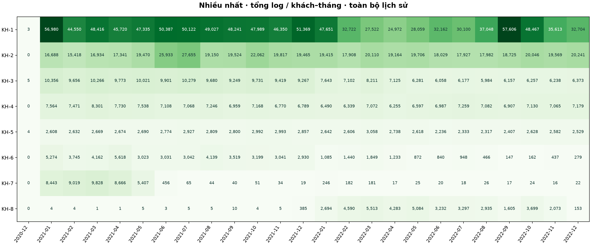

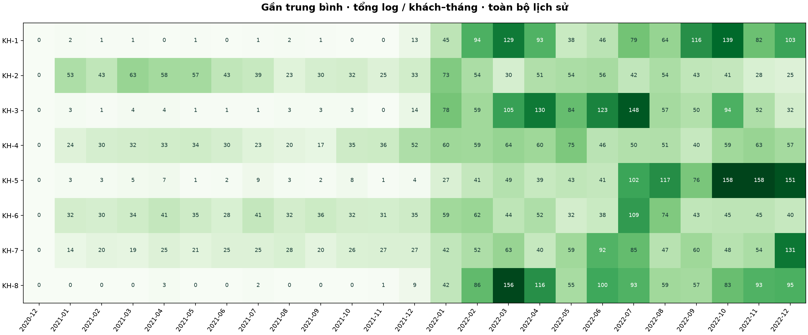

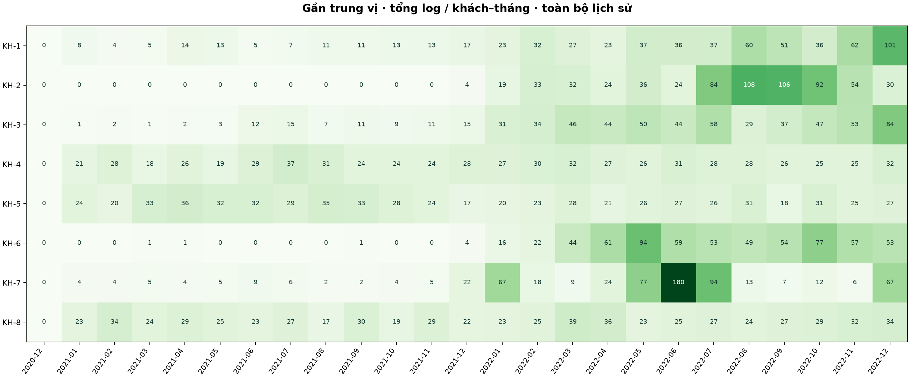

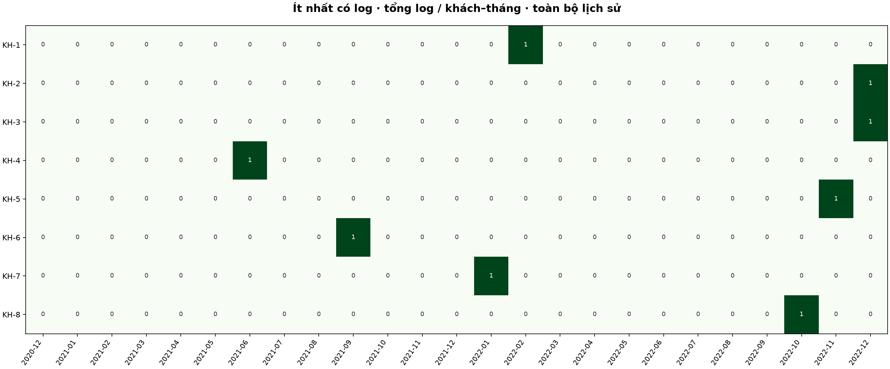

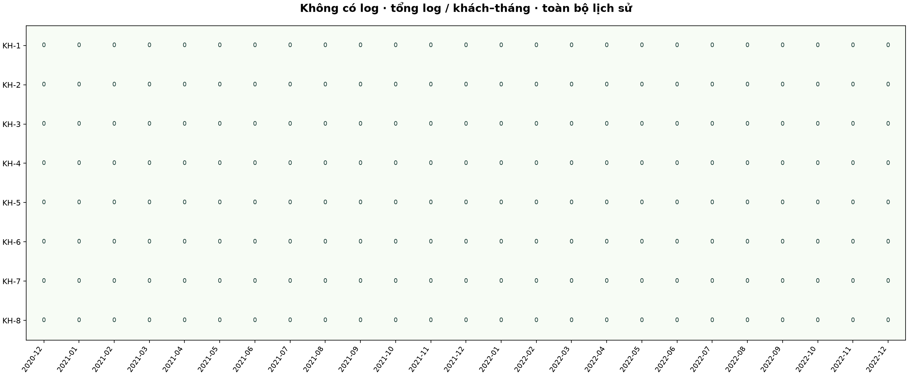

Phần tổng hợp dưới dùng **tất cả khách**, chia nhóm B0 = 0 log; B1…B6 theo các mốc P25/P50/P75/P95/P99 của **khách có log**. Các biên tổng log: 201, 651, 1,428, 3,362, 5,664.800. Mẫu số mỗi hàng là số khách trong nhóm, không phải toàn dân số.

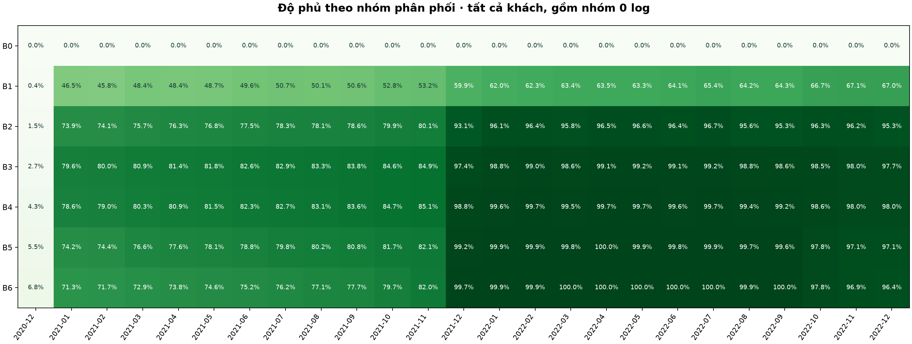

## 6. Tỷ lệ hành vi bằng bảng matrix

| source | population | with_log | without_log | coverage_percent |
| --- | --- | --- | --- | --- |
| trx | 100,224 | 98,721 | 1,503 | 98.500 |
| geo | 100,224 | 72,573 | 27,651 | 72.411 |
| dialog | 100,224 | 46,320 | 53,904 | 46.216 |

8 tổ hợp hiện diện nguồn trong toàn lịch sử (1 = có ít nhất một log):

| trx | geo | dialog | customers | population | percent |
| --- | --- | --- | --- | --- | --- |
| 0 | 0 | 0 | 468 | 100,224 | 0.467 |
| 1 | 0 | 0 | 16,492 | 100,224 | 16.455 |
| 0 | 1 | 0 | 721 | 100,224 | 0.719 |
| 1 | 1 | 0 | 36,223 | 100,224 | 36.142 |
| 0 | 0 | 1 | 109 | 100,224 | 0.109 |
| 1 | 0 | 1 | 10,582 | 100,224 | 10.558 |
| 0 | 1 | 1 | 205 | 100,224 | 0.205 |
| 1 | 1 | 1 | 35,424 | 100,224 | 35.345 |

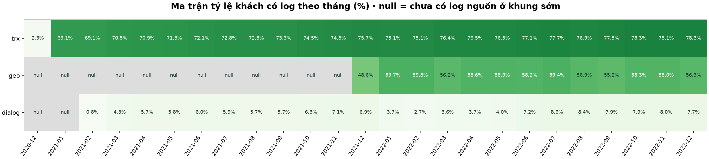

Mẫu số tỷ lệ theo tháng là toàn bộ 100,224 khách. Trước 01/2022, tỷ lệ có log là độ phủ log **đã quan sát**, không chứng minh phần còn lại không hoạt động. Khi cả nguồn không có log ở tháng sớm, tỷ lệ hiển thị null. `unknown_customers` trong monthly_coverage.csv giữ rõ số khách có ô chưa quan sát.

## 7. Trung bình phát sinh hành vi mỗi người, min/max

Tổng log mỗi người trong **toàn lịch sử**, cùng mẫu số kể cả người 0 log:

| source | rows | mean | min | p25 | median | p75 | p95 | p99 | max |
| --- | --- | --- | --- | --- | --- | --- | --- | --- | --- |
| trx | 100,224 | 386.783 | 0 | 38 | 164 | 503 | 1,378 | 2,233.540 | 1,020,773 |
| geo | 100,224 | 661.476 | 0 | 0 | 235 | 855 | 2,758 | 5,082.540 | 39,487 |
| dialog | 100,224 | 2.167 | 0 | 0 | 0 | 3 | 10 | 21 | 114 |
| any_source | 100,224 | 1,050.426 | 0 | 195 | 646 | 1,423 | 3,356 | 5,658 | 1,021,115 |

Có thêm phân phối trên riêng khách có log trong [events_per_customer.csv](tables/review/events_per_customer.csv). Mean số log phản ánh độ dài và độ phủ nguồn khác nhau; không coi là tần suất đã chuẩn hóa theo ngày thu thập.

## 8. Nhịp hành vi trên số gốc, không log

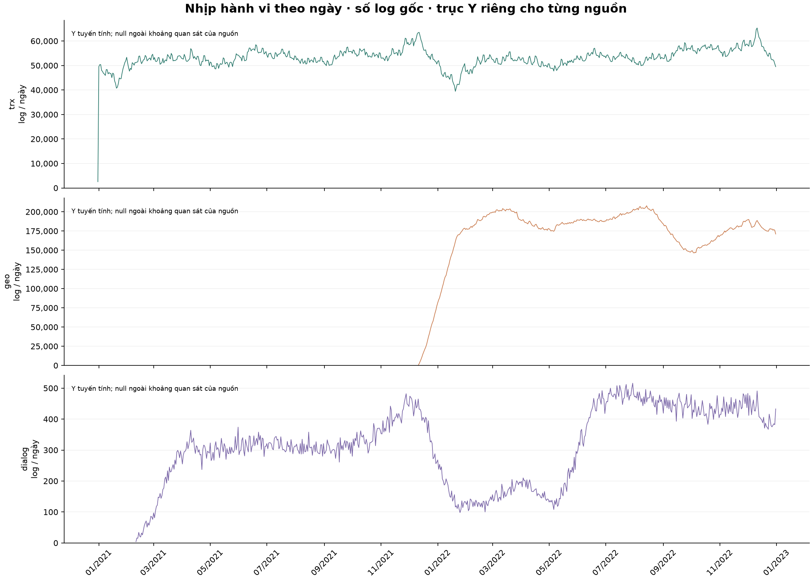

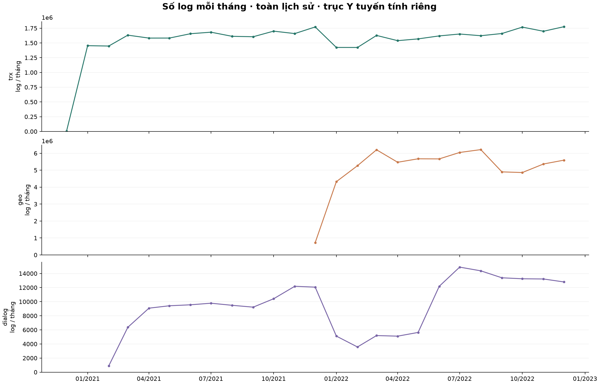

Mỗi nguồn có trục Y tuyến tính riêng để hội thoại không bị che bởi geo/trx. Ngày ngoài khoảng quan sát để null; ngày không có log nằm giữa mốc đầu/cuối nguồn ghi 0 log. Các mốc biên có thể chỉ có một phần ngày.

## 9. Amount gốc và cách chia bin

| finite_n | mean | min | p25 | median | p75 | p95 | p99 | max |
| --- | --- | --- | --- | --- | --- | --- | --- | --- |
| 38,764,930 | 1,304,901.247 | 0.000 | 2,453.869 | 18,035.837 | 94,759.545 | 904,811.156 | 5,377,121.430 | 1,370,187,366,400 |

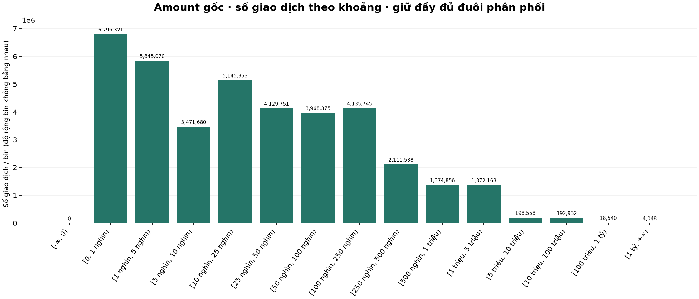

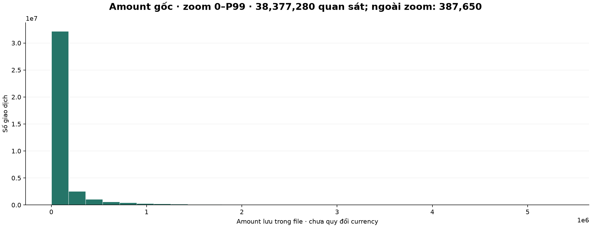

Biểu đồ đầy đủ dùng **số lượng trên bin** với nhãn khoảng giá trị gốc và độ rộng không bằng nhau; không diễn giải chiều cao như mật độ. Hình zoom dùng 30 bin đều trên [0,P99] để đọc khối chính; phần ngoài zoom được ghi rõ và vẫn nằm trong bảng/hình đầy đủ. Không biến đổi log hoặc cắt bỏ giá trị gốc. Currency là mã chưa quy đổi, nên thống kê pooled chỉ mô tả các số lưu trong file; xem [amount theo currency](tables/review/amount_by_currency.csv) trước khi diễn giải nghiệp vụ.

## 10. Biến động nhãn với Y zoom cho từng target

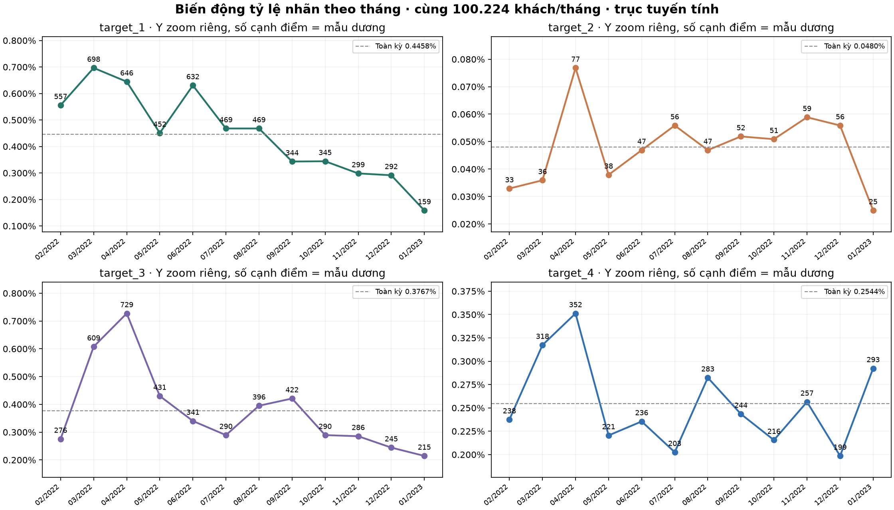

Bốn panel dùng trục tuyến tính với giới hạn Y riêng, có đường tỷ lệ toàn kỳ để đối chiếu. Y không bắt buộc bắt đầu từ 0 và không so biên độ thị giác giữa các panel. Tỷ lệ = tổng số dương các fold / tổng dòng có nhãn; số cạnh điểm là số dương thực tế. Dữ liệu chi tiết: [target_monthly.csv](tables/review/target_monthly.csv).

## 11. Resample theo phân phối và sampledata

Lấy **1,000 khách không lặp**, seed=42, phân tầng đồng thời theo fold × tổ hợp nguồn toàn lịch sử × band tổng log. Phân bổ tỷ lệ bằng phần nguyên và phần dư lớn nhất (Hamilton), sau đó lấy ngẫu nhiên trong tầng. Không ép mọi tầng hiếm xuất hiện: tầng nhận 0 mẫu được công khai, không coi weight bù được tầng vắng. Giữ toàn bộ sự kiện, 12 tháng nhãn và chuỗi ptls của khách đã chọn.

| source | rows | path |
| --- | --- | --- |
| clients | 1,000 | clients.parquet |
| targets | 12,000 | targets.parquet |
| trx | 358,682 | trx.parquet |
| geo | 666,411 | geo.parquet |
| dialog | 2,091 | dialog.parquet |
| ptls_trx | 989 | ptls_trx.parquet |
| ptls_geo | 724 | ptls_geo.parquet |
| ptls_dialog | 460 | ptls_dialog.parquet |

Mẫu đã ẩn danh từ MBD-mini nằm tại [sampledata/mbd_mini](../../sampledata/mbd_mini/), được đưa lên Git cùng mã tái tạo và bảng kiểm chứng tổng hợp. `selection.parquet` chứa tầng và weight = population_n/sample_n. `customer_month.parquet` chứa đầy đủ tháng và null nguồn sớm. Đây là mẫu EDA theo toàn lịch sử; khi làm mô hình phải lấy mẫu bằng lịch sử trước cutoff để tránh dùng tương lai.

| source | metric | population_value | sample_value |
| --- | --- | --- | --- |
| trx | mean | 386.783 | 358.682 |
| trx | median | 164 | 159.500 |
| trx | p95 | 1,378 | 1,388.500 |
| trx | max | 1,020,773 | 3,250 |
| trx | zero_percent | 1.500 | 1.100 |
| trx | KS_distance | 0 | 0.015 |
| geo | mean | 661.476 | 666.411 |
| geo | median | 235 | 228 |
| geo | p95 | 2,758 | 2,758.250 |
| geo | max | 39,487 | 7,280 |
| geo | zero_percent | 27.589 | 27.600 |
| geo | KS_distance | 0 | 0.015 |
| dialog | mean | 2.167 | 2.091 |
| dialog | median | 0 | 0 |
| dialog | p95 | 10 | 10 |
| dialog | max | 114 | 43 |
| dialog | zero_percent | 53.784 | 54 |
| dialog | KS_distance | 0 | 0.008 |
| any_source | mean | 1,050.426 | 1,027.184 |
| any_source | median | 646 | 640.500 |
| any_source | p95 | 3,356 | 3,365.600 |
| any_source | max | 1,021,115 | 8,464 |
| any_source | zero_percent | 0.467 | 0.500 |
| any_source | KS_distance | 0 | 0.023 |

| target | population_positive_n | population_percent | sample_positive_n | sample_percent |
| --- | --- | --- | --- | --- |
| target_1 | 5,362 | 0.446 | 72 | 0.600 |
| target_2 | 577 | 0.048 | 8 | 0.067 |
| target_3 | 4,530 | 0.377 | 56 | 0.467 |
| target_4 | 3,060 | 0.254 | 36 | 0.300 |

KS là chênh lệch lớn nhất giữa hai hàm phân phối thực nghiệm của tổng log (0 tốt hơn). Không suy ra mẫu bảo toàn chính xác mean/max hoặc tỷ lệ nhãn cực hiếm. Các số liệu báo cáo chính vẫn dùng toàn bộ raw. Xem [phân bổ từng tầng](tables/review/sampling_strata.csv).

## 12. Kiểm tra outliers

Số log mỗi khách: đánh dấu ngoài [Q1−1,5×IQR; Q3+1,5×IQR] và trên P99, trên toàn dân số kể cả 0.

| source | rows | q1 | median | q3 | lower_fence | upper_fence | outlier_n | above_p99_n | max |
| --- | --- | --- | --- | --- | --- | --- | --- | --- | --- |
| trx | 100,224 | 38 | 164 | 503 | -659.500 | 1,200.500 | 6,952 | 1,003 | 1,020,773 |
| geo | 100,224 | 0 | 235 | 855 | -1,282.500 | 2,137.500 | 8,171 | 1,003 | 39,487 |
| dialog | 100,224 | 0 | 0 | 3 | -4.500 | 7.500 | 8,007 | 892 | 114 |
| any_source | 100,224 | 195 | 646 | 1,423 | -1,647 | 3,265 | 5,390 | 1,002 | 1,021,115 |

Amount: tính Tukey **riêng từng currency**, giữ cả currency null.

| currency | finite_n | lower_fence | upper_fence | outlier_n | nonpositive_n | max |
| --- | --- | --- | --- | --- | --- | --- |
| 1 | 159 | -343,663.037 | 581,374.247 | 34 | 0 | 20,282,912 |
| 10 | 199 | -2,074,257.298 | 3,463,201.079 | 31 | 0 | 240,265,824 |
| 11 | 38,724,240 | -135,711.975 | 232,726.991 | 5,521,385 | 0 | 1,370,187,366,400 |
| 12 | 4 | -61,391,100.087 | 112,854,829.052 | 1 | 0 | 165,288,160 |
| 15 | 16,041 | -7,920,536.119 | 13,217,135.271 | 2,287 | 0 | 15,276,779,520 |
| 16 | 7 | -8,830.039 | 27,919.188 | 1 | 0 | 8,901,813 |
| 17 | 446 | -435,301.551 | 731,018.205 | 84 | 0 | 200,437,408 |
| 3 | 20,324 | -4,389,186.059 | 7,325,330.435 | 2,893 | 0 | 11,413,068,800 |
| 4 | 3,128 | -3,234,742.896 | 5,396,561.338 | 522 | 0 | 1,716,621,056 |
| 5 | 6 | -35,107,520.146 | 59,846,694.487 | 0 | 0 | 30,751,148 |
| 6 | 82 | -19,339,993.837 | 32,242,501.102 | 10 | 0 | 570,385,536 |
| 8 | 174 | -71,604.203 | 121,353.431 | 31 | 0 | 22,350,060 |
| 9 | 2 | -888,013.501 | 2,686,606.667 | 0 | 0 | 1,792,951.625 |
| null | 118 | -788,319.539 | 1,333,081.073 | 20 | 0 | 17,886,422 |

Số log/ngày trong khoảng đã có log từng nguồn:

| source | observed_days | q1 | q3 | upper_fence | outlier_days | max_day | max_events |
| --- | --- | --- | --- | --- | --- | --- | --- |
| trx | 731 | 51,326.500 | 55,125.500 | 60,824 | 15 | 2022-12-11 | 65,302 |
| geo | 386 | 170,090.500 | 190,210.500 | 220,390.500 | 0 | 2022-08-14 | 207,845 |
| dialog | 690 | 227.500 | 423.750 | 718.125 | 0 | 2022-07-30 | 516 |

Các điểm này là quan sát cực trị cần kiểm tra, chưa phải lỗi. Với hội thoại thưa, IQR nhỏ làm nhiều điểm bị gắn cờ; so sánh thêm P99 và bối cảnh sự kiện. Không tự xóa, winsorize hoặc clip outlier. Giá trị amount cực lớn và khách có số log cực lớn giải thích vì sao mean cao hơn median; cần xác minh đơn vị và cơ chế ghi log trước khi đưa ra ngưỡng nghiệp vụ.

## Tái lập và cache

```powershell
.\.venv\Scripts\python.exe -u -X utf8 src/review_mbd_eda.py
```

Chạy lại cùng lệnh sẽ tái dùng từng kết quả SQL đã hoàn tất trong `outputs/mbd_review_cache/review.duckdb`. Cache lưu theo câu truy vấn và fingerprint gồm đường dẫn, byte, mtime_ns, số dòng và schema mọi shard. Raw thay đổi thì dùng thư mục cache mới; cache cũ được giữ lại. Đây là kiểm tra inventory, không phải checksum toàn bộ byte nội dung. Cache `outputs/behavior_coverage/matrix.npz` và cache quét năm 2022 cũ được giữ trên máy. Raw đầy đủ và cache giữ trên máy; chỉ mẫu MBD-mini đã ẩn danh được version cùng repo theo yêu cầu.

Fingerprint lần rà soát: `21797227b070110fa91eca437d17a0834c26cfe5a5ade5114d0f7cedc7e97ccb`. Các số đếm raw được đối chiếu với ma trận và tổng sự kiện; mọi bảng mới nằm ở `tables/review/`, danh mục đầy đủ ở [data_catalog.md](data_catalog.md).
