# Bảy bước thống kê mô tả MBD-mini — bản chỉnh sửa

Phạm vi dữ liệu gốc: **full**.
Timezone: **naive_as_stored**; giữ quy ước thời gian trong dữ liệu.
Tổng hợp toàn lịch sử; không tạo feature khách hàng–tháng hoặc huấn luyện mô hình.
Mỗi bảng ghi phạm vi riêng. Không suy rộng kết quả kiểm tra trùng trên mẫu.

Bổ sung raw: **completed**.
Tần suất mọi mã đã tính lại từ raw; bảng top 20 giữ phần remaining, bảng *_full.csv chứa đầy đủ mã.

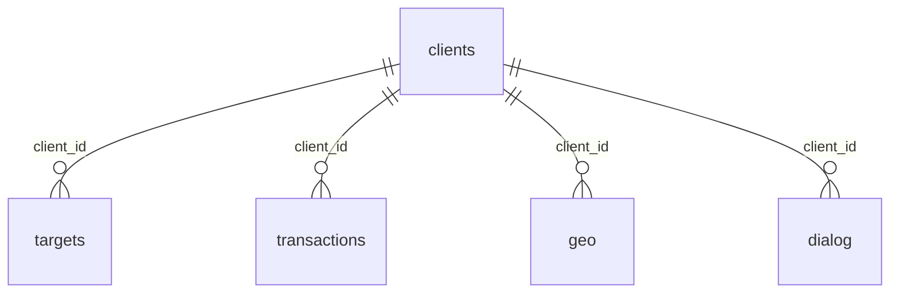

Thời gian phân tích export gốc: 2145.355 giây.
Thời gian bổ sung raw: 474.713 giây.
Config và thời gian các section/source giữ thông tin lần chạy gốc; raw_supplements ghi lần bổ sung. Phạm vi cuối xem ở từng bảng.

## 1. Cấu trúc và quy mô

- Quy mô: clients: 100,224 dòng; targets: 1,202,688 dòng; transactions: 38,764,930 dòng; geo: 66,295,724 dòng; dialog: 217,205 dòng.

- [column_roles](tables/descriptive.structure/column_roles.csv): 36 dòng tổng hợp.
- [relationship_summary](tables/descriptive.structure/relationship_summary.csv): 4 dòng tổng hợp.
- [table_inventory](tables/descriptive.structure/table_inventory.csv): 5 dòng tổng hợp.

## 2. Chất lượng dữ liệu

- targets.diff_trans_date: thiếu 120,786/1,202,688 (10.043%).
- transactions.dst_type12: thiếu 243,824/38,764,930 (0.629%).
- transactions.dst_type11: thiếu 243,824/38,764,930 (0.629%).
- transactions.src_type12: thiếu 217,361/38,764,930 (0.561%).
- transactions.src_type11: thiếu 217,361/38,764,930 (0.561%).
- Trùng clients/unique_key: 0 trên 100,224 dòng; phạm vi **full**.
- Trùng targets/unique_key: 0 trên 1,202,688 dòng; phạm vi **full**.
- Trùng clients/full_row: 0 trên 100,224 dòng; phạm vi **all_scanned_rows**.
- Trùng targets/full_row: 0 trên 1,202,688 dòng; phạm vi **all_scanned_rows**.
- Trùng transactions/full_row: 0 trên 38,764,930 dòng; phạm vi **all_scanned_rows**.
- Trùng geo/full_row: 0 trên 66,295,724 dòng; phạm vi **all_scanned_rows**.
- Trùng dialog/full_row: 0 trên 217,205 dòng; phạm vi **all_scanned_rows**.

- [duplicates](tables/descriptive.quality/duplicates.csv): 7 dòng tổng hợp.
- [invalid_values](tables/descriptive.quality/invalid_values.csv): 11 dòng tổng hợp.
- [key_coverage](tables/descriptive.quality/key_coverage.csv): 3 dòng tổng hợp.
- [missing_values](tables/descriptive.quality/missing_values.csv): 36 dòng tổng hợp.

## 3. Phạm vi thời gian

- transactions: 2020-12-31 21:00:02.169545 đến 2022-12-31 20:59:58.460193.
- geo: 2021-12-11 19:27:07.507106 đến 2022-12-31 20:59:58.725788.
- dialog: 2021-02-10 09:36:07.022271 đến 2022-12-31 20:25:11.730797.
- Mốc mon của nhãn: 2022-02-28 đến 2023-01-31; đây là marker gốc, không suy diễn khoảng nhãn/cutoff.

- [history_length_summary](tables/descriptive.temporal/history_length_summary.csv): 6 dòng tổng hợp.
- [monthly_activity](tables/descriptive.temporal/monthly_activity.csv): 61 dòng tổng hợp.
- [source_time_ranges](tables/descriptive.temporal/source_time_ranges.csv): 3 dòng tổng hợp.

## 4. Giao dịch

- Amount: mean=1.3049e+06, std=4.80446e+08, median=18,035.8, min=3.02182e-06, max=1.37019e+12.
- Moment: **all_scanned_finite_amounts**; phân vị: **all_scanned_finite_amounts**.
- Các mã currency chưa được diễn giải hoặc quy đổi; xem amount_by_currency nếu đã chạy bổ sung raw.
- Cột đầu histogram tuyến tính chứa 38,764,865/38,764,930 quan sát (99.999832%); xem thêm histogram log nếu có.

- [amount_by_currency](tables/descriptive.transactions/amount_by_currency.csv): 14 dòng tổng hợp.
- [amount_histogram](tables/descriptive.transactions/amount_histogram.csv): 40 dòng tổng hợp.
- [amount_log_histogram](tables/descriptive.transactions/amount_log_histogram.csv): 40 dòng tổng hợp.
- [amount_summary](tables/descriptive.transactions/amount_summary.csv): 1 dòng tổng hợp.
- [transaction_categories](tables/descriptive.transactions/transaction_categories.csv): 242 dòng tổng hợp.
- [transaction_categories_full](tables/descriptive.transactions/transaction_categories_full.csv): 12,829 dòng tổng hợp.
- [transaction_outliers](tables/descriptive.transactions/transaction_outliers.csv): 1 dòng tổng hợp.

## 5. Vị trí và hội thoại

- geo: 72,573/100,224 khách có log (72.41%).
- dialog: 46,320/100,224 khách có log (46.22%).

- [dialog_summary](tables/descriptive.modalities/dialog_summary.csv): 2 dòng tổng hợp.
- [embedding_quality](tables/descriptive.modalities/embedding_quality.csv): 6 dòng tổng hợp.
- [geo_summary](tables/descriptive.modalities/geo_summary.csv): 3 dòng tổng hợp.
- [location_categories](tables/descriptive.modalities/location_categories.csv): 73 dòng tổng hợp.
- [location_categories_full](tables/descriptive.modalities/location_categories_full.csv): 752,805 dòng tổng hợp.

## 6. Khách hàng

- 0 nguồn: 468 khách (0.47%).
- 1 nguồn: 17,322 khách (17.28%).
- 2 nguồn: 47,010 khách (46.90%).
- 3 nguồn: 35,424 khách (35.34%).

- [customer_activity](tables/descriptive.customers/customer_activity.csv): 20 dòng tổng hợp.
- [customer_aggregation_checks](tables/descriptive.customers/customer_aggregation_checks.csv): 1 dòng tổng hợp.
- [first_last_event_coverage](tables/descriptive.customers/first_last_event_coverage.csv): 3 dòng tổng hợp.
- [first_last_event_month](tables/descriptive.customers/first_last_event_month.csv): 121 dòng tổng hợp.
- [modality_coverage](tables/descriptive.customers/modality_coverage.csv): 8 dòng tổng hợp.
- [source_count_distribution](tables/descriptive.customers/source_count_distribution.csv): 4 dòng tổng hợp.

## 7. Nhãn

- target_1: 5,362 dương, 1,197,326 âm, thiếu 0; tỷ lệ dương 0.4458%.
- target_2: 577 dương, 1,202,111 âm, thiếu 0; tỷ lệ dương 0.0480%.
- target_3: 4,530 dương, 1,198,158 âm, thiếu 0; tỷ lệ dương 0.3767%.
- target_4: 3,060 dương, 1,199,628 âm, thiếu 0; tỷ lệ dương 0.2544%.

- [customer_positive_history](tables/descriptive.targets/customer_positive_history.csv): 4 dòng tổng hợp.
- [label_coverage](tables/descriptive.targets/label_coverage.csv): 60 dòng tổng hợp.
- [positive_labels_per_row](tables/descriptive.targets/positive_labels_per_row.csv): 5 dòng tổng hợp.
- [target_by_month_fold](tables/descriptive.targets/target_by_month_fold.csv): 240 dòng tổng hợp.
- [target_cooccurrence](tables/descriptive.targets/target_cooccurrence.csv): 6 dòng tổng hợp.
- [target_prevalence](tables/descriptive.targets/target_prevalence.csv): 4 dòng tổng hợp.

## Biểu đồ

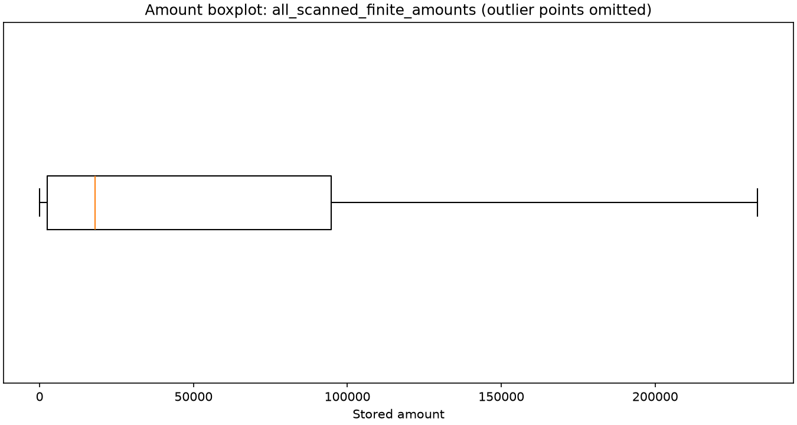

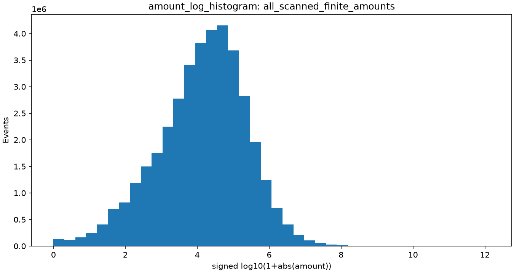

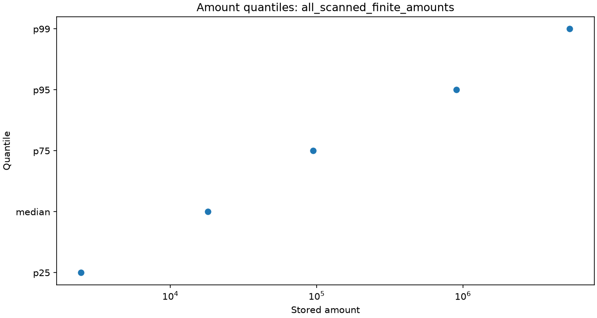

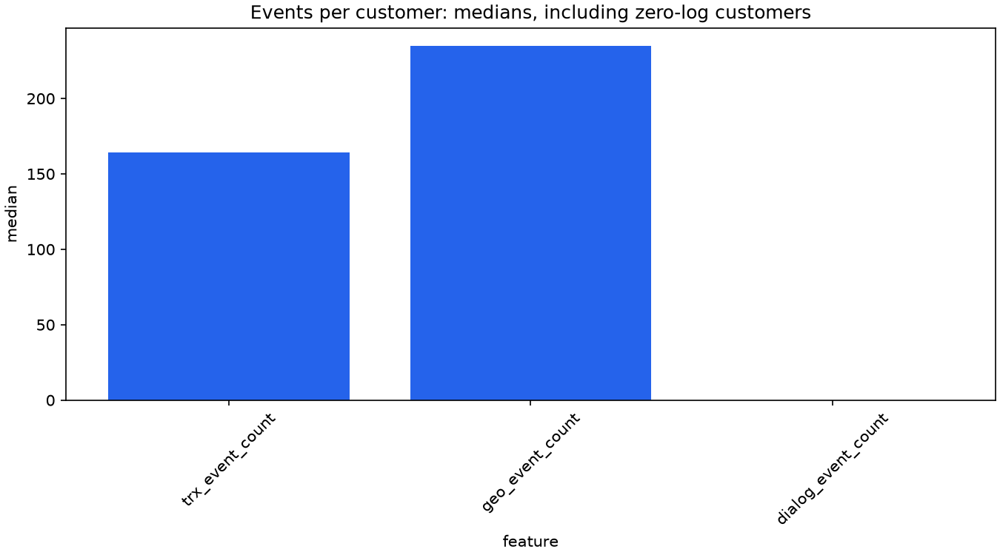

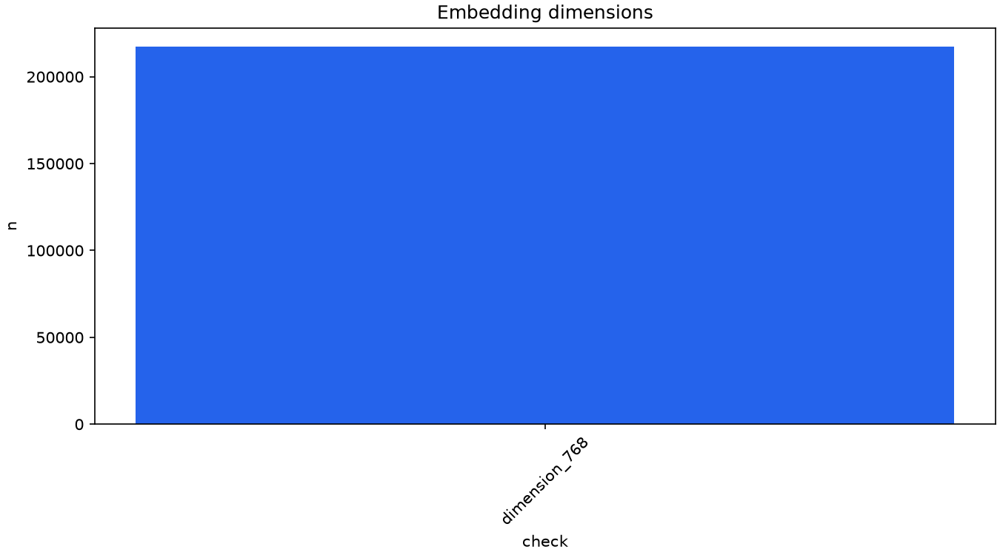

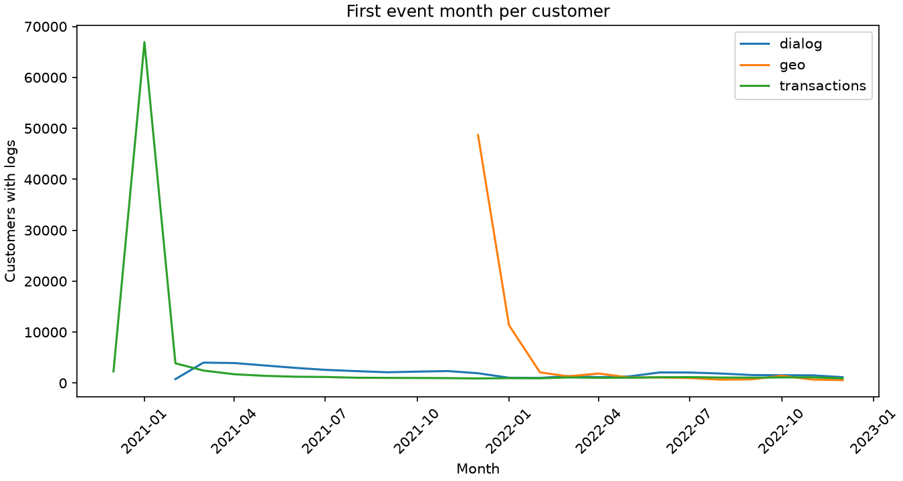

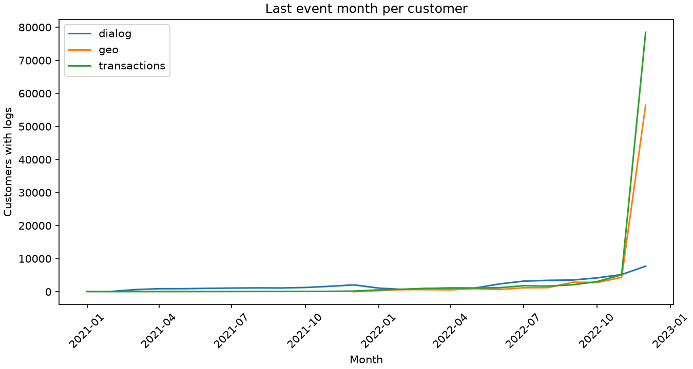

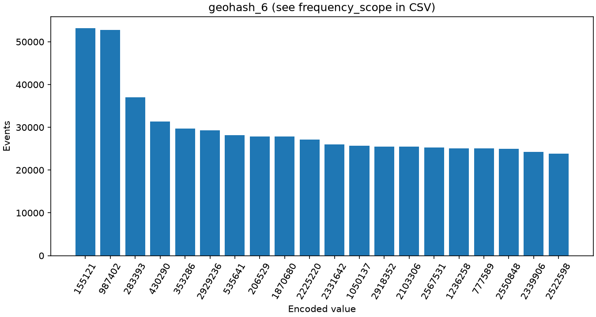

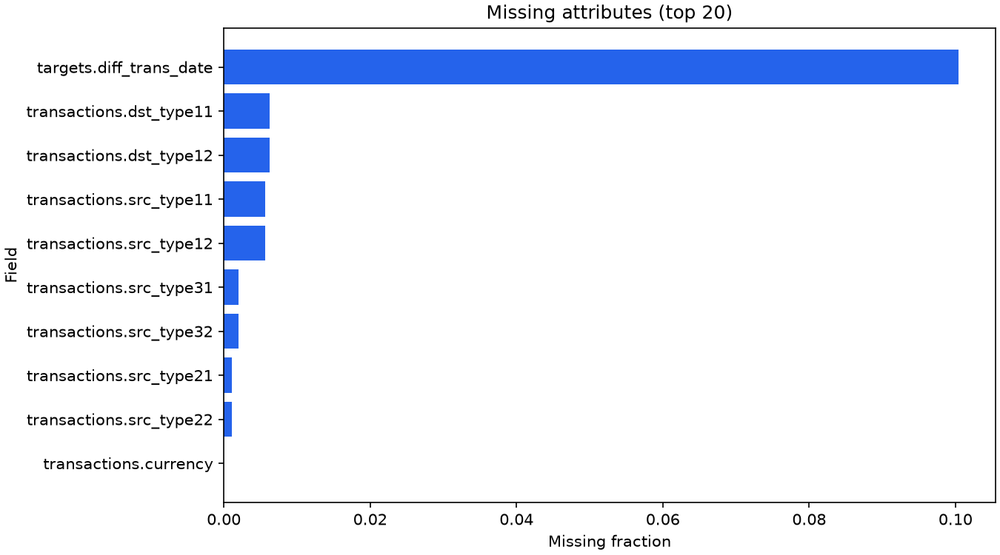

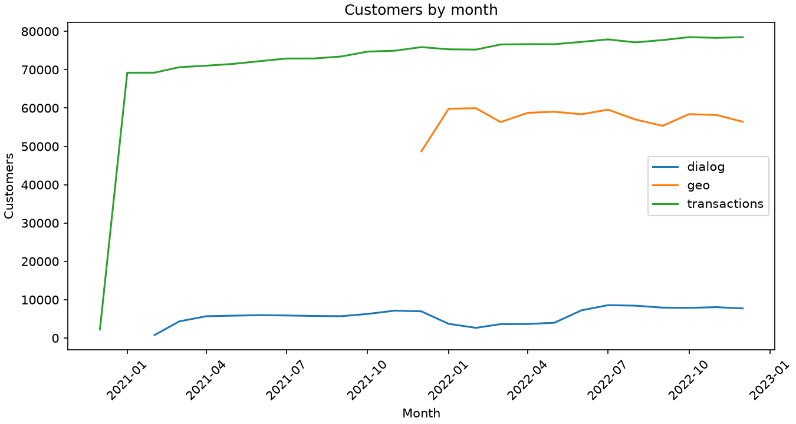

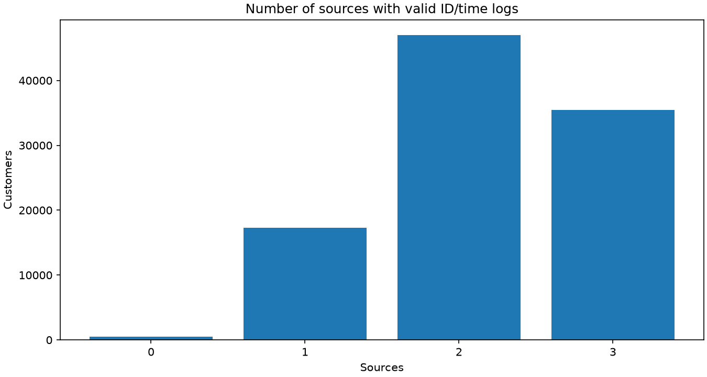

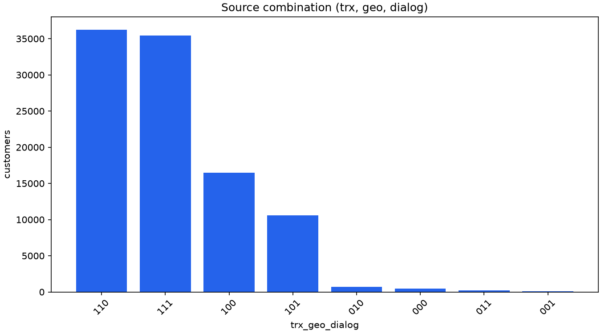

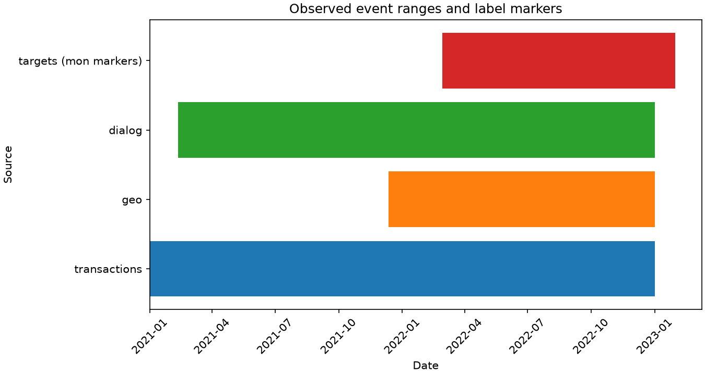

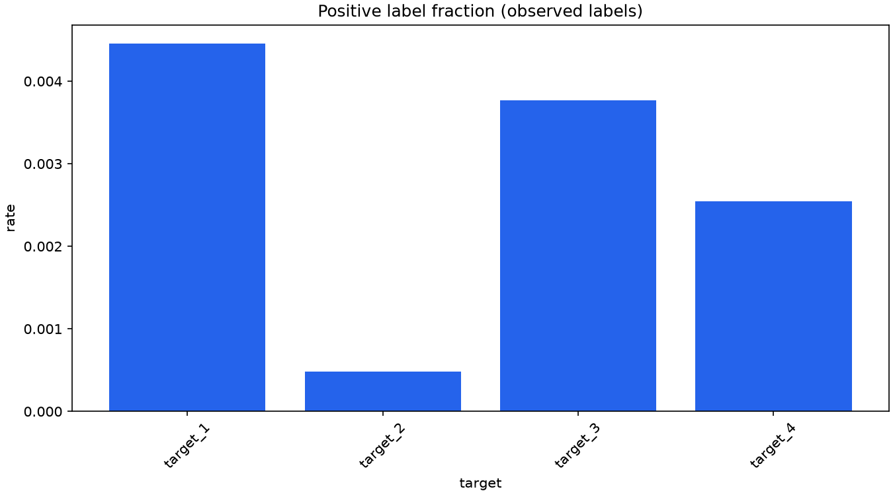

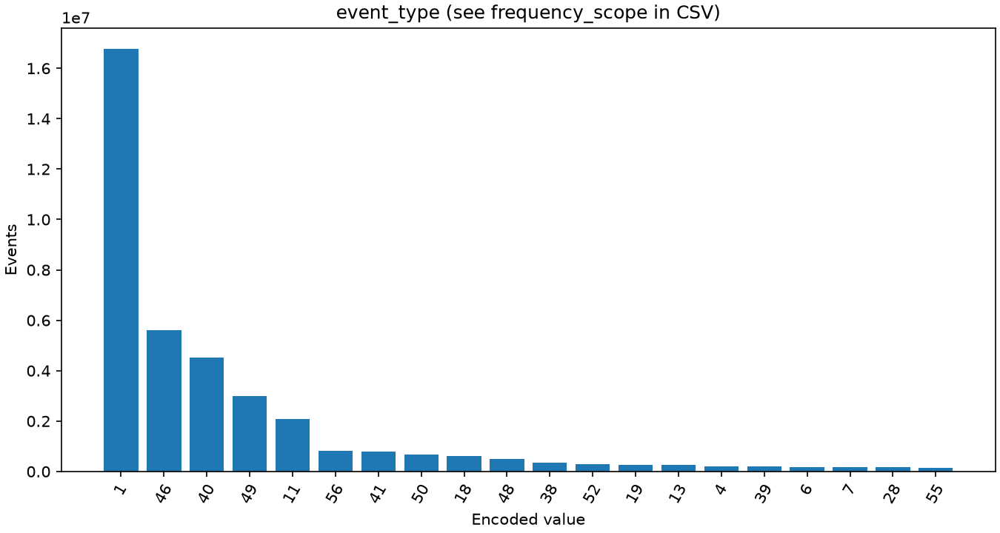
