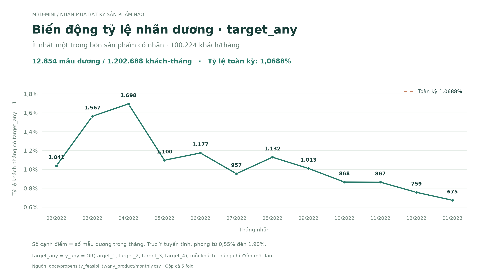

# Thiết kế propensity mua bất kỳ sản phẩm nào

Ngày cập nhật: **08/11/2026**. Thực hiện bốn điều chỉnh của người dùng: lịch sử dài, chấp nhận nguồn chưa thu thập là null, đầu ra any-product, loại mẫu không xác định được nhãn và có chính sách cho khách ít dữ liệu. Đây là thiết kế và audit dữ liệu; chưa tạo training features, huấn luyện mô hình hoặc xóa dữ liệu gốc.

**Bổ sung xác minh 09/11/2026:** [bản trả lời các câu hỏi còn mở](../open_questions/answers.md)
định nghĩa mục tiêu nghiên cứu, baseline, top-K, kế hoạch và bằng chứng nguồn.
**Quyết định người dùng sau rà soát:** tạm dùng UTC thống nhất cho raw, cutoff và
cửa sổ. Nhãn tháng 12 dùng cutoff `2022-12-01 00:00 UTC`, không dịch 3 giờ.
Đây là quy ước nghiên cứu, chưa phải xác nhận timezone ETL gốc. Protocol Moscow của
EventGPT và audit biên 3 giờ được giữ làm đối chiếu. Các số cohort ngày 08/11 vẫn là
snapshot raw-naive được diễn giải theo quy ước UTC; số lượng nhãn không đổi.
Tên thương mại của từng sản phẩm không còn là yêu cầu xác minh cho đầu ra `p_any`;
giữ bốn nhãn nguồn để tạo và đối soát `y_any`.

**Cập nhật tự xác minh:** [báo cáo trans_count/missing/độ trễ nhãn](../remaining_questions/assessment.md)
ghi 612 cấu hình không tái tạo được trans_count nguồn. Chưa dùng trans_count hoặc
diff_trans_date nguồn làm predictor; tự tạo count/recency từ detail trước cutoff.
Currency 11 là mã chính, các mã khác có giá trị gắn cờ ngoại tệ của dự án, currency
null giữ unknown với cờ missing riêng. Hàm tạo cờ tại `src/mbd_mini_eda/currency.py`.

## 1. Lịch sử dài và null có ý nghĩa

Giữ toàn bộ lịch sử **trước cutoff** theo từng nguồn; không yêu cầu trx, geo, dialog cùng ngày bắt đầu. Ví dụ dự đoán tháng 12/2022 thì chỉ dùng sự kiện trước 01/12/2022. Không cần dời cutoff để kéo dài quá khứ.

Chấp nhận khoảng chưa thu thập geo/dialog là null và giữ các mask cho biết lý do hoặc mức độ chắc chắn của trạng thái này. Dữ liệu hiện chỉ cho biết phạm vi timestamp đã ghi nhận, chưa có lịch bật/tắt thu thập cho từng khách. Vì vậy chỉ gắn nguyên nhân “chưa thu thập” khi có cơ sở; những khoảng không rõ nguyên nhân là unknown, không khẳng định mất log hoặc không hoạt động.

- Trước phạm vi nguồn: feature nội dung null, cờ cửa sổ bị cắt và số ngày chồng lấn phạm vi nguồn. Không điền 0 như thể đã quan sát cả giai đoạn.
- Bên trong phạm vi trích xuất nhưng không ghi nhận sự kiện: count có thể bằng 0 theo nghĩa đếm log, `has_event=0`; mean/embedding/recency không xác định giữ null. Điều này không chứng minh khách không có hoạt động thực.
- Có sự kiện thực tế sớm: giữ sự kiện, không phủ null lên nó chỉ vì một mốc quy ước như 01/01/2022.
- Nguồn từng xuất hiện nhưng đã lâu: giữ last-observed information và recency. Không giả định vị trí cũ vẫn là vị trí hiện tại hoặc phát sinh hội thoại giả.
- Không dùng ngày có log cuối cùng trong tương lai để chọn cohort tại cutoff.

Feature ban đầu: tóm tắt toàn bộ quá khứ + cửa sổ 30/84 ngày; thử 180 ngày bằng validation. Mỗi nguồn có event count, active days, has-event, ever-seen, recency và tuổi của lịch sử đã ghi nhận. Ngày đầu thấy khách không đồng nhất ngày mở tài khoản; phạm vi nguồn không đồng nhất thời gian quan sát liên tục từng khách.

## 2. Một target nhị phân

Với nhãn hợp lệ, đặt:

```text
y_any = 1 nếu ít nhất một trong target_1 ... target_4 bằng 1
y_any = 0 nếu cả bốn bằng 0
output = P(y_any = 1 trong tháng đích | lịch sử trước cutoff)
```

“Bất kỳ sản phẩm nào” ở đây là **ít nhất một trong bốn sản phẩm có nhãn**, không phải mọi sản phẩm của ngân hàng. Huấn luyện trực tiếp một classifier; không cộng bốn xác suất hoặc dùng công thức độc lập giữa sản phẩm khi chưa có cơ sở.

Đọc lại toàn bộ bảng targets cho kết quả:

| Phạm vi | Dòng dương | Dòng có nhãn | Tỷ lệ dương |
|---|---:|---:|---:|
| Toàn bộ 12 tháng | 12.854 | 1.202.688 | 1,0688% |
| Tháng 12/2022 | 759 | 100.224 | 0,7573% |
| Tháng 01/2023 | 675 | 100.224 | 0,6735% |

Toàn kỳ có 1.189.834 dòng âm, khoảng 92,57 âm cho một dương. Đây là số dòng khách–tháng, không phải số ca độc lập hay số khách dương duy nhất. Target mới bớt hiếm nhưng vẫn mất cân bằng. Nó trả lời khả năng mua chung; không cho biết nên giới thiệu sản phẩm cụ thể nào.

Nguồn: [summary.json](summary.json), [monthly.csv](monthly.csv). Kết quả khớp bảng phân bố số sản phẩm mua đã có trong EDA.

Biểu đồ nhãn gộp cập nhật ngày 09/11/2026 (`target_any` là tên hiển thị của `y_any`):



Số cạnh điểm là số mẫu dương, mỗi tháng có 100.224 khách; trục Y tuyến tính được
phóng và không bắt đầu từ 0. Tỷ lệ toàn kỳ tính bằng tổng mẫu dương chia tổng
khách–tháng có nhãn. [SVG để chỉnh sửa/xuất bản](target_any_by_month.svg).
Chạy lại bằng `.\.venv\Scripts\python.exe -B -X utf8 src/plot_target_any.py` từ bảng
audit hiện có; lệnh chỉ vẽ biểu đồ, không chạy pipeline chuẩn bị dữ liệu hoặc mô hình.

## 3. Loại mẫu mất target ở đúng đơn vị khách–tháng

Chính sách: **không dùng dòng không xác định được y_any để huấn luyện supervised hoặc tính metric**. Không xóa cả client_id chỉ vì một tháng mất nhãn; các tháng khác có nhãn vẫn dùng được. Khách không có nhãn ở thời điểm cần dự đoán vẫn có thể thuộc tập inference. Không điền nhãn mất thành 0.

Quy tắc cho trường hợp một phần nhãn thiếu:

| Bốn nhãn nguồn | y_any | Xử lý |
|---|---:|---|
| Có ít nhất một giá trị 1, các giá trị còn lại là 0/1/null hợp lệ | 1 | Giữ: đã biết chắc có mua một sản phẩm |
| Đủ bốn giá trị 0 | 0 | Giữ |
| Không có giá trị 1 và có ít nhất một null | null | Loại dòng khỏi supervised train/evaluation |
| Thiếu hoàn toàn dòng khách–tháng | null | Không suy ra 0; ghi nhận thiếu nhãn |
| Nhãn ngoài 0/1/null hoặc khóa trùng/xung đột | Không quyết định tự động | Kiểm tra chất lượng và giải quyết trước khi dựng target |

**Hiện tại không cần loại dòng nào vì mất nhãn:** cả 100.224 khách có đủ 12 tháng; 0 null trong bốn target; 0 dòng khách–tháng thiếu so với khung mong đợi. Tránh để inner join với dữ liệu sự kiện làm mất nhãn rồi hiểu nhầm đó là lỗi của bảng targets.

## 4. Khách có quá ít dữ liệu

Không dùng một ngưỡng chung như “null >50%/80% thì xóa khách”. Tỷ lệ null sẽ phụ thuộc chiều dài lịch sử, số feature sinh ra cho mỗi nguồn và thời điểm nguồn bắt đầu. Đặc biệt, 768 cột embedding có thể lấn át toàn bộ tỷ lệ null dù trx vẫn phong phú.

| Nhóm tại cutoff | Quyết định ban đầu |
|---|---|
| Có trx, thiếu geo/dialog | Giữ trong mô hình chính; dùng feature hiện có và masks |
| Không trx nhưng có geo hoặc dialog | Giữ, đánh giá riêng; mô hình có thể dùng các nguồn còn lại |
| Có lịch sử nhưng ít sự kiện | Giữ, dùng cùng mô hình regularized; tránh tạo nhiều mô hình chuyên biệt ít mẫu |
| Có lịch sử cũ nhưng không hoạt động gần đây | Giữ count gần đây bằng 0 theo log, recency và lịch sử dài; gắn cờ inactive |
| Không có bất kỳ sự kiện nào trước cutoff | Cold-start; nếu có hồ sơ hợp lệ tại cutoff dùng hồ sơ, nếu không dùng xác suất nền dự phòng |
| Không có nhãn hợp lệ | Loại khỏi supervised theo mục 3, độc lập với độ phủ feature |

Phương án dự phòng khi không có feature phân biệt khách: ước lượng tỷ lệ mua nhóm cold-start trên các tháng train quá khứ, shrink về tỷ lệ chung nếu nhóm nhỏ. Ví dụ `(s_cold + alpha * p_train) / (n_cold + alpha)`; `alpha` cố định hoặc chọn trên validation quá khứ. Không sử dụng tỷ lệ mua của tháng đang dự đoán. Đây là điểm nhóm, **không phải xác suất đã cá nhân hóa**; nếu chọn top-K có ties phải quy định tie-break không dựa vào nhãn tương lai.

Các dòng cold-start vẫn được giữ trong dữ liệu nghiên cứu và đánh giá toàn quần thể. Nếu tách khỏi mô hình hành vi chính, nhãn của chúng vẫn dùng để fit fallback; không âm thầm loại khỏi mẫu số metric. Đối chứng đơn giản khác là cho cùng CatBoost học nhóm không có nguồn bằng masks; so sánh trên validation trước khi quyết định routing.

Audit mô tả tại cutoff **01/12/2022**, dùng mọi log có ID/timestamp hợp lệ trước cutoff, không loại log vì thiếu thuộc tính phụ:

| Nhóm | Khách | Mua bất kỳ sản phẩm trong tháng 12 |
|---|---:|---:|
| Không có sự kiện ở cả ba nguồn trong toàn bộ quá khứ hiện có | 699 | 13 |
| Có lịch sử nhưng không có log trong ba tháng lịch 09–11/2022 | 5.122 | 9 |
| Không có trx nhưng có geo/dialog trong quá khứ | 1.729 | 55 |
| Có 1–9 giao dịch trong toàn bộ quá khứ | 10.476 | 61 |

Các hàng trong bảng có thể chồng lấn, không cộng số khách hoặc số dương. Ba tháng lịch không đồng nhất 84 ngày. Toàn lịch sử theo nguồn không đồng nhất khoảng chung 354 ngày; số đếm raw không đồng nhất chính sách complete-case cũ. Vì vậy các con số này không thay thế số của audit có phạm vi khác.

Những số trên cho thấy không thể đồng nhất “trống feature” với “không mua”. Chúng **không chứng minh** nhóm trống có xác suất cao ổn định: chỉ là một tháng và vài nhóm có rất ít ca dương. Không dùng bảng này để chọn ngưỡng lọc tối ưu; ngưỡng phải được kiểm định trên nhiều tháng validation.

Nếu cần đặt tiêu chí tối thiểu cho nghiên cứu hành vi, thử có/không có sự kiện, số giao dịch quá khứ, số ngày hoạt động và recency như các đối chứng. Với mỗi ngưỡng phải báo cáo tỷ lệ khách giữ lại, tỷ lệ ca dương mất đi, chất lượng trên cohort giữ lại **và chất lượng toàn quần thể sau fallback**. Không chọn ngưỡng chỉ vì metric tăng khi đã bỏ khách khó.

Nguồn: [cohorts_2022_12.csv](cohorts_2022_12.csv). Script [audit_any_product_cohorts.py](../../../src/audit_any_product_cohorts.py) đọc targets và cache đếm sự kiện hiện có, kiểm tra tổng ba nguồn khớp EDA; không quét lại nội dung sự kiện hay thay đổi raw. Cache fingerprint được lưu trong summary.

## 5. Cấu hình và đánh giá cập nhật

- **Một CatBoost binary**, log loss trên phân bố tự nhiên, NaN số và token thiếu riêng cho categorical. So sánh tăng trọng số dương vừa phải trên validation; không mặc định balanced 1:1. Nghiên cứu nền và giới hạn từng phương pháp nằm tại [bản tổng quan](../imbalance_missing_modalities_research.md).
- Fit toàn bộ bước xử lý, PCA, mô hình và fallback chỉ trên phần quá khứ hợp lệ. Không dùng các cột phụ trợ trong targets khi chưa xác nhận thời điểm tạo.
- Tuning cuốn chiếu trên 09–11/2022; fit cấu hình cuối trên 02–11; tháng 12 fit calibration theo quy tắc đã chọn; test khóa tháng 01/2023. **Đây là protocol offline với giả định nhãn sẵn ngay khi tháng kết thúc (độ trễ 0), chưa được xác minh là lịch vận hành thực tế.** Mô hình cơ sở giữ nguyên sau khi fit calibrator. Audit 435 shard không có ngày chốt nhãn; với độ trễ dương phải dựng lại lịch tuning/train/calibration theo thời điểm sẵn có giả định. Các kịch bản 0/1/7/30 ngày và một tháng lịch được đối chiếu trong báo cáo mới, chưa có kết quả mô hình theo các kịch bản này.
- Chỉ số chính: Recall/Precision/Lift@K theo ngân sách; AP và ROC-AUC bổ sung; log loss/calibration cho chất lượng xác suất. Báo cáo theo nhóm độ phủ, gồm cold-start; bootstrap theo khách khi gộp nhiều tháng.
- Lịch sử dài, bất kỳ ngưỡng lọc nào và class weight chỉ được chốt sau đối chứng cùng cohort/split. Hiện không áp ngưỡng xóa khách vì thưa.

Chạy lại audit từ thư mục dự án:

```powershell
.\.venv\Scripts\python.exe -X utf8 src/audit_any_product_cohorts.py
```
